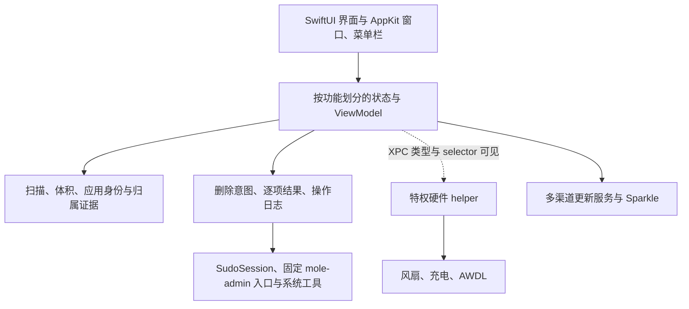

# Mole 原生 App 1.16.0：从发行包学习产品与实现

分析日期：2026-10-15。对象是用户提供的 `/Users/leo/Downloads/Mole.dmg`，不是公开的 Mole CLI。最值得学的是它如何处理不确定状态、危险操作与常驻成本。星球首页和菜单栏角色建立了记忆点，下面支撑这些体验的是分开的扫描、审阅、执行、核验和恢复模型。

已完成发行包、文案、类型与系统依赖盘点，读取了内嵌执行脚本，并打开应用核对首页。后续已通过 Hopper 原生 MCP 与离线反汇编获得函数级证据：窗口退役/恢复、取消退出、扫描并发与超时结算、模型身份传递、应用身份复核，以及 sudo/Process 启动路径，详见[原生函数研究](mole-native-functions.md)。**完整运行验收和全部调用链尚未完成**；REA 的 Apple Events 启动入口仍被系统拒绝，状态面板的窗口捕捉也失败。下面分别标明证据强度，不将类型名当作已验证算法。

## 证据与版本

| 对象 | 当前证据 |
|---|---|
| DMG | 27,272,086 bytes；SHA-256 `7153b8ed37b615560cb02d903da03f4d3e23d361c40ad43da239f563ffeab98a` |
| 主程序 | universal x86_64 / arm64；SHA-256 `77702d3d4fc9269f74fbfd61f10fc63462a98da15ef45c7d303db8a06f718e4e` |
| 应用 | `com.tw93.MoleApp`，1.16.0（324），macOS 14 起 |
| 包内源修订声明 | `69befc331671396345794427a9053d05b7a67218`；这是包内声明，未与源码构建逐字节对应 |
| 执行脚本 | 107,951 bytes；SHA-256 `bf136739cdfce7a3e57eda20866313ab12720b6ad4ccbf91a62bda495e83f367` |

REA 的 `inspect_artifact` 对 DMG 建立了内容图；主程序哈希与挂载文件一致。原有 `/Volumes/Mole` 不是根据目录名直接当成目标，使用内容身份核对。`/Applications/Mole.app` 的主程序也与此哈希一致；本轮观察到的进程路径为 `/Volumes/Mole/Mole.app/Contents/MacOS/Mole`。

REA 证据：

- DMG 检查：`ev_dbae4c06881f4bc27dcd00dee99144573a0790c005cd7adac76370978c699f04`。
- 内容图：`ev_a45cb0037686c2ebc7d7352ddc8f54765c00e74f64dad6c10521b79da31d669c`；manifest `agm_b65343978cdaece977c62da38acec68d2660b826d6f54691794b1b53750b0b24`。
- Mach-O：`ev_54a81798e19c83152495bbd183b7188140cc10a85e7984eee229f90ec384b2db`。
- Info.plist：`ev_d869c6eaa286ea447c741ea0f30b3572cefc10c766aafa67397ae1ed2004f9ce`。

完整 REA 记录在 [rea-evidence.json](../dist/mole-study/rea-evidence.json)。系统工具提取的字符串、符号和脚本是补充静态证据，不冒称 REA 反编译结果。

## 用户先看到什么

实际打开后，欢迎页用“把 Mac 收拾干净”介绍目标，只解释清理、卸载更新和状态三个用途。可见试用说明是每个付费工具两次、一次买断 $19、免费更新、14 天退款。这里记录的是本地界面文字，没有查询线上售价或购买条款。

点击“先试用”后，首页顶部是一个胶囊导航：**清理、软件、优化、分析、状态**。中间大面积留白给地球与月球，下面放短诗和“扫描 Mac”主按钮。AI 工具入口作为次级入口出现。付费状态放在右上角，没有挡住主要操作。

这套设计值得学的地方：首次进入每个功能时，先给一个明确的起点；专业细节留给扫描结果和二级面板。五个功能仍共用位置稳定的导航。装饰集中在进入功能的等待与选择阶段，危险操作的文字保持直接。

星球图像和 SceneKit 类型均在包内；当前只实际观察到地球首页。不能仅凭资源替其他星球的交互手感背书。第三方声明说明了纹理、角色图集和图标来源，学习视觉原则时应保留素材来源边界。

## 真正该学习的是结果模型

从英文 1,543 个资源 key 可以读出，它没有把所有事情压成“扫描中 / 成功 / 失败”。它把保留、未知、部分完成、权限不足、对象变化和恢复未确认放进用户可见流程。

| 场景 | 它表达的区别 | 对我们有用的设计要求 |
|---|---|---|
| 清理 | Safe / Review / Blocked / Manual | 候选资格与推荐勾选分开；每项都有理由 |
| 结果 | 完成、跳过、权限、仍在运行、白名单、路径保护 | 保留可以是正确结果，不应全算错误 |
| 体积 | 精确、估算、至少、部分、未知 | 不能把超时或无权限显示成 0 |
| 进程归属 | Part of / Likely part of；证据与置信度 | 不用图标掩盖归属推断的不确定性 |
| 软件更新 | 下载、安装、替换、验证、再次检查 | 更新器退出不是验收终点 |
| 系统控制 | 已恢复 / 恢复未确认 / 人工处理 | 不能在无法核验时显示绿色完成 |

资源还解释 APFS 共用块会让文件总计重复计算，文件总量不等于真实磁盘占用；可自动回收空间不应被包装成需要清理的垃圾。这个细节决定用户是否能信任空间数字。

这些是已观察的产品语义。默认选择、实际测量口径和所有状态是否可达，仍需代码与运行核对。逐 key 证据见 [产品研究](../dist/mole-study/product-findings.md)。

## 清理的控制权放在审阅现场

“Never Clean This”不是藏在设置里的高级选项。用户在复核列表发现不该清理的东西，就能形成长期规则；现场有 Undo，设置里可统一管理。重新允许清理的按钮写成“Allow in next cleanup”，说清生效时机。

文案按类别交代代价：浏览器清缓存保留会话，开发缓存重建可能变慢，聊天媒体可能需要重新下载，某些过期内容无法取回。移入废纸篓与永久清理分开，并解释移入废纸篓不立刻释放空间。卸载继续使用废纸篓，普通清理设置不会偷偷改变这个边界。

扫描后可能发生安装器变化、更新启动、所属应用运行。它为这些情况准备了独立原因，说明设计者把审阅当成某一时刻的快照。内嵌脚本进一步提供了执行端的身份检查，见后文。

## AI 数据按价值与可恢复性组织

AI 页面分为缓存旧版本、聊天与 worktree、闲置工具与维护。普通清理承诺保留聊天、项目和本地模型；敏感维护放到专门页面。这个分法比按工具品牌堆入口更接近用户的风险判断。

worktree 文案列出八类保留理由：未提交或未跟踪工作、仅在此 worktree 的提交、不可重建本地文件、锁定、T3 管理、24 小时内活跃、已初始化子模块、Git 状态无法核验。**只检查 `git status` 干净远远不够。** 干净的 worktree 仍可能拥有未被其他引用保存的提交。

数据库聊天删除有恢复副本说明；压缩数据库被描述为不删 session 的独立操作；存档 transcript 提醒可能是唯一副本。Codex 删除不能核验时保留 session。这些目前由资源证明其产品要求，不能替代数据库级故障测试。

## 软件管理围绕应用的整个生命周期

软件页把卸载、更新、启动项放在一起。卸载可取消 Application 的选择，只清关联数据；残留有 Bundle ID、group container、receipt、launch item、Spotlight、Team ID 等匹配证据。强匹配与待复核分开，用户能看到为什么属于这个应用。

浏览器个人数据、钱包、密钥、共享容器和数据型应用单独处理。无法确认共享归属就保留；某些厂商有官方卸载器；系统扩展、输入法切换和 root-owned 项目给专门说明。这种质量来自边界积累，无法由一张更大的目录规则表取代。

更新渠道也承认不同边界：Homebrew、App Store、Sparkle、Electron、网站有不同来源类型；部分更新在 Mole 内完成，部分引导外部完成。资源含 Intel-only 更新保护、版本无法确认、下载验证失败、更新后仍显示可用等状态。

## 原生结构与执行结构

REA Mach-O 解析观察到 SwiftUI、AppKit、Combine、IOKit、SceneKit、Security、ServiceManagement、sqlite3 等依赖；包内第三方框架为 Sparkle。类型包括按功能成对的 View / ViewModel，扫描和执行服务另行组织。

图中实线表达包内可见的模块组织或已追到的静态调用，不代表所有调用点已恢复；虚线强调尚未追踪的接线。SudoSession 的参数与 Process 启动已追到，真实安装的 mole-admin 是否与内嵌脚本一致尚未核验。具体模块有 DiskScanner、DeletionExecutor、RemnantScanner、ProcessAggregator、ProcessExplanationService、AIDataScanner、PermissionCoordinator、OperationLock 等。完整类型和静态边界见 [架构研究](../dist/mole-study/architecture-findings.md)。

### 扫描成本和 UI 发布成本分别处理

静态成员出现 `maxConcurrentWorkers`、`timeoutQueue`、`activeWorkers`、`settled` 与 `timedOut`，结果模型保留 partial/incomplete；还有按功能分开的缓存、warm task、generation 和 StatusThrottle。后续已恢复首轮体积测量 executor 的并发上限计算：按 activeProcessorCount 的 3/5 向下取整，限制在 2 到 10 之间；工作队列与超时队列分开。又追到一条执行路径：锁内申请名额，超时/取消只结算等待结果，operation 返回后才释放名额，并用 settled 避免重复交付。**所有调用路径是否一致、operation 内部的资源回收、TTL 和 UI 节流间隔仍未确认**，详见[函数研究](mole-native-functions.md)。

能直接借鉴的是问题拆法：一个目录的体积探测卡住，不应让整个界面失去已有结果；文件系统事件可以很密，UI 与日志不必逐条同步重绘；旧扫描结果不能覆盖新一轮保护规则。

### 关闭窗口后的成本有专门设计

包内日志非常具体：`window content retire`、`retained window release`、`hidden window reclaim`、`static cache reclaim done ... planet scenes and textures, icons, catalog, inventories`。还有 `activeWork`、overlay、可重开窗口条件，冷重开和重复主窗口自愈记录。

这比“关闭动画”多了一层：它显然为视图树与大资源释放设计了状态。真实触发时间、常驻内存降低多少尚未测量，不能写成性能验收结论。Thermo 若做装饰界面，应该同时设计进入、隐藏、释放和恢复，而不只设计进入动画。

## 内嵌脚本提供了可读的实际执行逻辑

从 universal 文件两个偏移 `17438832`、`35424336` 提取到完全相同的 NUL 结尾脚本，保留原始字节。文件为 [embedded-bf136739cd.sh.txt](../dist/mole-study/embedded-bf136739cd.sh.txt)，没有执行，也未将其引入 Thermo 产品代码。

脚本的实际代码可以证明：

- `mole_cleanup_path_allowed` 先检查范围、拒绝特殊路径和符号链接，再检查系统保护项。
- `mole_remove_path_if_allowed` 进入物理父目录，核对 `pwd -P`，用相对叶名执行；目录仅尝试 `rmdir`，文件用 `rm -f`。这不是给任意字符串套一个 `rm -rf`。
- `mole_path_identity_matches` 比较 device/inode；应用语义校验还可检查 bundle mtime、限定的元数据文件、元数据身份、mtime 与 SHA-256。
- 废纸篓移动使用 `/Library/Mole/.trash-staging` 私有暂存目录、700 权限和所有者检查；源与目标验证、无覆盖移动、退出回滚分别处理，无法恢复时保留恢复路径。
- 废纸篓目标冲突同时检测 `-e` 与 `-L`，覆盖悬空链接这种“看似不存在但名字已占用”的情况。
- 孤立 helper 检查会扫描 launchd plist；目录或 plist 不能可靠读取时返回拒绝，而不是直接当作无引用。
- App Store 包替换路径包含包形状、bundle ID、代码签名、商店签名要求、版本和备份/回滚处理。

脚本内部的保护不等于所有 Swift 调用者都会传正确参数。后续已追到参数构造器，以及空 mode、uninstall-remnant 两类调用：Swift 会序列化 device/inode，应用身份非空时追加六个语义字段，位置与脚本对齐。但应用语义参数为空时仍允许退回普通文件身份模式；身份是否来自审阅快照、哪些 UI 路径强制要求非空语义身份，还需继续追。详见[函数研究第 5 节](mole-native-functions.md#5-swift-调用方确实传递身份参数)。

另一个不能忽略的边界：某些体积探测失败时脚本会计作 0，部分低层清理错误被 `|| true` 吞掉。上层是否把这种结果转换为“不完整/未知”、是否再次检查实际结果，还未追到。详细代码研究见 [执行机制](../dist/mole-study/execution-findings.md)。

进程检查也不能笼统称为保守三态：Adobe 的 `ps/lsof` 分支拒绝查询不确定状态；macOS 安装器和 Simulator 的部分 `pgrep` 分支则吞掉非零状态，脚本本身不能区分“没有匹配”与“查询出错”。此外，停服务后的移动若失败，并非所有分支都会立即重新启动原服务。学习时应保留这些差异，再为自己的实现建立一致的要求。

## 特权 helper 的职责较窄

helper 中可见的 XPC selector 主要是版本、风扇模式、充电、开始/结束 AWDL 低延迟操作，没有在这组 selector 中看到任意 shell 或任意路径删除。这里只陈述已观察到的接口，不能扩大成安全审计保证。

主应用的 `SMPrivilegedExecutables` 与 helper 内的 `SMAuthorizedClients` 有签名约束；helper 有拒绝不可信 peer 的日志和 Security 校验 API 导入。检查是否发生在导出接口之前、所有连接路径是否一致，仍需反编译。

AWDL 有持久 lease 与 launchd 保活条件、恢复重试相关状态。风扇日志记录设置后验证、控制失效回 Auto、唤醒恢复、退出时恢复未确认。产品文案也明确恢复无法确认时阻止正常退出，并提供强制退出路径。这些证据显示“谁负责恢复”被当作独立设计问题；没有执行硬件操作来验证故障恢复。

## 对 Thermo 的学习顺序

这次不应按“再补多少功能”排期。先抽取决定可信度和常驻质量的要求，再独立实现和验证。

| 优先方向 | 可评审的交付要求 | 怎样证明做好 |
|---|---|---|
| 清理状态 | 候选安全级别、理由、证据、推荐选择；扫描与执行结果分开 | 权限不足、对象变化、仍在运行均有准确结果 |
| 删除边界 | 身份快照、物理路径、共享归属、不可核验即保留 | 用合成目录做重命名、链接替换、重新安装、目标冲突验证 |
| 统一操作记录 | 每项记录执行、核验、保留、恢复入口 | 能从一条结果解释“改了什么、没改什么、如何恢复” |
| 常驻性能 | 隐藏时采样/绘制/缓存策略，视图树释放与冷重开 | 比较可见、隐藏、关闭后 CPU/RSS/唤醒，恢复时保持正确状态 |
| 扫描韧性 | 有限并发、单项预算、部分结果、旧结果淘汰 | 慢目录与无权限目录不拖死整轮；未知不变成 0 |
| 系统控制 | 开始、保持、失效、退出、崩溃恢复都有状态 | 用替身先验故障，再在独立硬件会话测真实恢复 |
| 视觉与文案 | 稳定导航、明确主动作、细节逐步展开、装饰可退场 | 首次使用能定位动作，重复使用不被动画阻碍 |

这些是建议，不是 Thermo 当前缺陷清单。本轮没有逐项审计 Thermo 最新实现，也没有修改产品源码。

## 覆盖清单与未解问题

| 原始问题 | 本轮状态 |
|---|---|
| 目标身份、包结构、依赖、分发配置 | 已回答；线上更新服务未访问 |
| 功能范围、风险文案、失败与恢复设计 | 资源层已回答；首页有限运行观察 |
| 扫描、清理、卸载、监控的模块组织 | 部分回答；类型、成员、导入与脚本可见 |
| 清理端实际安全逻辑 | 内嵌脚本、模型身份传递、语义复核、两类调用和 Process 启动已追到；首次捕获/展示顺序、所有调用覆盖及安装脚本一致性仍待验 |
| helper 身份验证与恢复机制 | 静态接口和日志已回答一部分；控制流未验 |
| 星球、菜单栏、状态面板完整交互 | 未完成；状态面板捕捉失败 |
| CPU、内存、能耗、扫描速度与恢复可靠性 | 未测量，不作优劣结论 |
| 逐函数反编译与端到端调用链 | Hopper 原生 MCP 已可分析；部分生命周期与扫描初始化已追到函数；REA 启动入口仍被阻断 |

继续深挖时，按 DiskScanner 超时后的 worker 生命周期、DeletionExecutor 到脚本的身份参数、窗口 retire/reclaim 条件、helper 校验顺序、风扇/AWDL 恢复顺序逐条追。每条应保留函数地址、调用者、伪代码证据和故障案例，不把生成的伪代码叫作原始源码。

REA `extract_artifact` 在此服务版本不支持 DMG，已记录其明确错误，后续直接读取内容身份匹配的挂载文件。REA 尝试关闭 Hopper 会话时同样未收到关闭确认，报告的残留为 `/tmp/rea-pvaiBI` 和未确认的 Hopper 文档。本轮未强杀 Hopper、未删除这个运行目录，也未改动用户的其他反编译窗口。恢复授权后应先核对并收尾这次会话。

应用已在只读浏览范围启动并进入试用首页；没有执行清理、卸载、更新、硬件控制或授予额外系统权限。

后续连接复核：已通过 computer-use 点击 Hopper 的 `Try the Demo`，主窗口显示 `Hopper is ready` 与 Python 库加载成功。系统日志将启动器的请求归属于 `com.cmuxterm.app`。在“隐私与安全性 → 自动化 → cmux”实际展开后，没有 Hopper 条目可开启。停止本次失效的 REA MCP 进程、以独立 REA CLI 重试后，仍得到 `Not authorized to send Apple events to Hopper Disassembler`；因此已排除旧目标占用是唯一原因，尚未确认自动化拒绝的底层原因。试用已进入，REA 深分析连接仍未成功；未改动其他应用的权限。
