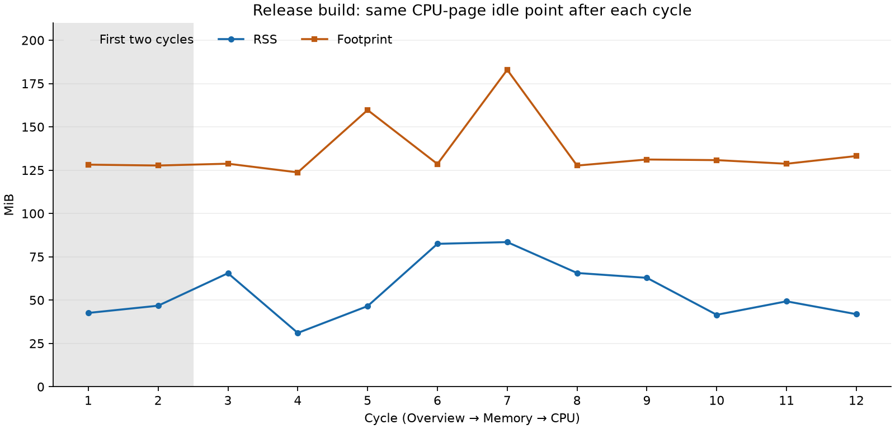

# Thermo 与 Mole 的对齐验收

先补可靠性与核心流程，再打磨界面。参照本地 Mole 原生 App 1.16.0（324），证据见 [原生研究](mole-native-study.md)和[函数研究](mole-native-functions.md)。整体齐平仍未成立。

2026-10-19 当前本机为 1.1.37（543），源码 3892e70。通用签名、macOS 13 最低版本、原生/Rosetta CLI、ZIP 内容一致性和自建文件移除/恢复检查通过；四个自建 Node 进程在两种架构下得到相同分组身份，按 PID 查询只包括同一调用的三个进程，排除另一段代码。可见内存页的 node 分组名称已核对。Helper 24 次观测均保留注册，8/1.1.37 与包内文件一致，原 6617 RPM 策略连续 6 次读回通过，退出日志确认自动恢复。三轮离屏检查共 69 个观测点：首次普通模式与活动对照通过，第二次普通模式的两个首轮样本未在 4 秒内刷新；所有关闭检查均无物理查询残留。普通模式整体仍未通过，活动对照不替代该结论。充电关闭、AWDL 空闲、合盖不休眠关闭，未提交新控制策略。旧版与 helper 备份保留，未测试运行回滚，未公证或发布。见 [543 分项安装验收](measurements/mole-installed-543-2026-10-19.json)。

原始 Mole.dmg 哈希复核与研究一致。对照原生资源、KeepAwakeController 类型及两个 idle-sleep assertion 名称，确认 Thermo 当前缺少普通保持唤醒：现有 awake 命令只控制合盖不休眠，屏幕/任务模式、定时结束、低电量暂停与接电恢复尚未实现。下一步按这项实际功能缺口推进，见 [保持唤醒差距](measurements/mole-idle-awake-gap-2026-10-19.json)。534 另补只读软件管理导航：停止测量后的下限提示、Homebrew 版本冲突禁用、原生恢复记录空状态与 CLI 零记录/无问题结果一致；有备份时的操作仍待验收，见 [软件导航检查](measurements/mole-software-navigation-534-2026-10-19.json)。

前一安装检查点（2026-10-19）：本机为 1.1.36（534），源码 b5f4628。1,760 项相关回归、通用 Developer ID 签名、原生/Rosetta CLI、归档一致性及自建文件的手动移除保护通过。升级的 34 次观测均保留 helper 注册，新服务 8/1.1.36 与包内文件一致，原 6617 RPM 策略连续 6 次读回通过，退出日志确认自动恢复。普通侧栏已实际进入 AI 会话页：默认保留全部，已选 0 项、清理禁用，未改期限或删除会话；可见内存页首次观察得到当次数据。离屏检查的 23 个观测点中，关闭后的物理查询均已结束，但第一轮部分 4 秒新样本及页面返回检查仍失败，不能认定整体生命周期或首次刷新时限通过。旧版及 helper 备份保留，未测试运行回滚，未公证或发布；整体齐平仍未成立。见 [534 分项安装验收](measurements/mole-installed-534-2026-10-19.json)。

543 打包前源码检查点：1.1.37 已整合主线至 fec3384（包括 AI 诊断验收工具与执行器截断声明修复），整合后 AgentDoctor 295、App 311、CLI 110 项通过，共 716 项；新验收执行器的 14 项自建样本测试通过。此处记录当时的源码检查，后续签名包分项验收见 543 记录，见 [主线整合回归](measurements/inline-main-integration-2026-10-19.json)。

543 打包前行为检查点：内联命令显示运行时名称，调用摘要保留不同程序的独立分组，PID 查询与其他目录统计不再仅按显示名合并。旧实现的 3 个行为测试出现 12 个断言失败，修复后的 4 项相关测试和 4 个自建 Node 进程查询通过。App 311、CLI 110 项通过；清理库首轮 759 项中有 1 项在测试镜像卸载断言失败，单项复测及补诊断后的 759 项复测通过，首次原因仍未确认。另增加默认关闭、报告中明确标记的前台活动对照选项，尚未运行签名包对照。当时此修复未进入安装版，后续安装见 543 记录；行为证据见 [内联程序命名及分项回归](measurements/inline-program-name-2026-10-19.json)。

安装前检查点（2026-10-19）：内存页补入关闭时的协作取消：进程枚举在下一进程前检查取消，丢弃已取消的部分清单；重开等待原物理任务返回后再请求新样本，避免重叠和旧数据回填。新增关闭/重开竞态及取消结果测试，1,760 项相关非硬件回归通过。当时修复尚未进入签名包或已安装 App；后续安装见 534 记录，首次采样时限及其他页面仍待验收，见 [内存页取消记录](measurements/memory-page-cancellation-2026-10-19.json)。

前一候选检查点（2026-10-19）：1.1.36（533），源码 5ec47c1，已完成签名、原生/Rosetta CLI、ZIP 一致性及自建文件手动移除保护检查，但两次窗口生命周期检查失败：部分页面未在 4 秒观察窗口内获得新样本，内存页关闭后仍有进程枚举未完成。调用栈确认当时正在逐项读取进程参数、路径和身份，不能据此认定死锁。此候选未安装，当时保留 1.1.35（522）；正在补页面关闭时的协作取消及重开串行采样，见 [533 候选失败记录](measurements/mole-candidate-533-lifecycle-2026-10-19.json)。

前一安装检查点（2026-10-19）：本机为 1.1.35（522），源码 4d5f53a。1,745 项非硬件回归、通用签名、源码标记、原生/Rosetta CLI、ZIP 一致性和 23 个生命周期观测点通过。已安装 App 再次完成自建应用/缓存的原生 Trash 移动与恢复：审阅时已有原路径冲突仍显示 1/2 并保留冲突，移开占位后恢复显示“1/1，另有 1 项已在原处”；4 个文件哈希、设备号和 inode 一致，恢复记录仅新增实际放回的一项且 outcome 成功，应用清单自动返回。已安装 CLI 对同批次重复恢复返回 0、两项 alreadyRestored，不新增历史或再次移动。样本及占位内容已移入证据目录保留，未清空 Trash 或操作个人数据。此结论仅限自建样本和本机；其余路径/卷、权限与硬件会话仍待验收，未公证或公开发布。见 [522 卸载恢复及反馈复测](measurements/mole-installed-522-2026-10-19.json)。

前一检查点（2026-10-19）本机为 1.1.34（519），包源码 b1cff4d，工作树标记为 clean。合并主线后的 1,738 项非硬件回归及 GUI 修复改动后的 655 项相关回归通过。包签名、源码标记、原生/Rosetta CLI、ZIP 和 23 个窗口生命周期观测点通过；自动升级 20 次采样保留注册。已实际点击设置页“重新安装…”：显示设置进度并禁用重装/卸载，捕获到 App 忙碌状态，17 次观测中 helper 从 47787 更换为 55775，停止时确认自动恢复，随后 6 次原 6617 RPM 策略读回通过，按钮重新启用。设置页版本、源码及正常窗口布局可见确认。普通退出保护由安装持有测试验证，本轮没有实际触发退出；过期/无响应提示的可见样本仍待验收。未公证或公开发布，整体齐平未成立。见 [519 GUI 重装实机验收](measurements/mole-installed-519-2026-10-19.json)。

前一检查点（2026-10-19）本机为 1.1.33（509），源码 5c1b127。651 项相关非硬件回归、通用 Developer ID 包、原生/Rosetta CLI、ZIP 文件/权限/链接比对及 23 个生命周期观测点通过。自动升级 16 次采样保留注册，旧 helper 确认恢复自动；正式安装包自带 CLI 的热重装返回成功，21 次观测中旧进程确认自动恢复，新进程完成 6 次原 6617 RPM 策略读回。root helper 为 8/1.1.33，文件与包内一致，设置页和风扇页可见确认。安装器等待修复已随 App 交付，不再仅限临时 CLI。此结论限本机 Mac15,3；清屏权限、其他硬件会话、GUI 修复入口和整体齐平仍待继续，未公证或公开发布。见 [509 包内及实机验收](measurements/mole-installed-509-2026-10-19.json)。

前一检查点（2026-10-19）本机为 1.1.32（508），源码 0cfb42c。新 FanWriter 在真实 helper 停止时记录 automatic control confirmed，服务空档的只读风扇读数也显示自动模式；自动恢复补丁在 Mac15,3 上通过。本次原安装器热替换暴露 bootstrap 5，旧文件回滚后的重载也失败，修复文件已保留；确认旧进程退出后，重新安装恢复 8/1.1.32 和原 6617 RPM 策略。新安装器的 12 项测试及签名原生 CLI 热重装验证通过：21 次观测、6 次原策略读回、停止自动恢复确认，helper 来源仍指向正式 App。新安装器尚未进入已安装 App，正在准备 1.1.33；旧 EIO 的系统内部原因未独立证明。主目录其他改动保留，未公证或发布。见 [508 分项验收](measurements/mole-installed-508-2026-10-19.json)、[退出等待保护](measurements/helper-installer-unload-wait-2026-10-19.json)。

前一检查点（2026-10-19）本机为 1.1.31（506），源码 `3ca5039`。本次真实升级中，新 App 确实观察到旧 legacy helper；17 次采样均保留 launchd 注册，root helper 自主从 8/1.1.30 更新为 8/1.1.31，未调用安装器。原 6617 RPM 策略完成 6 次连续手动目标核对，设置页与风扇页可见检查通过。但旧 helper 退出日志记录“automatic control unconfirmed: fan 0: automatic mode readback did not match”；新服务已恢复既有手动策略，不能据此宣称自动模式恢复或整条升级全通过。候选签名、原生/Rosetta CLI、ZIP 一致性和 23 个生命周期观测点通过。主工作区有新提交和未提交的标签整理改动，保持原样；修复仍在隔离分支，未公证或发布。见 [506 安装与分项验收](measurements/mole-installed-506-2026-10-19.json)。

前一检查点（2026-10-19）本机更新为 1.1.30（505），源码 `1612982`。通用 Developer ID 包、原生/Rosetta CLI、只读探测、签名后的两轮窗口生命周期与 ZIP 解包文件/权限/链接一致性通过。493 正常退出并完成原子替换，旧 App、helper 和 plist 全部保留。本次自动升级暴露注册方式混用：App 对仍采用密码安装的旧 helper 调用 SMAppService 注销后，重注册返回 Operation not permitted，root job 消失。已通过官方 CLI 安装事务恢复为 8/1.1.30，原 6617 RPM 策略恢复，6 次手动目标核对通过，设置页显示运行中。未新设硬件策略。此包不算自动升级验收通过；当时源码正在补禁止注销 legacy 注册的保护，尚未部署，也未公证或公开发布。见 [505 安装及故障恢复](measurements/mole-installed-505-2026-10-19.json)。

2026-10-18 已继续安装 1.1.29（493），源码 `a0491ee`。1,697 项非硬件测试、Developer ID 通用签名、原生/Rosetta CLI、ZIP 95 文件比对及 Release 离屏窗口检查通过。真实 root helper 自动更新为协议 8/1.1.29，原有 6617 RPM 策略恢复为已核对手动模式与目标，6 次连续检查通过，转速约 6562–6622 RPM；AWDL 恢复为 idle，接口保持开启，专用锁为 root/0600；充电仍关闭，未新启充电或 AWDL 会话。旧版副本经内容、签名、归属、进程和打开文件检查后移至专用备份目录，文件全部保留。此前可视窗口读取受 `cgWindowNotFound` 阻塞，2026-10-19 已恢复读取，设置、风扇及电池/AWDL/清屏面板完成局部检查；最初后台绑定窗口时总览持续等待；经“显示 → 概览”正常打开后负载、热压力、程序及当天时间轴恢复，CPU 页采样和返回总览通过，先前可见性状态原因尚未确定；清屏缺少辅助功能授权，不能认定完整可视验收通过（见 [493 可视复验](measurements/mole-visible-493-2026-10-19.json)）；已恢复原版自动更新地址并核对原有 Apple Events 自动化声明，更新状态可用；本地候选未公证或发布，完整齐平仍未成立。见 [493 安装复验](measurements/mole-installed-493-2026-10-18.json)。 真实生产 root 服务另完成 3 个签名身份的版本 RPC 对照：允许角色成功、同标识 ad-hoc 与同团队错误标识拒绝，见 [生产签名身份检查](measurements/helper-production-peer-trust-2026-10-18.json)。

2026-10-18 本机已从 1.1.27（233）升级至 1.1.28（477），App 文件与签名核验通过，既有 helper 自动更新到协议 8，并接受生产 CLI 的状态查询。真实安装验收发现两项失败：固定 6617 RPM 策略读回不匹配后退回自动；AWDL 因 `/var/run` 的 0775 权限被租约检查阻止。充电保持关闭，AWDL 接口保持开启，未主动提交新控制策略。已准备 1.1.29 源码修复并通过 46 项相关测试，尚未构建和部署修复版；不能据源码测试宣布真机问题解决。见 [477 安装观察](measurements/mole-installed-477-2026-10-18.json)。

历史构建验证：1.1.28（477），源码冻结在 `d97df44`，包含 helper 安装事务及已合入的 AI 用量改动。1,687 项非硬件测试通过；Developer ID 通用签名、原生与 Rosetta CLI 只读/dry-run、ZIP 解包 95 个文件比对和签名复验通过。同一 Release 包完成 2 轮、6 次离屏窗口开关、19 个采样点，功能检查通过；不代表可见交互或长期内存验收。产物保存在独立工作区 `dist/mole-review-477-d97df44`，原版 App 的 92 个文件备份及签名已核对，root helper/plist 备份已校验；已安装六项文件校验值未变。尚未安装、公证或发布，文件备份不代表运行回滚验收。详见 [477 候选证据](measurements/mole-install-transaction-candidate-2026-10-17.json)。

此前整合候选为 1.1.28（457），源码冻结在 `3aeb21c`，包含此前 440 之后的系统进程归属、面板文本及扫描取消/不完整状态和 CSV 退出码修复。1,659 项非硬件测试通过；Developer ID 通用签名、原生与 Rosetta CLI 只读及 dry-run、ZIP 解包 95 个文件比对和签名复验通过。同一 Release 包完成 2 轮、6 次离屏窗口开关、19 个采样点，功能检查通过；不代表可见交互或长期内存验收。已安装 App 与 root helper 的六项文件校验值未变；尚未安装、公证或发布。详见 [整合候选证据](measurements/mole-consolidated-candidate-2026-10-17.json)。 最终签名 CLI 的 root 服务归属及四种扫描取消格式也已实测，原有 32 个测试文件字节不变；扫描历史写入隔离目录，见 [包内核心流程检查](measurements/mole-packaged-core-flows-2026-10-17.json)。

本轮已补入 helper 安装事务：先暂存并验证新文件、保留旧文件，再停止旧服务；激活失败尝试恢复旧文件和原登记，恢复失败则保留备份并报出路径。9 项隔离事务测试及 1,666 项非硬件回归通过；系统 `launchctl`、管理员安装与真实控制恢复均未执行。457 不含此修复，且其临时目录和 ZIP 本轮复查已不存在，历史记录保留，当前不能直接安装。后续已构建上述 477；文件恢复不代表 App 回滚或长期运行恢复，原 helper 的 `--source` 自更新仍可能跟随当前 App。见 [安装事务记录](measurements/helper-install-transaction-2026-10-17.json)。

Mole/缓存分支的冻结候选为 1.1.28（384），源码冻结在 `65eafd8`：补入 Go 固定本地工具链、原生清理范围确认、永久清理与工具保留文件提示。1,475 项非硬件测试通过；Developer ID 通用签名及 ZIP 解包复验、原生与 Rosetta CLI 检查、9 组离屏页面开关通过。已安装的 1.1.27（233）及 root helper 未变；未公证或发布，真实硬件控制验收仍缺。随后主分支的 Codex MCP 用量解析改动保留在源码中，不在此冻结包内。详见 [候选证据](measurements/mole-cache-candidate-2026-10-17.json)。

历史充电候选 1.1.28（421），源码 `a0ba8ed`，已完成 Developer ID 通用构建、原生/Rosetta CLI 充电 dry-run 与只读探测、ZIP 解包全文件比对及签名复验；同一签名包的离屏生命周期完成 2 轮、6 次窗口开关，功能检查通过，不代表可见交互或长期内存验收。该包包含协议 8、App/CLI 充电入口及临时充满自动结束；尚未完成新包的可见与安装验收，不替代此前冻结包的验收结论。详见 [充电候选记录](measurements/mole-charging-candidate-2026-10-17.json)。

| 项目 | 当前证据 | 待补齐或验收 |
|---|---|---|
| 卸载审阅与执行 | 预览重算关联数据，复核标准目录和运行中可识别 `.app` 声明；同 ID 副本的名称及标识数据均保留；标准位置的嵌套 helper/扩展/当前框架服务声明参与归属指纹及共享保留。执行前重读清单和路径元数据，移动中复查进程；未知进程清单不当作空表。共享原因可见，数据模式保留本体，确认任务阻止普通退出；自建应用可见窗口完成数据模式及完整移除/恢复，字节复核一致，恢复后软件及空间清单失效，旧空间扫描/缓存不可回填 | 真实应用并发更新；目录外未运行且未提供路径的副本；非标准位置/布局的组件、独立非 app 运行包、Team ID 等证据；目录深层内容变化；残留清理等其他入口；完整视觉交互验收 |
| 清理保护与恢复 | 普通清理确认冻结显示与执行输入，计划/扫描轮次变化要求重新审阅；运行状态、白名单、Trash 批次及恢复身份检查已有实现；恢复固定两端父目录，通过文件描述符执行排他重命名，并复核目录及 Trash 项身份；原生废纸篓位置通过 macOS 为原路径独立查询，不能由批次扩展；可写 APFS 镜像卷内恢复及冲突保留通过，系统别名与搜索权限已适配；应用及关联数据区分未测量、完整、下限和未知，执行及历史保留不完整标记；未检查完整的残留对象保留并阻止移除；残留清理保存审阅时数据身份与应用归属，移动前逐项重读，旧扫描不在恢复后回填；残留列表保留读取问题与取消状态，中文可见窗口区分错误空表与确认空表；457 最终签名 CLI 在自建 APFS 卷完成实际入废纸篓与批次恢复、原路径冲突保留、废纸篓对象替换拒绝，成功恢复的字节及 inode 一致（[包内恢复验收](measurements/mole-packaged-trash-restore-2026-10-17.json)）；同包已实测白名单预览排除、占用文件拒绝、重复副本移除及恢复，见 [入口保护检查](measurements/mole-packaged-removal-guards-2026-10-17.json) | 手动移除绑定选择身份、逐项占用/白名单复查，普通退出保护有模型和 CLI 确认等待替换样本；各入口保护一致性、真实数据恢复验收；其他模块的大小状态全入口验收 |
| 聊天保留与显式期限 | 默认不生成聊天清理候选；单独选择期限后列出旧会话，项目消失不绕过期限，聊天不自动选。常规 Everything/缓存扫描保持聊天；专门会话/AI 扫描才使用所选期限。切换清空旧计划，工作中不能更改；报告、缓存、变化比较区分策略及期限，旧报告缺少版本不可复用于新计划。App 本机保存“保留全部”或所选期限，格式/版本异常按保留全部处理，不恢复勾选或计划；三次独立启动确认 90 天恢复及保留全部恢复，无自动扫描或清理。会话即使标为 safe，也不进入自动选择和 CLI safe 分组。CLI 兼容 sessions/worktrees/models 分组别名，并仍要求显式 --older-than，不读取 App 偏好 | 保留全部时的主 App 侧栏入口已确认，其余期限与候选刷新全场景仍待验收；各工具实际会话维护与版本兼容继续独立核验；截图接口故障，本轮未完成新的视觉布局验收 |
| 工作树提交保留 | 共享仓库上下文核实 HEAD 有保留引用，排除 linked 私有 HEAD/引用作为证明；固定 HEAD、公共仓库和注册身份并核对反向路径，移动/永久移除/注销前复核。未知进程拒绝；缺失路径注册修复也保留独有提交。含被忽略本地文件的注册工作树保留，准备及永久移除前重查本地变化。默认 T3 目录的已注册及无注册工作树、链接目标在扫描和执行时保留。工作树与其 Git 注册目录 24 小时内有变动时保留，准备/永久移除前再次检查；活动核验覆盖目录、硬链接及 ctime，超限/取消/读取异常不放行。无注册遗留目录保留审阅后 Trash 流程并拒绝永久移除 | ignored 本地文件的精细可重建判定（当前整树保留）、T3 自定义目录及其他管理器归属、真实长时间并发负载；检查不是仓库引用与文件操作的原子事务 |
| 审阅现场的保护控制 | 工具范围逐目录盾牌入口与整项“始终保留”接入白名单，立即取消受影响选择；最近新增规则可一次撤销，已有规则不删除；绑定文件身份和完整文本，外部变化拒绝撤销；撤销后清空旧计划并要求重扫。800×580 中文窗口完成添加、撤销和外部编辑后拒绝的实际配置验收；设置与清理页接入同一规则管理视图，列表审阅绑定配置快照，单条允许后清空旧清理计划 | 设置页入口的可见布局、更多目录布局；不提供持久撤销栈；最终候选版全流程复测 |
| 取消与资源上限 | 取消令牌按线程隔离并传给子任务；应用测量与 feed 检查分别最多四项；总览的文件测量与运行时查询在进程内共享最多四个工作名额。清理失效后等待旧工作返回才启动替代扫描，旧结果不可写回；整批停止保留已完成结果；历史、重复文件与大文件打开时间查询在各自模型中最多各一个物理任务，重复请求合并并丢弃过时结果；清理缓存恢复、白名单套用与项目目录准备移至同一串行后台，新请求只保留最新范围，旧缓存不能覆盖新扫描或变更后的期限/保护规则；目录准备前即可停止，旧工作返回前不启动替代扫描 | 阻塞系统调用下的最坏延迟、其余同步规划阶段的耗时；连续重扫的真实负载与跨进程资源用量 |
| 窗口生命周期 | 关闭时释放页面树，停止自动采样与只读检查；恢复时重建页面并保留导航与共享结果。AppKit 释放、位置保留、SwiftUI 消失/恢复测试通过；Release 离屏进程完成 12 轮、36 次开关，控制器释放、页采样停止及新读数恢复均通过，并保留 RSS 与 footprint 记录 | 最终候选版本复测；普通可见窗口与常驻菜单栏模式；更长时段内存稳态及其他页面；共享模型仍保留结果数据 |
| Status 进程解释 | 新增按采样身份绑定的只读详情和 pulse explain PID；核对启动时间、UID、可执行路径及当前父子关系，区分直接路径与祖先关系，保留未知/不完整；有界读取当前用户参数/cwd/vnode 路径，遮蔽已知凭据并转义控制字符；关闭/切换后旧结果不回填。普通归因去掉同名 PID 路径缓存，历史只称记录关联；新增按 PID 的有界 TCP 监听观察，区分回环/通配/指定数值地址，未知/截断不冒充无监听；中文可见详情验证真实 IPv4/IPv6 回环监听、关闭 sockets 后刷新、跨 PID 切换及弹层关闭后重开读取新状态；系统结构化电源断言按 PID 观察，区分活动/未活动/未知级别及请求类型，不承诺系统必然保持唤醒；当前用户 GUI/User/System 域及 root 进程的 System 域直接 launchd 登记按列表和单项 PID 双重确认；新增工作目录附近的只读 Git 仓库、分支/游离 HEAD 和对象 ID，支持 worktree 与压缩引用，元数据或 cwd 变化丢弃结果，不执行仓库命令；新增经身份与关系复核的子孙树，限制 128 项/16 层，失效中间节点不保留下游归属，进程表遗漏和范围限制显式报告 | UDP/完整网络覆盖、服务子孙进程的登记关联；真实大树、跨用户权限及并发退出的设备验收；发布者验证；Git 状态、远端与对象存在性未检查；已安装主 App 入口与完整交互验收 |
| 其他系统小工具 | 电池读取、解析与充电保护策略已实现，已有合盖保持唤醒和风扇模块；清屏设置、期限、按住退出、输入拦截与全局键已有实现；AWDL 已接入协议 6、独立网络队列、连接持有者、helper 恢复/卸载及 App/CLI 入口，SMC 失败不再终止网络恢复；充电策略、事务与持久恢复已接入 helper 协议 8（保留旧 7 调用），App 面板、偏好、退出确认和前台 CLI 已接入，系统设置/无电池分支已有只读判断和可见检查 | 清屏真实硬件键/媒体键、多显示器/休眠/热插拔与实际定时到期待验收；AWDL 匿名 XPC 与生产面板/模拟接口已检查；493 已实际安装，root helper 为协议 8/1.1.29，AWDL idle 状态、保护目录及既有风扇策略恢复已核验；真实 AWDL 接口切换、睡眠及活动会话更新恢复仍未验收；充电 helper 的双键和 CHTE 路径已静态确认，App 80/75 策略、全充完成/拔电结束规则已有静态证据，当前 Mac 的系统电池设置导航和原生上限入口已只读核验；已安装 App 的电池面板和系统设置导航已检查，充电策略仍关闭，充电写入及阈值硬件验收仍缺，详见 [充电分析](mole-charging-analysis.md) |
| 普通保持唤醒 | 已有独立的合盖不休眠模式；原始 Mole 资源及 KeepAwakeController 字符串还声明屏幕/任务保持唤醒、时限与电源恢复行为；当前 Thermo 来源与已安装 CLI 已核对 | 普通闲置唤醒的屏幕/任务/组合模式、定时结束、低电量暂停及接电恢复尚未实现；保留现有合盖命令语义，补 App/CLI 入口、状态及结束核验 |
| 风扇控制 | helper 独立持有策略，CLI/App 退出后继续生效；自动恢复逐扇写入并读回模式/强制位及 Ftst，失败不短路其他风扇；未确认时策略查询报错、后台重试且暂缓手动策略，退出使用失败状态；手动写入及未改目标时核对控制模式和目标，失败尝试自动恢复并暂停到再次修改策略；卸载前清空并保存策略、确认风扇与已保存的休眠设置恢复，以令牌阻止并行修改，失败不进入删除 ；1.1.29 已实际恢复原有 6617 RPM 策略，生产 root 服务与受控签名身份检查通过 | 更多签名身份及生命周期、硬件断连验收；各机型温度来源及部分传感器丢失覆盖；卸载准备时守护进程重启竞态；持久化失败和重启恢复的真实故障验收；新状态查询、界面及 CLI 的真实端到端验收；硬件状态与提示一致性 |
| 软件管理 | 用户和共享 LaunchAgent 的当前用户启用/停用、来源复核、历史入口；第三方系统 LaunchDaemon 的确认及管理员授权修改，授权后重新核对文件和原状态、执行后读回；Homebrew 单项安装后同时核实安装记录、应用版本和构建号，自行更新过的应用不按旧记录覆盖；现代登录/后台登记增加独立只读入口，未授权与空列表分开，登记请求与系统允许状态分开展示；授权说明及取消经过可见窗口检查 | 现代登记的真实管理员读取与输出格式兼容；真实管理员授权及系统服务修改验收；现代项目交由系统设置管理；真实 Homebrew 安装；其他更新渠道 |
| 更新来源发现 | 本机元数据报告保留目录读取问题、取消、最多 128 项问题及截断标记；目录覆盖与单项元数据完整性分开，已知来源可独立检查；短声明标识与孤立目录推断分开校验。原生可见窗口区分未完成空表、已知来源伴随问题与确认空结果；实际只读 CLI 列出 74 个来源及 4 个身份未核实条目，名称离线预览仍可使用 | 覆盖支持的应用目录及一层真实套件目录，不代表整机所有位置；阻塞文件系统下的延迟与其余渠道仍需验收 |
| 原生更新 | Ed25519 签名 ZIP32/ZIP64 和受支持的只读 DMG，经过私有下载、目录检查、代码签名/发布者/版本/架构校验、原子替换、旧版保留及恢复；恢复确认绑定完整记录并在锁后及交换前复核，缓存列表刷新不替换已确认快照。DMG 复制后同时核对镜像清单与原私有挂载目录身份，结果不明时保留工作目录并写入独立检查记录，重开后可从恢复/历史定位；特殊记录文件非阻塞读取；安装结果与准备目录清理结果分别报告，清理异常保留检查入口；恢复列表显示保留副本的位置及已分配占用，区分完整/下限/未知；已确认的单份备份可审阅后移入废纸篓，保留当前应用、父目录和回执，并接入批次历史恢复；Finder 定位重读回执并核对目录身份，CLI JSON 同样包含占用报告。Rectangle 官方签名 DMG 在自建副本完成升级、恢复、篡改拒绝、替换后失败回滚和生产 HTTPS 下载验收 | 历史自建源 DMG 残留的原因、设备名复用与真实竞争验收；已安装真实应用的界面流程及运行验收、Developer ID 证书轮换；未声明 feed 的应用；PKG、增量包、脚本及其他镜像格式；自定义版本与认证来源；备用副本自动轮换策略；已安装主 App 回收入口及真实厂商应用验收（独立可见组件与 CLI 原生链路已验证） |
| 磁盘分析与优化 | 空间、内存、隐私和开发工具清理已有模块；目录树和磁盘总览传播读取失败与取消状态，保留未知位置和已知下限；总览分开记录尝试与完整测量数量，未归属差额不冒充实测；旧版及不完整缓存不可当成完整测量复用；重复文件选择绑定比对身份并核对保留副本，私有占用未知不回退逻辑长度；大文件时间筛选保留未知状态。自建样本完成中文窗口重复比对、变化拒绝、原生 Trash 移除/恢复、恢复后重扫及未知时间筛选；新增白名单保护后的零移动、保留选择和可取消选择已完成可见验收；私有测试 Trash 的移动后记录故障保留移动计数并单列警告；工具执行结果按前后测量报告，未测量保持未知，部分失败仍保留已观察到的变化；800×580 中文独立窗口完成工具范围、永久警示与当前分类页结果验收；失败余项要求重扫，已移除路径不接纳后来出现的新文件 | Go/npm/pip/uv 已在自建隔离缓存中完成真实工具清理及 Go 失败后重试，保留工具元数据、外部哨兵一致；仍需覆盖其他版本和配置、其余清理与优化入口及最终安装版流程 |
| 界面与交互 | 软件管理、启动项、更新来源页已做中文渲染检查；软件页独立可见 QA 窗口核对普通卸载、仅数据、共享保留和归属错误预览，移动/保留/说明分区展示；自建样本执行及恢复 1/1、2/2 可见验收通过，恢复后关联大小刷新；重名应用显示路径 | 首页、导航、扫描、真实执行、错误恢复与空状态的全流程对比；其他确认页的完整视觉验收 |

应用元数据另使用 1 MiB 普通文件快照、读前后及命名路径身份核对，Info.plist 摘要进入审阅身份；解析内容与身份绑定。特殊文件和已存在但不可解析的元数据不建立身份，链接只用于有界展示。缺失项仍按既有契约显式记录 missing；不能将文件系统身份等同于完整应用签名。

身份复核使用设备号、inode、文件类型、大小、mtime、ctime 与应用关键文件信息，不能代替整个应用的签名验证，也不能宣称消除了所有检查与移动间的时间窗口。

Homebrew 安装限定到确认的 cask，要求校验值，禁用自动清理与依赖升级，并使用 `--no-quit`。软件包自身的安装步骤仍由 Homebrew 执行。历史保留更新开始与最终状态，读取同一操作的最新追加记录；安装与核实时阻止正常退出，不提供自动回退。

自动测试使用临时目录、合成凭据、替身网络和安装器；本机扫描与渲染读取真实元数据；真实安装及硬件故障验收单独列为未完成，前两层不能代替第三层。

本机离线发现 74 个应用对象：12 个声明 Sparkle 源、14 个带 App Store 收据、48 个未声明可检查的来源。CLI 离线预览不含原始 HTTP(S) 更新地址。本轮未访问这些厂商 feed，未安装真实软件。Homebrew 只读检查发现 Ghostty、OrbStack、Phosphene 已达到目录目标，旧记录不再产生待安装项。

版本排序与锁定的 Sparkle 2.9.6 比较器对照 225 组常见版本；CLI 使用独立实现，不引入 Sparkle 动态框架。超长数值构建号另有验证，不经固定宽度整数。协议参考为本地依赖的 `SUStandardVersionComparator.m`、`SUAppcastItem.m` 与 `SUConstants.m`，没有使用 Mole 私有代码。

已有本地检查点 `ac69494`（首批功能）和 `8f3b432`（分析记录）。未执行推送、发布或替换已安装 App。

基础检查点验收为 548 项通过。新增原生安装事务使用合成 Ed25519 密钥和临时 ad-hoc 签名应用，实际经过系统 ZIP 解包、Security 代码签名校验、Mach-O 解析、文件原子交换与恢复；没有替换真实应用。故障场景包括签名错误、归档内容变更、发布者或版本不符、架构不兼容、应用/备份并发变化、准备副本被改、核实失败回滚以及损坏恢复记录。过期下载 URL 可更新，但下载内容必须同时通过预览时和新 feed 的签名验证。

原生安装检查点验收：同一回归命令得到清理 379 项、App 115 项、CLI 50 项、核心库 24 项，共 568 项通过，0 失败。19 项安装事务测试涵盖真实系统签名校验和文件交换；非空发布者要求分支使用临时 ad-hoc 指定要求测试，不等于 Developer ID 证书轮换验收。新增界面与 CLI 原生安装/恢复入口，确认的安装在页面退役后继续，正常退出被阻止。800×580 中文页面已检查；真实 CLI 只做恢复记录读取和安装来源的离线预览，未下载或更新真实软件。

归档格式检查点：相同回归命令得到清理 385 项、App 115 项、CLI 50 项、核心库 24 项，共 574 项通过，0 失败。临时 UDZO 镜像经过实际只读挂载、应用复制、卸载、安装与恢复，成功和多应用失败路径均确认没有残留挂载；许可协议和加密策略用合成元数据验证，未接受实际许可。ZIP64 用真实签名测试包转换中央目录后完成实际安装与恢复，并验证恶意 64 位指针/文件数不会触发整数溢出。本轮未安装真实软件。

应用大小检查点：清理 396 项、App 115 项、CLI 50 项、核心库 24 项，共 585 项通过，0 失败。新增测试覆盖大小状态、不可读目录、取消、分阶段发布和超时后工作名额保留。默认扫描先发布应用本体，再查关联数据；60 秒预算返回已知结果，单个应用本体最多发现 20,000 项，可通过界面或 `apps --exact` 完整测量。共享队列最多四个工作，系统调用阻塞时不会因重扫提前释放名额。关联目录名称使用 POSIX 枚举，避免 Foundation 为所有条目读取属性。

本机只读 CLI 扫描 74 个应用对象，25.8 秒返回：本体完整 66 项、下限 5 项、未知 3 项；关联数据完整 73 项、下限 1 项。800×580 中文页面已检查，汇总和行内均保留下限提示。这是当前机器的一次观测，不是性能保证；未移除或更新真实应用。

恢复故障检查点：清理 400 项、App 115 项、CLI 50 项、核心库 24 项，共 589 项回归通过，0 失败。其中临时目录中的 15 项恢复测试包含固定目录后父目录被替换、上级目录变成链接、Trash 项被替换、原路径出现新数据，以及同一批次失败与成功项目并存时的历史结果。两端目录描述符保留到排他重命名结束，避免路径在检查后被重定向；这不代表消除了源目录项最后复核与重命名之间的全部并发窗口，也不代表对目录内全部文件做了内容校验。未操作用户真实 Trash。

启动项范围检查点：清理 406 项、App 115 项、CLI 50 项、核心库 24 项，共 595 项回归通过，0 失败。新增测试覆盖共享 Agent 仅操作当前用户域、系统与用户域分别读回、同域跨目录重名锁定、伪造来源拒绝修改、系统状态读取失败时保留用户状态，以及配置所有者检查。配置通过不跟随末级链接的文件描述符读取，读取上限 1 MiB。执行后的来源、重复项和状态一并复核；CLI 支持完整路径选择，历史保留完整路径。

本机只读发现 63 个可核实的启动项：用户 36、共享 8、系统守护服务 19；另有 8 个文件未通过安全读取检查并显示提示。800×580 中文页面已核对，提示详情可展开，行内区分来源与状态。没有修改真实 launchd 状态。此范围检查点尚未实现管理员修改能力，不能将发现范围扩大视为启动项管理已全面齐平。

系统启动项修改使用 macOS 管理员授权，仅执行固定的 `launchctl enable/disable system/LABEL`。生产入口的目录固定为 `/Library/LaunchDaemons`，标签限制为 ASCII 标识，Apple 与 Thermo 自身服务仍受保护。授权结束后，提权脚本再次检查文件所有者、权限、设备号/inode、SHA-256 和原启动资格，再执行并读回；摘要工具使用空环境运行。用户取消、超时或无法确认时记录失败并要求刷新，不自动重试或回退。页面退役不取消已确认的任务，正常退出会等待任务完成。

生成的 shell 在真实临时文件上运行，root 身份和 launchctl 使用替身；系统 stat、SHA-256、状态解析、修改前后守卫以及收据检查均实际执行。覆盖成功和反向切换、授权期间配置/权限/链接/状态变化、异常状态输出、取消与缺少收据；App 模型另测页面退役后任务继续且不能重复提交。这些测试不等于真实授权和系统服务修改验收，本轮没有显示管理员授权对话框，也没有修改真实服务。

管理员修改检查点：清理 412 项、App 116 项、CLI 50 项、核心库 24 项，共 602 项回归通过，0 失败。真实 CLI 对系统服务执行 `--dry-run --json`，确认完整路径选择和管理员授权标记；没有执行修改。800×580 中文启动项列表已重新渲染检查，管理员授权对话框及系统服务确认页的完整交互仍待真实验收。

空间目录树区分完整、已知下限和未知；读取失败向祖先传播，不可读的小目录不会因 1 MiB 阈值或完整条目的显示上限而隐藏。取消后合并尚未结束的节点，保留已测结果和未访问目录；只保留未结束节点，完成节点及时释放。界面停止后等待物理工作返回，再接收部分结果，期间阻止重扫和移除，避免旧扫描覆盖变更。阻塞中的系统调用仍须等待返回，不能宣称可立即中断。

目录行、汇总、预览、CLI 和手选移除结果保留不完整标记；图块面积只表示已知估计数据，不保证实际回收字节。完整缓存要求新版状态字段，拒绝部分结果、错误状态及缺少状态的旧数据。临时目录的真实 CLI 测量得到已知 2 MiB 和一个权限为 000 的目录，JSON 根状态为 incomplete，受限目录状态为 unavailable；没有操作真实用户目录或 Trash。

空间大小检查点：清理 417 项、App 117 项、CLI 50 项、核心库 24 项，共 608 项回归通过，0 失败。新增测试覆盖真实权限失败、取消后保留已知数据与未知子目录、预先取消、旧版或状态矛盾的缓存、停止期间不增加物理扫描，以及手选移除结果与历史保留下限标记。磁盘总览的独立统计路径仍需核对，未将目录树结果扩展宣称为所有磁盘入口已完成。

磁盘总览现在保留 `DiskFootprint.incomplete`，将尝试过的位置和完整测量的位置分开计数。权限错误、其他读取失败及规划错误都会使分类不完整；未知子项不因大小或最大条目数而消失。不存在的可选根目录仍表示未安装/不存在，不与无法读取混同。底层缺失路径和预先取消也返回不完整状态。模拟器大小字段缺失、查询失败或非法数值均不显示为完整 0 B；未归属空间在分类未测完时标为未知差额。新版完整性字段用于缓存门槛，旧版缓存不再直接复用。

本机只读执行 `thermo clean overview --budget 3 --json`，实际 10.44 秒返回，cancelled 为 true；16 个返回分类中 2 个完整、14 个为下限，记录 1 个读取不完整位置。这是软预算和一次本机观测，不能据此承诺 3 秒硬超时，也不能证明所有系统调用可立即取消。没有执行清理或修改服务。

总览完整性检查点：清理 423 项、App 118 项、CLI 50 项、核心库 24 项，共 615 项回归通过，0 失败。新增真实权限和临时文件测试，另覆盖非权限错误、规划错误与可选根缺失、完整空目录与未知 0 B、模拟器缺失/非法/溢出大小，以及相同完整测量数下拒绝过时进度。界面的完整交互与阻塞系统调用的最坏延迟仍需继续验收。

总览资源管理：每次扫描原先创建独立四工作队列，清理使界面结果失效时还会提前清除忙碌状态。现在测量任务与模拟器查询共用进程内队列，取消不会提前释放占用中的名额；每个调用仅等待自己的任务组。界面清理失效后保持等待，连续刷新合并为一次替代扫描，旧结果既不显示也不保存。分类规划仍在调用方同步执行，不在这个四工作名额的范围内。

阻塞测试占满全部工作名额后取消，确认第二次测量不会获得新名额；界面测试在旧工作阻塞时执行清理失效和 20 次刷新，确认等待旧工作返回后只启动一次替代测量，并且只保存新结果。同一只读 CLI 的另一次观测在 3.04 秒测量结束，已在 3.2 秒采样点之前退出，未得到等待栈。因此不能把先前的 10.44 秒视作稳定复现，也不能用这次观测声称最坏取消延迟已经解决。

总览资源检查点：清理 424 项、App 119 项、CLI 50 项、核心库 24 项，共 617 项回归通过，0 失败。本批没有修改清理策略、真实文件或系统服务，也未将软预算改为硬超时。

窗口进程验收使用开发入口：`.build/debug/ThermoApp --offscreen --verify-lifecycle /tmp/thermo-window-lifecycle.json --cycles 3 --open-seconds 3 --idle-seconds 4`。入口要求离屏和绝对报告路径，轮数及等待时间有范围限制；固定轮流打开概览、内存和 CPU 页，不启动菜单栏记录器，也禁用 helper 交互。它实际创建、关闭并重建 AppKit/SwiftUI 内容，关闭后检查控制器弱引用、页面定时器和已完成采样；空闲期比较发布时刻，重开时要求读数晚于本次打开。

macOS 会将离屏窗口标为遮挡，因此验收显式设置 watched 状态以覆盖可见时的采样路径。它不能代替普通可见窗口、真实遮挡通知和常驻菜单栏模式的验收。RSS 是驻留映射，footprint 还包含压缩等内存账目，不能只看 RSS 下降就宣称释放了所有页面数据；共享模型和系统 UI 缓存可继续持有结果。报告的 functionalChecksPassed 只表示生命周期功能检查，内存趋势另行分析。

开发构建实测用时 79.09 秒，3 轮共 9 次打开/关闭，28 个采样点，原始报告见 [窗口生命周期测量](measurements/window-lifecycle-2026-10-16.json)。9 次打开均在本次打开后取得新读数；关闭后的页面控制器弱引用存活数均为 0，页定时器均停止，Pulse 持有数为 0，空闲期没有继续发布页面读数，窗口位置保持一致。报告中的 controllersAlive 只计算已关闭的页面控制器，不计算当前打开的页面。

每轮最后一个 CPU 页面关闭并空闲后的 RSS 分别为 129.6、93.8、68.1 MiB，footprint 分别为 176.2、130.8、180.5 MiB。这 3 轮数据波动明显，不能证明长期稳态或没有泄漏。各 4 秒空闲段的 CPU 用量为单核的 0.121%–0.279%，中位数 0.160%；其中仍包含按设计运行的基础传感器采样，不能宣称后台工作为零。该 Debug 记录不覆盖 Release 构建、更长时间开关、普通可见窗口及其余页面。

窗口进程检查点：清理 424 项、App 120 项、CLI 50 项、核心库 24 项，共 618 项回归通过，0 失败。新增入口边界验证拒绝非离屏、相对路径、过大轮数及非有限等待时间；真实离屏进程另完成上述 9 次重开/关闭检查。没有替换已安装 App 或修改 helper、风扇策略和系统服务。

Release 检查点基于源码 `0416670`，`swift build -c release --jobs 4 --product ThermoApp` 成功，用时 125.06 秒；这是 SwiftPM 的 Release 模式裸可执行文件，非发布安装包。使用同一入口将轮数增加到 12：进程内记录用时 314.59 秒，共 36 次打开/关闭和 109 个采样点。36 次打开均取得本次新读数；所有关闭与空闲点的已退役页面控制器为 0，页面定时器和 Pulse 持有均停止，空闲期发布时刻不变，窗口位置保持。helper 与常驻记录器仍禁用，已安装 App 未替换。

将前两轮作为预热，按第 3–12 轮 CPU 页关闭后的同一空闲点比较，footprint 为 123.72–182.92 MiB；第 7 轮峰值后回落，第 8–12 轮为 127.66–133.16 MiB。这段运行未呈现逐轮持续累积，但 5 分钟观察不能证明长期无泄漏，也不能替代普通可见窗口和菜单栏模式。各 4 秒空闲段 CPU 用量为单核的 0.097%–0.197%，中位数 0.143%。不同构建运行时的系统负载未隔离，不能据此把与 Debug 的差异算成优化收益。

原始数据见 [Release 窗口记录](measurements/window-lifecycle-release-2026-10-16.json)，构建命令、二进制 SHA-256 和汇总统计见 [构建与统计记录](measurements/window-lifecycle-release-2026-10-16-build.json)。本轮生产源码没有变化，新增证据对应上述固定源码版本。

关联数据单独移除：应用详情可选「仅审阅关联数据」，CLI 使用 `apps uninstall NAME --data-only --dry-run --json`。计划显式记录 removeApp 为 false，移动路径和大小汇总排除应用本体；执行仍核对应用与关联对象身份，应用运行时拒绝操作。确认与历史区分数据移除和卸载，也不会建议卸载 Homebrew cask。个人数据继续默认保留，白名单按移动路径检查；只读应用本体可以保留，无需获得移除本体的写权限。

执行会拒绝数据模式中误加的本体、内部路径、父目录或经链接父目录指向本体的路径；缺少模式字段的旧计划按普通卸载解释，与数据模式路径不一致时拒绝执行。已被阻止的计划必须重新审阅，不能直接执行。关闭窗口取消未完成审阅，等待物理读取退出才释放审阅名额，取消的计划不可执行，也不在重开后发布。停止已经完成的大小测量不再产生虚假的“未完成”提示。确认页和 CLI 解释设置/登录状态可能重置，以及应在重开应用前恢复；个人数据扩展清理指引保留 --data-only，不引导误入普通卸载。

关联数据检查点：清理 433 项、App 122 项、CLI 51 项、核心库 24 项，共 630 项回归通过，0 失败。临时应用实际完成数据移入与恢复，本体身份和 Info.plist 内容保持不变；另覆盖个人数据与白名单保留、只读本体、运行中与变化对象、清单范围变化、取消、旧 JSON 和空计划。CLI 实机只做本地应用预览，得到 4 个关联路径，removeApp 为 false 且本体不在路径列表中，未移动真实数据。完整视觉交互和关联归属证据的全入口验收仍未完成。

关联归属复核读取标准应用目录及调用方已知的附加应用，按 Bundle ID 和名称约定重新发现文件，不再复用旧测量中的归属。元数据读取限制为 1 MiB，并检查读取前后身份及清单稳定性；无法完整核实且存在待移除关联数据时阻止操作。单项计划只导出清单指纹和必要范围/问题信息，不带其他应用的完整声明列表。共享或失去归属的旧路径列为保留，发生移除后使用本次审阅结果更新保留应用的列表，避免把旧共享路径加回。

执行先检查当前声明清单、应用身份和全部选中关联路径的元数据，任何不符都会在第一项移动前停止；每个关联路径移动前再次复核。路径元数据包含设备号、inode、类型、大小、修改/状态变化及创建时间，可识别同 inode 的文件改写。这不是目录深层内容封存，也没有消除最后一次复核和系统移动之间的竞争窗口。旧计划缺少归属证明时不能移除关联数据。

已确认的应用或关联数据移除不因窗口退役而取消，执行期间阻止普通退出，并阻止本模型的重复提交和应用列表重测；退出提示回到软件页。测试通过注入显示回调核对退出决策，没有打开测试窗口或执行真实移除。真实 CLI 数据模式预览用时约 0.81 秒，4 个数据路径、本体排除，清单问题数为 0，导出含 64 个十六进制字符的 SHA-256 指纹且不含其他应用声明；没有移动真实数据。

归属检查点：清理 439 项、App 123 项、CLI 51 项、核心库 24 项，共 637 项回归通过，0 失败。新增用例覆盖旧测量重算、新装同 ID/同厂商应用、原地修改其他应用的标识、同 inode 偏好文件改写、不完整应用清单、旧计划缺少证明，以及关闭窗口后执行继续与正常退出保护。修补末次归属扫描对取消的响应后，相关守卫回归再次通过。完整 UI 交互和上述范围以外的归属仍待验收。

运行副本检查点：从当前用户进程的可识别 `.app` 路径补充目录外及嵌套应用声明；外层仅以 .app 结尾但没有声明的包装目录不当作另一个应用。实际探测曾将 cmux helper 的包装目录误判为缺少声明，修正后真实 CLI 数据预览约 0.58 秒返回：4 个关联路径、本体排除、71 个补充应用路径、清单问题为 0，未移动真实数据。单项导出仍没有完整的其他应用声明。

同 Bundle ID 副本同时存在时，按名称匹配的文件也保留，避免两个不同文件名的副本共用同一名称目录。移动每项前重读进程；新目录外副本、目标临时启动或进程清单获取失败，会阻止全部剩余项，并保留已经完成部分的批次记录。`ProcessTable.available` 区分枚举失败和已验证的空表，应用移除链路消费该状态；其他进程信息使用方仍需逐项验收。这里未验证所有进程详情均可读取，也不等于完整文件使用关系证明。

运行归属回归：清理 448 项、App 123 项、CLI 51 项、核心库 24 项，共 646 项通过，0 失败。新增测试用临时应用与模拟进程表覆盖目录外同 ID 副本、预览后和移动边界启动、目标启动、声明缺失、嵌套路径及包装目录、进程清单不可用。临时安装副本可单独移入测试 Trash，共享的 ID/名称数据和目录外副本保持不变；这不代替真实 DMG 启动和普通窗口的完整交互验收。

真实 DMG 进程验收：临时编译并 ad-hoc 签名一个无窗口 AppKit 后台应用，复制同 ID 副本到 UDZO 镜像，使用只读、无自动打开的私有挂载点启动。`statfs` 确认只读，内核进程记录的执行文件身份与镜像内文件相符；子进程启动 AppKit 前核对隔离 Home。进程表取自真实枚举，只保留测试宿主与自有子进程，以隔离其他应用对测试的影响。

启动镜像副本后，启动前生成的完整移除计划被拒绝，未移动任何路径；重新审阅只选择临时安装副本。实际移入测试 Trash 后，按 Bundle ID 和名称匹配的数据目录及文件字节均保留，镜像副本仍在运行且进程身份未变。随后只按记录的身份停止自有子进程，仅卸载精确匹配的自有镜像。子进程有 120 秒自退出上限；挂载或清理结果不明时保留工作目录。现有 Mole、其他进程和用户 Trash 均未参与操作。

本轮生产源码未改动，证据对应 `c12a59a`，见 [DMG 运行归属验收记录](measurements/runtime-dmg-ownership-2026-10-16.json)。新增用例在定向运行与完整回归中均通过，完整回归内用时 10.387 秒；加强数据字节保留断言后独立复验通过，用时 12.549 秒。清理 449 项、App 123 项、CLI 51 项、核心库 24 项，共 647 项通过，0 失败。该用例补上真实只读镜像和真实后台进程链路，普通第三方应用的可见窗口启动与完整交互仍待验收。

可见软件预览 QA：使用不同 Bundle ID 的独立 App 包和隔离 Home，只创建自有应用及缓存样本。通过真实可见窗口搜索、展开、打开预览及取消，没有点击移动确认。发现保留应用原先混在“将移到废纸篓的内容”下，现将实际移动项、保留项和补充说明分别分区；关联数据中的个人数据、白名单项、共享保留项与归属错误位置不再混入移动清单。普通卸载仍显示本体和所选关联路径，数据模式将本体单独列为保留。

窗口缩至 1600×1216 像素截图尺寸后，数据模式的移动/保留范围与恢复提示仍完整可见；长列表可滚动且取消/确认按钮保持可见。同 ID 测试副本使移动列表为空并禁用确认；测试副本声明不可读时，详情显示问题位置并禁用确认。全部预览都取消，QA 正常退出，自有工作区清理，应用及缓存字节未被移动或改写。首次 QA 包装漏带 Sparkle 导致启动失败，补齐依赖后完成本次检查，没有替换已安装 App。

证据见 [可见 QA 记录](measurements/visible-app-data-review-2026-10-16.json)、[数据模式确认页](measurements/data-only-visible-review-2026-10-16.jpg)、[紧凑窗口](measurements/software-visible-compact-2026-10-16.jpg)、[共享保留状态](measurements/data-only-visible-shared-blocked-2026-10-16.jpg)和[归属错误详情](measurements/data-only-visible-ownership-error-2026-10-16.jpg)；同目录保留对应可访问性树。完整回归为清理 449 项、App 123 项、CLI 51 项、核心库 24 项，共 647 项通过，0 失败。GUI 实际移动、恢复及其他页面尚未完成全流程验收。

风扇自动恢复：`FanWriter` 支持注入 SMC 替身，逐扇尝试后独立读回最终状态。单扇失败仍继续其他扇；Apple Silicon 清除 `Ftst` 后再核对各扇，允许固件恢复成功而个别请求报错。强制位只清除已发现风扇的位，拒绝非有限值、负数、小数及越界读数。恢复未获确认时，helper 保存待恢复状态，定时重试并暂缓手动策略；策略查询返回保留错误对象，新旧客户端均不能将它解码为空策略。信号退出、二进制替换和自更新退出使用恢复结果决定退出码。

新增 7 项替身测试覆盖写失败、成功写入但读回未变、读失败、Ftst 固件恢复、Ftst 重置失败、强制位异常及协议兼容性。helper 控制路径通过编译，尚未在真实守护进程中注入故障。未运行真实 SMC 写入测试，未安装或重启 helper；手动目标转速读回、策略持久化失败反馈、卸载前确认及真实硬件状态一致性仍待完成。

自动恢复检查点：ThermoKit 58 项（排除 HardwareTests）、清理 449 项、App 123 项、CLI 51 项、AgentCore 24 项，共 705 项通过，0 失败；`swift build --jobs 4` 通过。测试未覆盖 AgentDoctor 套件，未发布构建。

手动控制读回：拒绝 NaN、负转速和不完整、非有限、倒置的硬件范围；没有控制模式或强制位时不尝试写入。Apple Silicon 在写模式前确认 Ftst，模式及目标写完后再次读回；整数、fpe2 和浮点目标容许 1 RPM 量化差异，返回实际目标寄存器读数。未改目标时也读回控制模式和目标，固件重新接管不会被滞回缓存隐藏。确认的是目标寄存器，未宣称实际转速立即达到目标。

手动写入或核对失败后，helper 尝试全扇自动恢复，清空写入缓存并保留控制错误，停止本次后续手动操作。自动恢复成功也不会清除该错误或定时重试原手动请求；再次明确修改策略后才允许继续。保存的策略仍为用户期望，重启仍按原有规则重新加载；设置 RPC 仍在实际手动写入前回复，界面尚需区分“请求接受”和“实际生效”。

新增 6 项替身测试覆盖量化和上下限、异常输入及无控制键、无效写入和读回异常、Ftst 被固件收回、强制位保留，以及自动恢复后控制错误仍不可解码为有效策略。helper 的暂停与再请求流程目前通过源码检查和编译，尚未对真实守护进程注入故障；本轮没有写入真实 SMC、安装或重启 helper。

手动读回检查点：ThermoKit 64 项（排除 HardwareTests）、清理 449 项、App 123 项、CLI 51 项、AgentCore 24 项，共 711 项通过，0 失败；最终 helper 源码另经 `swift build --jobs 4` 编译通过。未运行 AgentDoctor 套件，未发布构建。

helper 卸载准备：协议升至 4，App 与 CLI 在移除服务前调用专用准备接口。helper 在控制队列上以每次操作的令牌阻止并行准备和新的风扇/合盖设置，先清空内存策略并保存空策略，再读回自动控制和已保存的休眠设置恢复结果；策略保存或任一恢复失败都拒绝进入删除。取消准备只解除本令牌的保护，不重建旧手动策略。旧版、不响应或不支持准备接口的 helper 无法通过确认，CLI 仅处理已检测到的旧式安装。

旧式卸载脚本按顺序传播 bootout、删除和路径消失检查的失败，取消授权或任何阶段失败不再输出成功。App 后台项目注销后核对注册状态；卸载过程中阻止普通退出并回到设置页，结束后释放退出保护。失败时客户端尝试解除准备；若连接已失效会保留原失败和解除失败，不能把超时当作卸载成功。

休眠恢复在写入后读回，未确认或记录损坏时保留原记录并阻止卸载。没有保存记录且未处于启用状态时，不改写用户的休眠设置。新增 8 项卸载测试覆盖持久化失败仍尝试恢复、任一恢复未确认、取消、竞争令牌和卸载后不重连；其中脚本测试真实执行 `/bin/sh`，只在临时目录验证失败不删除、成功删除、引号路径及删除失败。另新增 2 项休眠替身测试，覆盖写入无效、读回失败、损坏和丢失记录；App 原有 2 项维护测试补充真实退出决策断言，无可见窗口或真实 helper 操作。

准备保护位于守护进程内存中，进程重启会失效；保存空策略可防止该次准备前的手动策略重新加载，但尚未证明重启与其他客户端并发修改的全过程安全。真实管理员授权、XPC 断连、SMAppService 注销、硬件状态及安装升级路径仍待验收。本轮未写真实 SMC 或 pmset，未安装、重启或卸载本机 helper，未发布构建。

令牌另按 XPC 连接隔离；连接失效不自动解除准备，避免授权操作仍在执行时另一个客户端重开手动控制。客户端崩溃或失联留下的准备保护需要更新/重启 helper 后再尝试卸载，该恢复流程尚未做真机验收。

卸载检查点：最终 App 退出保护修正后，ThermoKit 74 项（排除 HardwareTests）、清理 449 项、App 123 项、CLI 51 项、AgentCore 24 项，共 721 项通过，0 失败；随后最终 helper 连接隔离源码经 `swift build --jobs 4` 编译通过。测试未运行真实 root XPC 服务或 AgentDoctor 套件。

普通风扇策略持久化：将提交顺序收敛到 `FanPolicyCommit`。手动策略先保存完整候选字典，成功后才替换控制引擎；保存失败会返回错误，不提交新策略或触发新手动写入。恢复自动则先撤下对应内存策略，即使保存失败仍尝试所有请求风扇；请求或保存出错时再尝试全扇恢复。仅当保存成功且最终自动状态确认后才返回成功；保存失败会保留控制错误并暂停手动策略，明确提示旧磁盘策略可能在重启后回来。已有恢复未确认状态不再阻止保存新的自动意图及继续恢复。

新增 8 项测试覆盖手动提交顺序、真实临时文件的保存/重载、存储异常时不提交、自动请求在保存失败时仍恢复、固件回退成功、持久化与硬件失败合并、非法策略和真实文件系统保存失败。真实失败样本使用临时普通文件阻挡父目录创建，文件字节保持不变；没有写入系统策略文件。保存失败时无法保证旧磁盘策略已被移除，完整断电持久性与真实 helper 重启仍未验收；手动 RPC 的成功仍表示策略已接受，不表示异步硬件操作已经完成。

持久化检查点：ThermoKit 82 项（排除 HardwareTests）、清理 449 项、App 123 项、CLI 51 项、AgentCore 24 项，共 729 项通过，0 失败；最终源码 `swift build --jobs 4` 通过。helper 调用顺序经源码核对，未在真实守护进程中制造存储故障或执行重启；未运行 AgentDoctor 套件，未安装、修改本机风扇或发布构建。

风扇状态分层：协议 5 新增结构化查询，单独返回已设策略、每扇最近一次成功读回的控制模式/目标/时间、温度保护和控制错误。接收手动策略后清除该扇旧核对结果；写入或滞回复查成功后才生成手动观察，自动恢复仅在全扇确认成功时生成自动观察。恢复未确认时清除观察。旧策略接口在等待手动确认、曲线因缺少温度而退回自动、温度保护或控制失败时返回保留错误对象，不再将这些情况交给旧客户端当作有效手动策略。

App 风扇页、概览与菜单按钮明确称“已设策略”，另显示上次核对、时间、等待或错误；按钮发送期间不称为已经应用。CLI 设置命令只报告请求接受；status 文本、JSON 与 CSV 分开输出期望和观察，CSV 保留检查状态、上次模式、目标、时间、暂停及错误。全速散热在温度保护期间继续执行的例外仍可显示已核对手动模式；全局保护状态仍保留。旧 helper 只能提供策略时，新的硬件核对状态为不可用。恢复相关说明改为尝试及失败反馈，未承诺每次恢复必定成功。

新增 4 项状态测试、2 项展示逻辑测试和 1 项 CLI 导出测试，覆盖请求待核对、旧客户端拒绝未核对策略、温度暂停、曲线自动回退、全速例外、异常目标、兼容退化、期望与观察的独立序列化，以及 CSV 的时间和错误转义。测试没有调用真实 XPC helper 或 SMC；该查询是最近成功检查的记录，未声称读取后控制权永远不变。新状态页面的可见窗口布局、真实异步请求与故障恢复仍待端到端验收；`FanReading.manual` 的读取失败表达也需另行核对。

状态分层检查点：ThermoKit 86 项（排除 HardwareTests）、清理 449 项、App 125 项、CLI 52 项、AgentCore 24 项，共 736 项通过，0 失败；随后快捷入口标注、恢复说明及时间有效性检查的最终源码重新编译，15 项相关测试通过。未运行真实 XPC、硬件写入或 AgentDoctor 套件，未替换已安装 App 或发布构建。

实时模式未知：`FanReading.manual` 改为可空布尔值。模式键仅认可 0/3 自动和 1 手动；存在强制位时，自动需要所有相关标志都已读到并清除，任一有效手动标志仍保留手动。缺失、非有限、负数、小数、越界强制值和未知模式不再折成自动，强制位转换前检查 16 位范围及 fan index。JSON 显式输出 `manual:null`，旧 true/false 快照仍可读取，旧的必填布尔值解码器会拒绝未知；Pulse 另外输出 `controlMode=unknown`。App、概览、CLI、CSV 和 Pulse 文本使用未知标签，概览不将未知模式显示成正常自动状态；手动目标未读到时也不再用 0 RPM 代替。

统一自动恢复判据：同时存在模式键与强制位时，两者均尝试恢复和读回，模式写入失败也继续尝试清除强制位。只有模式 0/3 和已清除的相关强制位可确认自动；启动时读到的手动或未知模式不会原样恢复并认证为自动。0 与 3 之间的固件自动状态切换不当作恢复失败。

新增 5 项读取/编码测试、2 项恢复测试和 1 项 CLI/Pulse 导出测试，覆盖双标志不完整、非有限及越界输入、未知状态往返、旧快照、旧消费者拒绝 null，以及模式已自动但强制位未清除等情形。测试只使用合成读数与 FakeSMC，未操作真实硬件。转速读取失败时保留风扇记录、范围读取失败的表达，以及新未知状态的可见窗口和真机验收仍待补齐。

模式未知检查点：ThermoKit 93 项（排除 HardwareTests）、清理 449 项、App 125 项、CLI 53 项、AgentCore 24 项，共 744 项通过，0 失败。收尾统一模式 0/3 的恢复判据及对应测试后，最终源码重新编译，40 项模式、恢复、策略与 CLI 测试通过。未运行 AgentDoctor、真实 SMC 写入或 XPC 故障注入，未安装或发布构建。

转速与范围缺失：采样按已发现的风扇逐项生成记录，转速读取失败也保留名称和 ID。`rpm/min/max/target` 经过非有限、负值和范围关系检查，不再将错误值折为零；0 RPM 仍表示真实读到停转。范围缺失或倒置时不提供百分比或手动滑块，App 禁用手动应用及 Max 快捷操作；控制引擎请求自动并保留用户策略，范围恢复后可继续。缺失范围不会清除已触发的温度保护，也不会被计作全速散热的豁免策略。

未知转速在 JSON 输出 null，在一般 CSV 数值格留空；Pulse 保留风扇条目而缺少未知数值。旧数字快照仍可读取。菜单栏、侧栏与概览区分无风扇、全未知和部分最高转速，部分结果用 ≥ 表示已知下限；不会因转速读不到而回退显示成另一个指标。图表保留风扇位置，缺失样本按各扇独立分段，避免当成 0 或跨缺口连线。

新增 4 项采样/控制测试、2 项图表数据测试、1 项汇总展示测试和 1 项 CLI 导出测试。覆盖单扇读取异常不丢身份或其他扇、非法与倒置范围、null 往返和旧快照、范围缺失时自动处理及温度保护保留、真实停转、缺口分段、部分最高值，以及终端不误报无风扇。真实硬件测试只适配可空范围，仍未执行。

另用当前 Debug CLI 完成一次只读原生采样：读到 1 扇，转速约 6601 RPM、范围 2317–6800 RPM、手动模式；未设置策略或写入 SMC。证据见 [只读风扇记录](measurements/fan-missing-live-read-2026-10-16.json)，包含二进制及相关源文件校验值。该正常采样不能证明缺失读数的真实故障恢复，未知状态和图表的新可见窗口验收仍待完成。

缺失读数检查点：ThermoKit 97 项（排除 HardwareTests）、清理 449 项、App 128 项、CLI 54 项、AgentCore 24 项，共 752 项通过，0 失败，全部目标编译通过。未运行 AgentDoctor、真实写入或 XPC 故障注入，未安装 helper、替换已安装 App 或发布构建。

温度失联保护：控制决策使用独立的正值、有限、已命名 CPU 温度，不借用电池、主板或存储温度；显示和告警的全传感器最大值仍独立保留。helper 根据清单中的必需 GPU 温度配置控制引擎，运行中一旦观测到有效 GPU 温度，该来源暂时消失也会视为失联。未取得必需温度时，非全速策略立即暂停，尝试交回自动；缺失值不再作为 0°C 参与恢复计时。有效温度恢复后，仍需按既有连续低温窗口恢复，失联和回温重置计时，热读数回归则转入过热保护。

全速散热可在失联时继续，此时按实际最大值请求；其他低速策略仍暂停。曲线必须读到自己选择的 CPU 或 GPU 温度，不再以另一来源代替。合盖保护共享同一温度观察入口，未启用风扇策略时也保留已观测 GPU 来源要求。状态查询、中文展示、CLI 文本及 CSV 新增暂停原因，区分热保护与温度失联；旧状态数据缺少可选原因时仍可解码。最后一扇已确认回到自动时，尝试清除并读回 Apple Silicon 的 Ftst；仍有手动风扇时保留解锁，清除未获确认则报错并进入原有恢复路径。

新增 7 项温度策略测试、1 项状态兼容测试、1 项 CLI 原因测试和 1 项解锁恢复测试，并扩展已有展示与范围测试。覆盖 CPU 缺失、异常值、GPU-only 和板载温度误替代、已观测/必需 GPU 丢失、连续冷却窗口被中断、热恢复、全速例外、指定曲线来源，以及混合手动与最后自动扇的 Ftst 行为。范围测试提供有效 CPU 温度以隔离范围故障；合盖与控制共享入口另有直接断言。故障全部通过替身和合成样本注入，没有运行真实 SMC 写入或 pmset。

只读兼容性检查通过 `thermo temps --json` 取得 76 项有效已命名 CPU 和 13 项 GPU 读数，正常样本最大值约 76.4°C / 53.4°C；记录见 [温度只读样本](measurements/temperature-loss-live-read-2026-10-16.json)。这是 CLI 的 known 范围，不能代替已安装 helper 的 essential 范围运行或真实断连验收。每个机型的启动时温度覆盖、单个热点传感器部分丢失、HID 来源与设备休眠行为仍待验证，未声称所有物理热点均已覆盖。

温度失联检查点：ThermoKit 106 项（排除 HardwareTests）、清理 449 项、App 128 项、CLI 55 项、AgentCore 24 项，共 762 项通过，0 失败；收尾合盖共享入口后，最终源码重新编译且 65 项相关测试通过。未运行 AgentDoctor、真实硬件故障或 XPC 注入，未安装、重启 helper、修改本机风扇或发布构建。

匿名 XPC 客户端验收：生产 `HelperClient` 通过仅包内可用的连接工厂接到 XCTest 自建的匿名 `NSXPCListener`，消息仍经真实 Foundation XPC 接口、代理和回调传递；正常构造入口仍只连接原来的 privileged Mach service。没有新增 CLI 或环境变量切换生产端点的入口，也没有注册系统服务。

新增 8 项测试覆盖请求接受后的待核对状态、后续独立核对结果、协议 3 的字典降级、不支持卸载准备时拒绝、无效 JSON、合法 JSON 内非法策略、卸载取消时同一令牌往返、服务端失效后的新连接，以及生产默认 3 秒无回复超时和迟到回复。断连用例要求新连接已创建且收到成功回复，不将尚未失效的旧连接的一条回复当作重连；修正该等待条件后单独连续 10 轮通过。迟到回复在替换连接建立后发送，再确认后续调用不被它切断。

真实往返暴露了策略内容校验缺口：NaN 转速和负风扇编号在新旧回复中原先均会被接受。保留回归用例确认四种组合原先失败后，在传统策略字典和结构化状态两个客户端入口统一要求非负编号并调用策略验证；非法内容现在报错，不作为有效策略进入界面，也不以空字典冒充自动。正无穷表示 Max 的既有策略仍能通过真实往返。

服务回复由测试对象提供，仍在 XCTest 进程内，未运行生产 `Service/Controller` 的硬件控制路径。该层不能证明 root helper 的签名身份、授权拒绝、跨独立进程重启、真实读取失败或物理恢复；这些验收仍保留。全部测试仅连接自有匿名端点，没有安装、重启、卸载或连接本机系统 helper，没有写 SMC、pmset 或系统策略文件。

XPC 检查点：最终版本 ThermoKit 114 项（排除 HardwareTests）、清理 449 项、App 128 项、CLI 55 项、AgentCore 24 项，共 770 项通过，0 失败，全部目标编译通过。包含 8 项匿名 XPC 验收；证据见 [XPC 测试记录](measurements/helper-xpc-2026-10-16.json)，另记录断连 10 轮复验和非法策略修复前的四个失败样本。未运行 AgentDoctor 或生产 root 服务，未安装或发布构建。

可见移除/恢复验收：独立 ad-hoc QA App 使用隔离 Foundation Home，创建唯一 Bundle ID 的临时应用及缓存。探针确认 macOS `trashItem` 仍选择当前用户原生废纸篓，不能把 CFFIXED_USER_HOME 当成文件系统级废纸篓隔离；探针文件已取回。恢复增加独立系统位置查询，仅接受 macOS 为原路径返回的根；显式其他 Home 不采用当前用户的原生根，嵌套或任意批次目录仍拒绝。恢复继续固定实际来源和原目标目录的描述符，重复检查身份、创建身份、拥有者、原路径冲突与同卷条件。

通过可见窗口先执行仅关联数据移除，再从历史恢复 1/1；应用本体和所有文件字节保留。发现恢复后软件页仍保留旧关联大小和移除提示，已使成功恢复触发软件测量失效、取消陈旧审阅，返回软件页重新读取清单。随后执行完整卸载并恢复 2/2：应用及缓存确实离开原位，再回到原位，全部样本文件 SHA-256 与初始一致。完整卸载第一次被归属复核拒绝且未移动，重新审阅后成功，没有放宽该守卫；精确变更源未另行定位。最终构建又重复数据模式并恢复 1/1，返回列表自动显示应用及 24.6 KB 关联数据，无需点击重新扫描。

历史恢复增加普通退出保护，完成或失败后释放；只对真实恢复的路径触发失效。新增 3 项原生位置选择测试和 3 项历史模型测试，覆盖原路径的 OS 查询、不同 Home 和错误路径拒绝、恢复中退出/重复提交、部分成功与失败反馈，以及旧审阅不能在恢复后发布。阻塞测试用替身验证退出决策，没有延迟或中断真实文件恢复。

证据见 [可见执行记录](measurements/visible-uninstall-restore-2026-10-16.json)、[数据确认页](measurements/roundtrip-data-review-2026-10-16.jpg)、[完整卸载确认页](measurements/roundtrip-uninstall-review-2026-10-16.jpg)、[完整恢复 2/2](measurements/roundtrip-full-restored-2026-10-16.jpg)、[恢复后应用重现](measurements/roundtrip-list-refreshed-2026-10-16.jpg)、[数据模式恢复后刷新](measurements/roundtrip-data-list-refreshed-2026-10-16.jpg)及[修复前的陈旧列表](measurements/roundtrip-stale-apps-before-fix-2026-10-16.jpg)；各图有完整 AX 树。QA 包首次缺少 Sparkle 的加载路径，补齐仅 QA 包的 rpath 后完成验证；没有替换已安装 App。

所有移动只涉及自建样本，未清空废纸篓。样本已全部取回并比对字节，记录中的原生 Trash 位置均无遗留项；QA 关闭后核对进程已不存在，临时工作区已删除。普通第三方应用、其他卷、恢复与其他写操作并发，以及历史记录恢复按钮的即时可用性与深层内容变化证明仍待验收。软件页刷新不等于其他页面的内存结果都已刷新。

可见恢复检查点：清理 452 项、App 131 项、CLI 55 项、ThermoKit 114 项（排除 HardwareTests）、AgentCore 24 项，共 776 项通过，0 失败，全部目标编译通过。未运行 AgentDoctor、真实风扇设置或系统服务安装/卸载，未发布构建。整体与 Mole 齐平仍未成立。

历史读取质量与并发：新增 `OperationJournal.readReport`，保留有效行并报告文件不可读、锁忙、类型/拥有者/链接异常、越界大小和损坏行；不存在的保留日志仍是正常空结果。逐文件共享锁使用非阻塞方式，每个文件读取最多 8 MiB，FIFO 打开不会等待对端。旧 `read` API 保留尽力返回数组的兼容语义，App 和 history CLI 使用带读取质量的入口；其他旧调用方未统一迁移。

HistoryModel 同时只运行一个物理读取，重复请求合并为一次后续刷新；恢复后触发刷新时，旧读取即使最后返回也不能发布。部分或失败读取保留先前已知记录，合并本次有效 ID 更新并明确标记不完整，完整刷新才清除警告或确认空历史。CLI 列表与详情的 JSON 增加 complete/issues，详情保留原记录字段；已知记录可在不完整历史中查看，未知 ID 不会被断言为不存在。恢复提示改为核对“记录的原项目”，不再暗示深层内容完全未改动。

轮转负例发现既有 `removeItem` 会递归删除误放在 operations.2.jsonl 位置的目录；目录与链接两个临时回归样本均先复现失败。现先检查当前及各代文件的拥有者、普通文件类型和单链接状态，异常时停止轮转；旧代清理使用不会递归进目录的 unlink，移动失败不继续追加。写入拒绝超过读取上限的单条记录。写入仍为尽力而为，未将这些检查当作持久化回执或跨进程原子轮转证明。

新增 8 项 Core 文件测试与 4 项历史模型测试，覆盖空/异常/部分日志、锁忙、FIFO、超限写入、轮转异物保护、1000 次刷新仅 2 次物理读取且并发峰值为 1、恢复与旧读取交错，以及部分刷新保留已知结果。另以当前 CLI 在隔离 Home 执行 9 个场景：正常/空、目录、FIFO、损坏行、锁忙、超大文件及部分历史中的已知/未知 ID；均通过，异常内容未在诊断中原样泄露，临时目录已清理。证据见 [历史读取记录](measurements/history-read-2026-10-16.json)。

历史读取检查点：完整回归清理 452 项、App 135 项、CLI 55 项、ThermoKit 114 项（排除 HardwareTests）、AgentCore 32 项，共 788 项通过，0 失败。详情 JSON 的兼容字段收尾后另复验 55 项 CLI 测试，全部目标编译通过。新错误横幅及恢复提示未进行可见窗口复验；并发轮转、写失败反馈和其他页面缓存仍待验收。未修改用户历史、运行 AgentDoctor、安装 helper 或发布构建。

跨进程历史协调：独立辅助程序直接编译生产 OperationJournal.swift，12 个进程同时从接近 4 MiB 的有效日志开始追加。修复前全部进程正常退出，预期 361 条却只留下 331 条，缺少 30 条且无 JSON 破损，确认当前文件锁未覆盖轮转造成丢失。

追加现在先取得已验证状态目录的内核独占锁，再进行轮转、打开当前文件和追加，文件锁保留用于旧读取路径。目录锁不随 operations.jsonl 的重命名或删除改变，不用持久锁文件的存在判断运行状态。读取用非阻塞共享目录锁复制保留文件集合，解码在释放目录锁后进行；忙碌或目录身份变化会明确报告不完整。锁取得后复核目录的设备、inode 和拥有者。

新增 2 项独立进程测试：12 个写入者应保留全部 361 个唯一 ID，原始行数也必须一致，避免去重掩盖重复；持锁辅助进程被终止后，等待写入者应继续并完成，读取期间则报告 busy。测试辅助程序只在临时 Home 写入，使用生产源文件，没有重写写入算法。原始复现负载又单独执行 10 轮，每轮 12 个进程、361 条记录，无丢失、重复或破损。所有子进程已退出，临时工作区已清理。

证据见 [跨进程协调记录](measurements/history-process-coordination-2026-10-16.json)。该验证针对本机文件系统和协作的新版写入者；混合旧版进程、非协作命名空间替换、其他文件系统及 I/O 故障下的写入回执仍未验收。写入仍为尽力而为，不据此宣称任何失败都能持久记录。

跨进程检查点：清理 452 项、App 135 项、CLI 55 项、ThermoKit 114 项（排除 HardwareTests）、AgentCore 34 项，共 790 项通过，0 失败，全部目标编译通过。未运行 AgentDoctor、修改用户历史、安装 helper 或发布构建；整体与 Mole 齐平仍未成立。

其他卷原生恢复：创建只含自建文件的 64 MiB 可写 APFS 镜像，macOS 将文件移至该卷 .Trashes/501，独立系统查询也返回同一根。原代码因 /private/var 与 /var 的系统路径表示不同而拒绝该位置；统一标准路径比较后预览通过，但实际固定目录时又因 .Trashes 祖先没有列目录权限而失败。原生祖先模式实测为 01311，O_RDONLY 逐级打开被拒绝，O_SEARCH 成功。

恢复目录描述符现使用 O_SEARCH 与 O_NOFOLLOW 逐级固定，不改变任何原生目录权限；仍检查记录身份、拥有者、目录身份、同卷和原路径冲突。比较标准系统表示时显式拒绝目的路径中的点段，用户符号链接仍拒绝，其他 Home 不扩展原生根的限制保留。独立 CLI 最终预览及恢复均返回 restored，20 字节样本完整回到原位，卷内 Trash 的原项目已消失。

新增 3 项路径/权限测试及 1 项真实 APFS 镜像 CLI 测试。后者通过 Foundation 原生 trashItem 移动文件，按隔离状态目录生成仅含该自建项目的批次，调用构建出的 CLI：预览不移动；原位置有自建新文件时返回 conflict，两边字节都保留；删除仅该冲突样本后恢复成功。清理前按确切镜像路径核对设备，卸载后再次确认该镜像已不在连接列表，结果不明会保留工作区而不会递归清理挂载内容。

证据见 [卷内恢复记录](measurements/volume-trash-restore-2026-10-16.json)，包含路径拒绝、权限拒绝、最终成功、样本哈希与卸载结果。所有文件、镜像和状态目录均为本次自建，未操作现有外置设备或用户文件；独立探针镜像与自动测试镜像均已确认不存在，临时工作区已清理。其他文件系统、真实外置设备、权限拒绝和强制卸载后的恢复仍待验收，未据此认定所有卷均已支持。

卷内恢复检查点：清理 455 项、App 135 项、CLI 56 项、ThermoKit 114 项（排除 HardwareTests）、AgentCore 34 项，共 794 项通过，0 失败，全部目标编译通过。未运行 AgentDoctor、UI 操作、风扇控制或 helper 安装，未发布构建；整体对齐目标继续。

现代登录与后台登记：增加独立 BTM 只读报告，保留未授权、完整、部分和不可用状态。只显示当前用户及 UID 0 的登记；请求启用与 macOS 允许分别展示，缺失、矛盾或未知字段不解释为停用。输出超时、被取消、截断或格式无法识别时不作为完整清单；重复身份、重复字段和控制字符不能进入可操作条目。诊断数据不会作为 launchctl 选择器，现代项目通过系统设置管理。

普通启动项刷新在 macOS 14 及以上不自动启动 sfltool。此前本机未提权的 dumpbtm 等待超过 77 秒，输出仍为 0 字节，已终止确切的自建查询进程；Mole 随包脚本也注明 macOS 14+ 需要管理员读取。新入口先展示命令、读取范围和用途，由用户确认后请求系统管理员授权。固定命令只执行 `/usr/bin/sfltool dumpbtm`，约 30 秒后对自己启动的查询发送 TERM，再等 2 秒发送 KILL；只按父进程身份检查清理自己的查询及计时子进程。授权窗口等待由调用方另设 180 秒上限。缩短时间的测试仅使用普通用户自建 sleep，尚不能替代真正的提权生命周期验收。

[Apple 的部署文档](https://support.apple.com/en-ca/guide/deployment/depdca572563/web)将 dumpbtm 列为读取当前登录和后台任务状态的工具；SMAppService 管理应用自身打包的 helper，不能据此声称可直接切换任意第三方现代登记。本次没有调用 resetbtm，没有更改启动状态、安装 helper 或执行真实管理员读取。解析格式依据本机系统二进制字段及自建样本，成功的真实 dump 兼容性仍待验证；macOS 13 分支也仅有注入测试。

模型刷新现在合并重复请求，旧结果不在后续刷新前发布；授权读取与传统修改互斥。新增 12 项解析、授权边界和计时清理测试、2 项模型测试及 1 项 CLI 参数测试。完整回归清理 467 项、App 137 项、CLI 57 项、ThermoKit 114 项（排除 HardwareTests）、AgentCore 34 项，共 809 项通过，0 失败；最终计时器调整后另有 43 项相关测试通过，全部目标编译通过。没有运行 AgentDoctor 或真实风扇写入。

当前 Debug CLI 的普通 `apps startup list --json` 在隔离状态 Home 中约 0.197 秒返回，现代状态为 requiresAuthorization，无 stderr。独立 ad-hoc QA App 可见窗口展示正确中文、准确命令及数据范围；点击取消后回到未读取列表，未点击最终授权。QA 进程已退出，自建工作区已删除。证据见 [后台登记记录](measurements/startup-background-2026-10-16.json)及[确认窗口](measurements/startup-background-review-2026-10-16.jpg)。未替换已安装 App、推送或发布；整体齐平仍未成立。

厂商签名包验收：从 [Rectangle 官方发布](https://github.com/rxhanson/Rectangle/releases/tag/v2.0.3)及声明的 feed 取得 2.0.2（109）与 2.0.3（110）DMG。在临时 Home 的 Applications 内放置未经修改的旧版副本，使用生产验证、替换及恢复代码执行升级；两版均保留原始 Developer ID 签名，Team ID 为 XSYZ3E4B7D，主程序含 arm64 和 x86_64。新版 DMG 的 Ed25519 签名用原包内置公钥核对，安装后的新版与恢复后的旧版均核对内容 seal，恢复同时保留新版副本，重复恢复成功。

真实包首次检查暴露了内部版本链接的路径表示问题：Foundation 将系统路径规范为 /var，realpath 返回 /private/var，原比较误判为链接越界。回归样本先以相同错误失败，修复后在同一物理命名空间比较根及链接目标；根目录别名检查和绝对链接拒绝保留。新增有效内部相对链接、真实外部文件链接及绝对内部链接两项测试，26 项原生更新事务测试通过。

同一验收将下载包私有副本翻转一个字节，确认认证失败且原应用未变；注入原子替换后的验证失败，确认恢复旧版内容。另用生产 HTTPS 下载器重新下载厂商包，并通过完整 prepare/install/recover 链路，内容与先前样本一致。feed 使用 HTTPS 获取的固定快照进行可重复复查，未将此扩展为网络中断或动态 feed 变化验收。厂商 App 未执行，现有 Applications 未修改；不能据此声称真实运行兼容或证书轮换已经验收。

CotEditor 7.0.9 的真实包也通过修复后的签名及内部链接检查，但包内只有更新公钥、没有 SUFeedURL，目前保留手动更新提示；没有篡改或重新签名厂商包来绕过发现条件。记录见 [厂商验收证据](measurements/native-vendor-update-2026-10-16.json)。可复用步骤见 [原生厂商包验收](native-vendor-update-acceptance.md)，测试程序只连接当前 Debug 库对象，不增加产品运行入口。

厂商包检查点：清理 469 项、App 137 项、CLI 57 项、ThermoKit 114 项（排除 HardwareTests）、AgentCore 34 项，共 811 项通过，0 失败，全部目标编译通过。按确切临时根查询，确认所有自建镜像均已卸载，再清理下载包、失败时保留的副本和验收目录；未操作其他挂载。未运行 AgentDoctor、真实风扇控制、管理员读取、helper 安装或发布；目标仍继续。

残留清理的审阅绑定：OrphanData 增加可选的数据身份和应用归属快照，旧格式仍可读取但不能授权移动。扫描时在测量前后核对数据路径元信息；未知进程表或不可核对的应用目录会将候选标为不可清理。执行时重新扫描实际应用目录及观测到的运行应用，不把调用方传入的旧 installed 数组当作完整当前事实；审阅后的同名数据替换或归属变化要求重新检查。每个文件移动前再核对进程、归属及数据身份，第一项移动后若应用重新出现，后续项保留。

新增 8 项普通用户临时目录测试，覆盖正常移动及恢复批次记录、同路径替换、应用重装、其他归属变化、未知进程表、两次移动之间应用出现、旧审阅缺少身份、应用目录不可读。年龄使用测试时钟前移 40 天，未改变生产时间或用户文件时间；移动只使用自建 Home 内的替身 Trash，不操作真实用户废纸篓。这里只固定被选路径的元信息，不保证目录深层内容完全未变，也不将 Spotlight 当作全盘应用存在性的绝对证明。

残留页面现在只运行一个物理扫描，重复请求合并；关闭或恢复使旧扫描失效后，旧结果不能重新写回。确认移除时停止测量，拒绝重复移除及扫描，并沿用普通退出保护。4 项模型测试覆盖旧任务与恢复交错、100 次请求合并、确认任务跨页面退出、退休任务不回填，以及扫描排队后开始卸载的状态释放；最后一个场景先复现忙碌状态无法清除，再修复。已有界面未在本轮进行可见操作验收。

当前 CLI 在隔离空 Home 执行 `apps leftovers --json` 约 0.7 秒返回空数组，无 stderr；这里只证明默认入口健康，不能代替真实陈旧数据移除。记录见 [残留审阅证据](measurements/orphan-review-2026-10-16.json)。未改变用户应用、启动项、helper 或风扇。嵌套 helper 声明是否完整、扫描根读取失败时的总体报告、真实窗口中的残留恢复仍需继续核对。

残留审阅检查点：清理 477 项、App 141 项、CLI 57 项、ThermoKit 114 项（排除 HardwareTests）、AgentCore 34 项，共 823 项通过，0 失败，全部目标编译通过。没有运行 AgentDoctor、真实用户残留移除、管理员读取、helper 安装或发布；整体对齐目标继续。

残留扫描质量报告：增加 OrphanScanReport，分别返回 items、complete、issues、cancelled。已覆盖目录的读取失败、应用归属读取失败、测量不完整和查询取消均保留诊断，即使没有候选也不能当作完整空结果。可选目录不存在仍是正常情况。Spotlight 查询改为直接运行固定 mdfind 路径，不经过 shell；失败、超时、取消或截断返回 unavailable，只有成功空输出才表示未找到。旧的数组式库 API 保持兼容，App 与 CLI 列表使用新报告。

部分刷新保留先前已知、但本轮未再次读到的行，将其标记为需要重扫并取消移动资格；完整刷新才清除旧行及警告。CLI 的 `apps leftovers --json` 从数组改为报告对象，调用方改用 `.items`；移除预览和执行结果格式不变。扫描不完整时，未找到的明确 ID 不会被断言为非残留；没有可核实项目的 all 预览返回错误。README 已说明 JSON 变化。

新增 8 项文件/查询测试与 1 项模型测试，覆盖可选根缺失、目录误放文件、零候选下归属未知、Spotlight 未知、预取消及查询中取消、真实权限不足、错误/超时/截断输出，以及部分保留到完整清空的状态变化。当前 CLI 在隔离空 Home 中约 0.348 秒返回 complete=true、0 项；相同自建 Home 的 Caches 改为普通文件后约 0.231 秒返回 complete=false、1 项目录问题。另核对文本列表不再给出空扫描结论，指定缺失 ID 和 all 的 dry-run 都以不完整诊断退出，没有移动文件。

独立 ad-hoc QA App 的中文可见窗口显示橙色不完整警告、具体目录和禁用的移除按钮；保留异常根重新扫描时警告仍在。将自建根修成空目录后点击重新扫描，警告消失，才显示已确认没有残留。两个状态均保存截图与 AX，进程已退出，自建工作区已清理。证据见 [扫描质量记录](measurements/orphan-quality-2026-10-16.json)和[错误窗口](measurements/orphan-quality-2026-10-16.jpg)。未替换已安装 App、操作真实用户残留或取得新的管理员权限。

完整性字段限于当前实现的根目录、归属检查和观测到的候选，不代表所有可能位置及嵌套 helper 声明均已被发现。后者和真实残留恢复流程仍在待验收范围，整体齐平未成立。

残留质量检查点：清理 485 项、App 142 项、CLI 57 项、ThermoKit 114 项（排除 HardwareTests）、AgentCore 34 项，共 832 项通过，0 失败，全部目标编译通过。另有 5 个原生 CLI 样本和中文可见窗口错误/修复对照。未运行 AgentDoctor、用户残留移除、管理员读取、helper 安装或发布；整体对齐继续。

嵌套声明归属：AppOwnershipSnapshot 现在读取标准 LoginItems、LaunchServices、PlugIns、XPCServices、Helpers、Frameworks 和 SystemExtensions 等位置中的代码包。递归扩展限 8 层、4096 个嵌套声明（触及层级边界可记录已看到的声明，但不再展开，并报告不完整），单份 plist 仍限 1 MiB；超限、取消、文件不可读或损坏均保留问题，不能作为完整归属。版本化框架读取当前 Resources、Helpers 和 XPCServices，允许在外层主应用内共享声明；不遍历任意资源目录，不跟随跳出主应用的链接，不执行被读代码。

根应用及嵌套声明分别重读，目录成员变化和声明内容变化均影响指纹。嵌套明细不进入对外 JSON，继续只导出根、额外路径、问题及总指纹；旧指纹需要重新审阅。其他应用内的嵌套组件参与关联数据共享保护；被选主应用自己的组件仍归为同一移除组。残留扫描使用这份声明集合，不再依赖忽略读取失败的一层 helper 查询。

14 项嵌套测试及 1 项执行测试覆盖深层独立 XPC 数据保留、当前版本框架/服务、不可读或缺失的执行包信息、声明改写或新增而外层目录元信息不变、包外链接拒绝、资源包不虚构 ID、短声明 ID、无 ID 框架、非法声明、隐私导出、层级上限，以及其他应用新增同 ID helper 后旧计划禁止移动、重审保留数据。运行中嵌套应用共享外层框架的用例先复现误判，再改用外层边界通过。

只读实机 metadata 显示 Infuse、iTerm 和 SwitchHosts 的部分框架/helper 声明不是三段反向域名；声明验证现允许有界、安全字符的短 ID，原残留目录发现规则仍要求至少三段，不扩大自动清理范围。OrbStack helper 指向主应用内 LaunchServices 的共享路径也按外层边界读取。一次隔离 Home 的原生 CLI 读取用时约 6.55 秒，已安装 Applications 条目无归属问题；标准目录外正在运行的包仍返回 14 个问题，因此完整性为 false。没有关闭、修改这些其他应用，也不以该次采样承诺性能上限。

本轮第一次完整回归在自建 DMG 清理断言出现 1 个失败：安装已成功，但仍看到源 update.dmg 挂载。随后独立查询确认该确切测试镜像已不在挂载列表，原用例单独复验通过；原因尚未解决，保留为开放问题，不能据此认定整个镜像生命周期没有风险。记录见 [嵌套归属证据](measurements/nested-ownership-2026-10-16.json)。未运行真实用户数据移除、管理员读取或 helper 安装。

当前实现仍不等于通用文件系统发现：非标准组件位置、其他元数据布局、非当前框架版本、entitlements/Team ID 共享关系，以及外部独立非 app 运行包仍待验证。整体齐平未成立。

嵌套归属复验：第二轮完整回归清理 500 项、App 142 项、CLI 57 项、ThermoKit 114 项（排除 HardwareTests）、AgentCore 34 项，共 847 项通过，0 失败，全部目标编译通过。首次 1 项 DMG 失败仍开放。全套结束后再做同一只读 CLI 采样约 1.003 秒，仍有 14 个运行包问题；保留先前 6.55 秒观测，不把较快样本作为性能上限。未运行 AgentDoctor、实际用户数据移除、管理员读取、helper 安装或发布。

DMG 挂载身份对照：只用自建文本镜像，比较 APFS 克隆与普通字节复制。创建后均无本次镜像挂载；两类副本单独挂载、以及源镜像已挂载时，均获得独立物理和 APFS 合成设备。全部按本次确切路径卸载并复查不存在，再清理自建目录。该对照没有复现先前那次源 update.dmg 残留，不能据此关闭原问题；证据见 [镜像身份探针](measurements/dmg-identity-probe-2026-10-16.json)。本机 hdiutil 手册说明 attach 也可能返回已挂载镜像的信息，因此成功返回本身不能证明是本次新挂载。

更新镜像清理现在先记录已有设备集合与私有挂载目录的文件身份；已挂载的同路径 payload 或已占用的私有挂载点不进入接管。物理根设备按分区表提示识别，不依赖 plist 项顺序。卸载仅针对操作前不存在、且匹配本次私有 payload 或匹配 attach 返回设备及私有挂载点的镜像。若返回设备出现在无法关联的位置，不按设备名猜测卸载，也不把它当作已消失。卸载后重新查询镜像清单，并独立要求私有目录恢复原身份；查询失败、设备仍在或目录身份不符均进入既有 CleanupFailure，保留工作区。

新增 10 项设备/清单注入测试覆盖乱序、物理与合成设备区分、不同镜像路径但本次私有挂载可核实、既有设备不接管、陌生设备不卸载、路径清单为空但目录仍被覆盖、卸载成功回复仍未消失、清单不可读、卸载失败，以及 attach 输出不完整时仅按确切私有 payload 清理。未知位置的返回设备先复现错误的“清理已完成”，再补上拒绝判据。注入测试不会调用真实 detach；另新增真实 DMG 用例，源镜像先挂载，私有副本完成验证、安装、卸载与丢弃，原挂载仍可读且留待测试自身清理。

测试清理也改为只有确认自建镜像全部卸载才删除临时 Home，失败保留目录；若残留再次出现，断言会记录自建镜像的设备及挂载点，补足原先只有文件名的诊断。记录见 [挂载清理证据](measurements/dmg-attachment-cleanup-2026-10-16.json)。新保护修复了可独立验证的清理判断缺口；历史偶发源镜像残留的原因仍开放。BSD 设备名复用可能使保守判断要求人工检查，真实竞争、异常 I/O 与权限故障仍待验收。没有强制卸载或操作用户现有挂载。

收尾原生测试在前置 hdiutil 命令遇到一次“资源暂时不可用”，没有取得更新安装结果；该失败与生产清理误判分别记录。镜像创建后现先确认创建阶段自有挂载已清理；显式挂载原镜像的测试只在 EAGAIN/EBUSY、未超时、确切挂载清单为空且目录身份未变时，最多再尝试两次。后续 27 项原生更新事务测试通过，0 失败。该准备重试没有加入生产安装器，也没有通过忽略挂载来放宽断言。

使用最新生产库对象再次验收 Rectangle 2.0.2 → 2.0.3 官方签名 DMG，完成篡改拒绝、安装、恢复、重复恢复、替换后失败回滚，以及生产 HTTPS 下载后安装和恢复；内容 seal 一致。厂商 App 未启动，已安装 Applications 未修改，自建镜像确认不存在后才清理下载与状态目录。证据见 [厂商复验](measurements/dmg-vendor-recheck-2026-10-16.json)。

挂载身份检查点：最终完整回归清理 511 项、App 142 项、CLI 57 项、ThermoKit 114 项（排除 HardwareTests）、AgentCore 34 项，共 858 项通过，0 失败，全部目标编译通过。原先源镜像残留的具体机制仍未复现，保留开放状态；新代码修复的是已通过负例验证的清理确认缺口。未运行 AgentDoctor、管理员读取、helper 安装、风扇写入或发布；整体对齐目标继续。

准备失败后的目录恢复：确认镜像清理失败时，在应用替换前保留工作区，并以独立 workspace-UUID.json 保存目标、目录位置、原目录身份、原因和时间。NativeInstallResult 增加可选 preservedWorkspace、workspaceRecordSaved，NativeRecoveryReport 增加可选 workspaces，旧 JSON 仍能解码。目录记录与应用版本恢复记录分开；inspect ID 只验证并返回匹配的私有目录，不能据此执行版本恢复。记录写入失败仍保留文件并返回路径及明确警告。工作区在准备过程中被替换时也不删除当前目录，检查入口拒绝与原身份不符的路径。

确认的安装尝试在下载、复查或准备阶段失败时补充 nativeUpdatePreparation 历史；应用路径为 failed，未确认的保留目录为 partial，保存成功才给出检查入口。正常提交沿用原来的版本记录，不重复添加准备失败事件。更新源复查取消保留“准备已停止”的原因，不误报为版本变化。历史标题改为中性的原生更新/恢复，详情读取时翻译静态消息，原始记录保持语言无关；新准备记录从历史打开对应恢复页面，不承诺已经安装或恢复。

恢复文件读取修复了实际 FIFO 阻塞：修复前，自建 UUID.json FIFO 让原生 CLI 超过 1.5 秒仍不能返回，只终止并回收该自建 CLI；修复后用 O_NONBLOCK、普通文件/拥有者/链接检查、1 MiB 上限与读前后身份复核，FIFO、目录、损坏记录等均保留问题，其他有效记录仍可读。同一原生 CLI 样本约 0.01 秒返回 1 个读取问题，不再阻塞。

恢复模型只运行一个物理读取，100 次请求合并为一次后续刷新；页面失效和安装/恢复开始会使旧读取失效，旧空表不能覆盖操作结束后的新记录。未完成读取时不显示已确认空记录。7 项存储测试、3 项准备/取消测试与 3 项模型测试覆盖记录重读、目录替换、任意路径拒绝、写入失败、FIFO 子进程验收、旧 JSON、读取缺失目录不创建状态、签名后注入清理失败、错误返回及历史关联、取消不下载、合并刷新及过时读取。

可见验收使用生产库创建模拟准备失败记录和纯文本 marker，独立 ad-hoc App 在同一隔离 Home 重开两次后仍能查到目录。首次截图发现恢复 ScrollView 被压为零高度，虽然 AX 含记录，用户实际看不到；加最小高度后，目录、原因及查看按钮完整可见。查看动作在 Finder 打开确切自建 UUID 目录及 payload.txt，历史“打开”也能返回该记录；最终中文详情明确应用未替换。仅保存 Finder 中与自建路径有关的 AX 摘录。marker 字节保持一致，只关闭本次目录窗口；QA 进程确认已退出，自建目录与记录已清理。证据见 [恢复目录记录](measurements/native-workspace-recovery-2026-10-16.json)、[修正后窗口](measurements/native-workspace-recovery-2026-10-16.jpg)及[中文历史](measurements/native-workspace-history-2026-10-16.jpg)。GUI 没有制造真实挂载失败，没有替换用户应用。

准备恢复检查点：完整回归清理 521 项、App 145 项、CLI 57 项、ThermoKit 114 项（排除 HardwareTests）、AgentCore 34 项，共 871 项通过，0 失败。最后可见布局及历史翻译收尾后，另复验 App 145 项与 CLI 57 项，共 202 项通过，全部目标编译通过。记录和历史在 I/O 失败下仍不保证持久化；历史源镜像残留、提交后工作区丢弃失败、真实异常挂载及其他平台验收仍待继续。未运行 AgentDoctor、管理员读取、helper 安装、风扇写入或发布；整体齐平未成立。

最后的准备失败复核还补上目录替换保护：默认清理只删除仍匹配最初目录身份的工作区；即使复制阶段抛出普通错误，只要目录身份已变，也转为持久保留记录。新增签名样本用例在复制钩子里移走原目录、放入同名新目录并报错，确认两边数据均保留、应用未替换，检查入口拒绝把新目录视为旧目录。该测试没有挂载镜像；目录内容仍不是递归封印，不能据此宣称消除了所有路径竞争。

目录身份收尾后最终完整回归：清理 522 项、App 145 项、CLI 57 项、ThermoKit 114 项（排除 HardwareTests）、AgentCore 34 项，共 872 项通过，0 失败，全部目标编译通过。前述 871 项及 202 项收尾复验保留为阶段记录，不与最终数量相加。未改变已安装 App、用户历史或系统配置，未发布；整体对齐继续。

提交后的准备文件清理：installAvailable 不再通过 try? 忽略 discard 错误。应用提交仍由原事务判定，保留 outcome、message 和版本 receipt；若准备目录未能清除，额外返回可选 cleanupIssue、preservedWorkspace 和 workspaceRecordSaved，另写部分完成的 nativeUpdateCleanup 历史。成功的版本提交不会因临时清理失败自动回滚，失败的版本提交也不会被清理警告改写为成功。界面与 CLI 同时显示独立清理原因；旧 JSON 缺少新字段仍能读取。

4 项新文件测试使用签名合成 ZIP 和普通用户临时目录：正常提交后准备目录消失而安装及旧版备份保留；安装成功且注入 discard 失败时，仍可回退旧版，准备目录可检查，历史分别保留安装成功与清理未确认；安装失败且清理失败时原应用仍保留；同名工作区被替换时两份目录均不删除，检查拒绝新的身份。故障注入只替换内部清理回调，没有让真实用户目录进入权限错误或删除流程。

记录见 [提交后清理证据](measurements/post-install-cleanup-2026-10-16.json)。此检查点没有新增“安装成功但清理异常”可见 GUI 样本；检查界面沿用上轮实际验收，当前只补结果警告。下载临时目录的清理、真实 I/O 错误和源镜像残留机制仍待核对，没有把这次改动宣称为所有临时文件生命周期均已完成。

提交后清理检查点：清理 526 项、App 145 项、CLI 57 项、ThermoKit 114 项（排除 HardwareTests）、AgentCore 34 项，共 876 项通过，0 失败，全部目标编译通过。未运行 AgentDoctor、实际用户更新/删除、管理员读取、helper 安装或发布；整体对齐继续。

下载目录清理：去掉下载阶段的忽略错误 defer，先取得原下载目录身份，下载/准备/提交结束或报错后，都在返回前完成范围及身份核对。只移除当前私有存储下的 download-UUID，目录被替换或清理报错则保留并记录；应用的安装/回滚结果保持原样。准备目录与下载目录可以同时异常，新增可选 additionalPreservedWorkspaces，逐项保留目录和 recorded 标记。界面模型及 CLI 不再只取第一条，第二条写入失败也能返回直接路径。

检查记录新增可选 kind。缺省和 prepared 保持原 UUID 准备目录规则，download 只接受对应 download-UUID；未知类型或类型/路径不匹配拒绝检查。旧 JSON 与单目录字段继续支持，运行时 workspacePreservations 聚合所有结果，不在 JSON 再输出重复数组。清理事件继续独立于应用版本结果，恢复页只提供受限目录查看。

4 项新事务测试覆盖部分下载失败后残片正常清理、下载目录同名替换保留、准备与下载同时清理失败、第二条检查记录无法写入仍保留直接路径；普通成功流水线也核对没有 download 目录残留。2 项存储测试核对 download 类型往返及路径边界，1 项模型测试核对两个直接结果及各自保存状态。相关 56 项测试通过，0 失败。记录见 [下载清理证据](measurements/download-cleanup-2026-10-16.json)。这次没有新增双异常目录的可见 GUI 样本，也没有让真实用户目录进入删除故障。

该处理针对正常返回和可捕获错误，进程崩溃/断电时的遗留文件发现与恢复仍不能据此认定完成；记录和历史写入也仍是尽力而为。历史源镜像残留、真实异常 I/O、设备竞争及其他更新形式仍保留在整体待验收范围。未执行管理员读取或发布。

下载清理检查点：清理 532 项、App 146 项、CLI 57 项、ThermoKit 114 项（排除 HardwareTests）、AgentCore 34 项，共 883 项通过，0 失败，全部目标编译通过。未运行 AgentDoctor、真实用户更新/删除、管理员读取、helper 安装或发布；整体对齐目标继续。

手动移除入口：空间页选择时保存不透明身份 token，绑定条目元信息、实际删除位置和父目录身份。CLI 在展示大小前后核对身份，保留当时的大小及不完整标记，确认后不再默默重新测量同名新文件。执行前重新核对每个条目的占用状态与当前白名单，然后核对选择 token；缺少 token、同 inode 改写、同名替换或父目录替换均拒绝移动。兼容的立即执行库 API 在入口捕获 token，不能作为早先确认已绑定的证明。重复路径只处理一次。

空间模型确认后保留普通退出令牌直到物理移除返回，重复执行、重新扫描和选择修改均拒绝。退出请求返回空间页并提示等待；页面关闭不取消已经确认的移除。开始移除会取消并使旧重复文件结果失效，避免操作后旧数据回填；这不等于已解决重复扫描工作者数量的上限。

8 项普通用户文件测试覆盖同名替换、同 inode 改写、占用查询过程中改写、逐项占用变化、缺失身份/未知占用、重复选择与不完整大小恢复、相同文件 inode 下父目录替换，以及查询期间新增白名单。占用替身按内核实际的 /private/var 路径表示构建，未将最初非规范测试路径的失败当作生产回归。2 项模型测试覆盖选择 token 传递、普通退出拦截、物理工作期间不启动重复任务、不修改篮子，以及重新选择可更新 token。

当前原生 CLI 使用自建文件和真实交互确认：看到 [y/N] 后将原文件移至自建 kept 路径，在原位置放入新文件，再输入 y；CLI 非零退出，两份字节均保留，没有调用真实 Trash 移动，自建状态目录已清理。相关 48 项测试通过，0 失败，证据见 [手动移除审阅记录](measurements/manual-removal-review-2026-10-16.json)。测试中的正常移动及恢复仅使用临时 Home 内的替身 Trash。

Token 不保证目录深层内容完全未变，也不声称消除了最终核对与移动间的时间窗口。占用读取有内核可见性边界，强制退出/崩溃不受普通退出保护。新增空间页可见移除、重复扫描资源上限及删除后缓存更新仍待验收；未操作真实用户文件或发布。

手动移除检查点：清理 540 项、App 148 项、CLI 57 项、ThermoKit 114 项（排除 HardwareTests）、AgentCore 34 项，共 893 项通过，0 失败，全部目标编译通过。未运行 AgentDoctor、用户文件移动、管理员读取、helper 安装或发布；整体对齐继续。

空间移除后的失效处理：原方法仅在被移除条目仍位于父目录保留清单时更新，遗漏前 300 项以外的大文件和折叠目录。现在先独立移除对应大文件及目录索引，再更新估计；已知旧大小同步扣除各层可见条目与 other 汇总，父/子重叠选择只扣一次。缺少旧估计时，不能把删前旧合计标作删后下限，改由仍可确认的条目重建下限并标为不完整。受影响的折叠目录重新以部分条目呈现，保留其已知幸存数据；混合已知/未知删除不重复扣除旧分支。

手动移除成功后清除原空间缓存，空间模型的自定义缓存也先失效，再保存完整新结果。删除缓存用 unlink，仅接受拥有的普通单链接文件，不递归进入误放的目录；失败明确报告。缓存读取改为显式非阻塞、64 MiB 上限、读前后及可见文件身份核对；读取/写入/失效均拒绝用户父目录符号链接跳转，仅规范 macOS 系统路径表示。原生 CLI 的修复前 FIFO 对照在本机约 0.018 秒正常返回，所以这项属于显式约束加强，不声称复现了 Foundation 缓存挂起。

重复文件停止现在保留工作名额，直到原物理任务返回；停止期间仍显示正在停止，不能重叠启动扫描。反复重开合并为一次替代工作，旧取消结果及进度不再发布；确认移除会清除已排队的重扫。扫描根使用模型的 Home，临时模型不误扫真实用户目录；已移除目录下的重复候选也会清除。

9 项新缓存/模型数据测试覆盖保留上限外大文件、未知旧占用、祖先下限重建、折叠分支汇总、已知与未知混合删除、缓存异物保护、FIFO 拒绝和父链接拒绝；3 项模型测试用阻塞工作者覆盖停止时名额保留、100 次重开仅一次替代、晚到结果丢弃，以及移除阻止已排队旧结果回填。没有用真实用户文件制造故障，也没有新增长时真实重复扫描或可见 GUI 停止验收。记录见 [空间失效记录](measurements/space-invalidation-2026-10-16.json)。恢复后空间模型失效和选择大小来源仍需后续核对，整体齐平未成立。

空间失效检查点：清理 549 项、App 151 项、CLI 57 项、ThermoKit 114 项（排除 HardwareTests）、AgentCore 34 项，共 905 项通过，0 失败，全部目标编译通过。未运行 AgentDoctor、用户文件移动、管理员读取、helper 安装或发布；整体对齐继续。

恢复到空间模型：TrashBatches 只有实际 restored 项才失效空间缓存，预览不改变缓存。缓存清除失败放入可选 issues，CLI 与历史提示单独报告，历史记录为部分完成而不改写成功恢复的条目。旧 TrashRestore JSON 缺少 issues 仍可读取。默认 History 回调现在同时使应用和空间模型失效，只传入真正恢复的原路径。

空间失效清除旧目录树、选择、重复候选和最近打开时间，取消旧工作者并变更代次。旧扫描在返回后不能发布恢复前的树，也不能保留取消后的缓存写入。需要替代扫描时仍等待原物理任务完成；没有重新打开空间页不启动隐藏重扫，重新离开也会清除排队请求。最近打开时间的旧回调不再写回，但该元数据工作者的物理资源上限没有在这里扩展处理。

2 项文件测试覆盖实际恢复与预览的缓存差异、缓存路径误放目录时不递归删除及独立问题报告。4 项空间模型测试覆盖恢复与旧扫描交错、100 次重开只启动一次替代、没有重开不重扫、重开后离开撤销排队、旧缓存不回填和选择/提示清除；1 项历史测试确认成功路径与缓存警告都保留。原生 CLI 另用临时 Home 内的替身 Trash 完成预览及恢复：预览保留缓存和当前位置，确认恢复后缓存消失，2 MiB 样本 SHA-256 一致。自建目录已清理，没有操作用户真实废纸篓。

证据见 [恢复后空间刷新记录](measurements/restore-space-refresh-2026-10-16.json)。完整回归先有 911 项通过，0 失败；最后的“离开撤销排队”属于 App 层收尾，另复验全部 App 测试。跨进程扫描与恢复的缓存排序、可见窗口全流程、选择大小来源与真实故障条件仍待验收，不能据此宣称所有恢复视图均已齐平。

恢复空间收尾：最后 156 项 App 测试通过，0 失败，全部目标编译通过；与前述 911 项完整回归分开记录，不把重叠用例相加。未运行 AgentDoctor、用户文件恢复、管理员读取、helper 安装或发布；整体对齐继续。

重复文件比对与选择：每组保存每个文件的元数据身份，短哈希和完整 SHA-256 都用不跟随链接、非阻塞打开的普通文件描述符读取，读取范围绑定比对时长度，并核对读前、读后及当前路径身份。旧 JSON 没有身份字段仍可读取，但不能据此授权重复文件选择。

重复页保留第一份作为比对依据；勾选其他副本时核对两者身份，确认移除后逐项再核对。保留副本变化或消失会停止剩余移除；批次同时选中保留副本或其祖先目录时拒绝执行，避免从其他页面混选后删掉全部副本。这些是元数据身份校验，仍不能消除最后一次检查到系统移动之间的并发变化窗口。

重复组的可回收量仅累计已读到的私有占用，不再回退到逻辑长度。已知零值保持零，未知值单独标记；选择时保存占用量状态，确认和执行不会把未知逻辑长度算成释放空间。移除后组内估算也沿用这一口径，CLI、JSON 和界面汇总一致。

本轮新增 8 项测试覆盖比对中改写、路径替换、符号链接/FIFO 拒绝、旧 JSON、保留副本在两次移动间变化、跨页选择保留副本及其父目录、选择身份传递、零值和未知占用量。原生 CLI 另在临时 Home 内扫描两份 2,400,000 字节样本，返回两份身份及私有占用量记录，样本 SHA-256 保持一致；临时目录已清理。尚未验收可见窗口的重复清理全流程，也不把逻辑相同等同于应用语义上可以任意删除。

重复文件检查点：清理 557 项、App 158 项、CLI 57 项、ThermoKit 114 项（排除 HardwareTests）、AgentCore 34 项，共 920 项通过，0 失败。证据见 [重复文件审阅记录](measurements/duplicate-review-2026-10-16.json)。未运行 AgentDoctor、管理员读取、helper 安装、硬件写入或发布；整体对齐继续。

大文件打开时间：界面与 CLI 的“长期未打开”筛选只使用已知的 Spotlight 打开时间；不再把修改时间当成打开时间，也不把未知写为“从未”。筛选时显示因打开时间未知而排除的数量，JSON 行继续通过缺少 lastOpened 表示未知。已知时间仅代表系统提供的记录，不能据此证明文件可以删除。

打开时间查询在空间模型中最多保留一个物理任务。离开页面或关闭窗口后取消后续读取，系统调用未返回时不提前释放名额；重开请求合并，原任务返回后再查当前目录树。恢复文件使旧查询失效且不启动隐藏读取；新扫描完成后按页面请求查询新列表。未知结果也缓存，避免切页重复查同一份缺失记录。单次最多查询前 3,000 个大文件，尚未查询的时间仍为未知。没有给不可中断的系统元数据调用承诺超时上限。

新增 5 项模型测试验证 100 次重开请求、取消后物理名额保留、晚到结果丢弃、恢复后不后台重读、初次扫描结束后继续查询及未知结果不重复读取；2 项筛选测试验证未知、非有限时间、边界和近期记录。原生 CLI 使用临时 Home 的 105 MiB 自有文件建立缓存，删除该自有文件后查询到未知时间，旧修改时间为 2000 年仍未被纳入 90 天筛选，并显示排除说明。首次试验在文件仍存在时，系统实际提供了日期，因此未把该情况误记成“未知”验收。临时目录已清理，没有改写用户文件；可见窗口的完整筛选交互仍待验收。

打开时间检查点：清理 559 项、App 163 项、CLI 57 项、ThermoKit 114 项（排除 HardwareTests）、AgentCore 34 项，共 927 项通过，0 失败。全部目标编译通过，证据见 [打开时间记录](measurements/last-opened-2026-10-16.json)。未运行 AgentDoctor、管理员读取、helper 安装、硬件写入或发布；整体对齐继续。

空间可见流程验收：当前生产二进制对应 `6ca3e95`，复制为不同 Bundle ID 的 ad-hoc QA App，使用隔离 Home 和自建样本，在中文可见窗口执行。三份相同文件中，第一份保留副本的选择按钮禁用；自动选择只勾选另外两份，确认页逐项列出。选择后改写自有保留副本，再确认移除，窗口显示两项均未移动并要求重新比对，两份文件字节保持不变。错误横幅仍以“已把 0 项移到废纸篓”开头，详细原因和历史失败状态存在，措辞仍需改进。

重置自有样本并重新比对后，窗口成功把两份额外副本移到原生废纸篓，保留副本 SHA-256 不变。操作记录显示恢复清单并完成 2/2 放回，所有原始样本 SHA-256 与初始清单相符。返回空间页后，总量从移除后的 112 MB 更新到 116 MB，旧提示、选择和重复比对结果清除；明确重新查找后再次发现三份样本，没有沿用恢复前的空结果。

大文件时间筛选使用生产窗口先建立中文缓存，关闭窗口后删除其中一个自有 105 MiB 文件，再用同一 Home 重开，未手工改写缓存。不限时间时已知记录显示“打开”、缺失记录只显示“修改”；选择“3 个月没打开”后只保留已知的旧打开记录，明确显示“1 个文件的上次打开时间未知，未纳入此筛选”。初次 CLI 缓存为英文，被中文 App 重新测量，因此未把初次窗口算作未知时间验收。

证据见 [空间可见流程记录](measurements/visible-space-roundtrip-2026-10-16.json)、[选择与保留副本](measurements/space-duplicates-selected-2026-10-16.jpg)、[变化后拒绝移动](measurements/space-duplicates-blocked-2026-10-16.jpg)、[移除成功](measurements/space-duplicates-moved-2026-10-16.jpg)、[恢复成功](measurements/space-duplicates-restored-2026-10-16.jpg)、[恢复后重新比对](measurements/space-duplicates-refreshed-2026-10-16.jpg)及[未知时间筛选](measurements/space-large-unknown-filter-2026-10-16.jpg)。对应可访问性文本一并保存。两次 QA 进程正常退出，全部自建临时目录清理，记录中的两项废纸篓目标确认已不存在，没有清空用户废纸篓。

本轮仅新增验收证据，没有修改生产源码或重跑同一批回归；此前固定源码的 927 项通过记录保留。没有替换已安装 App、发布、管理员读取、helper 安装或硬件写入；真实并发应用、其他文件系统和全功能验收仍未完成，整体齐平未成立。另在继续核对恢复入口时发现批次清单读取先进行阻塞 open、再检查普通文件类型，FIFO 异物场景仍需定向复现和修复。

恢复批次清单 I/O：已用原生 CLI 在隔离 Home 的 UUID.jsonl 位置放置自有 FIFO，修复前恢复预览超过 1.5 秒未返回，测试进程已回收。读取、追加和同步统一采用非阻塞、末级不跟随链接且执行子程序时不继承的文件描述符；特殊文件不能在类型检查之前等待对端。读取上限固定为 8 MiB 加一个溢出检测字节，读取长度必须匹配打开时大小，读前后元数据和当前路径的普通文件身份一致才解码。追加与同步也复核拥有者、普通文件类型、单链接、容量及仍可见身份。

新增 7 项测试覆盖 FIFO 的读/追加/同步均及时拒绝，符号链接/硬链接/目录不改写目标，超大稀疏清单不读取或追加，清单锁占用，读取后路径被同内容新文件替换，原 inode 上的等长有效 JSON 改写，以及缺少末尾换行时不误报空批次。既有 Trash 恢复与 CLI 确认测试同时复验通过。

修复后同一原生 CLI 的恢复预览约 0.013 秒返回错误，清空批次的预览约 0.006 秒返回错误，FIFO 保持原样。仅使用临时目录及 dry-run，没有读取或操作用户真实废纸篓。这一修改加强清单快照与资源约束，不代表消除了快照返回后和实际移动之间的所有变化窗口，也未给底层文件系统调用承诺超时上限。

批次清单检查点：清理 566 项、App 163 项、CLI 57 项、ThermoKit 114 项（排除 HardwareTests）、AgentCore 34 项，共 934 项通过，0 失败。全部目标编译通过，证据见 [批次清单记录](measurements/trash-batch-record-2026-10-16.json)。未运行 AgentDoctor、管理员读取、helper 安装、硬件写入或发布；整体对齐继续。

手动移除反馈：App 与 CLI 现在共用同一结果格式。零项实际移动时明确显示“没有项目移到废纸篓”，不再生成零项成功句；部分移动仍保留确认移动的数量及大小质量。白名单保留项单独列出。批次记录或缓存问题放在后续问题中，不把已移动文件写成“没有移动”，恢复记录问题带独立说明，避免把内部 batch/ 键当成未移动路径。失败、审阅身份异常和缓存问题在空间页使用警告图标；正常结果会清除前次警告状态。

新增 4 项格式测试覆盖全部失败、部分成功且大小未知、白名单去重保留，以及移动后记录/缓存失败；1 项模型测试覆盖失败选择保留、警告状态和下一次结果重置。既有恢复模型测试也复验了成功路径回调、缓存警告保留和失败后退出保护释放，未改写恢复行为。

原生 CLI 由自有 Python 子进程持有临时文件，确认移除后返回 1，显示没有项目移动及具体占用原因，文件字节不变。中文可见 QA 窗口重做保留副本变化后的确认失败：新的零移动摘要、警告三角和原因可见，失败项仍保留选择，没有产生 Trash 批次；自建进程正常退出，临时目录清理。证据见 [反馈记录](measurements/manual-removal-feedback-2026-10-16.json)、[新提示截图](measurements/manual-removal-feedback-2026-10-16.jpg)及同名可访问性文本。前述旧截图仍对应当时源码，新截图作为措辞问题的收尾证据。白名单与移动后 I/O 问题的可见故障注入没有在本轮扩展验收。

手动反馈检查点：清理 570 项、App 164 项、CLI 57 项、ThermoKit 114 项（排除 HardwareTests）、AgentCore 34 项，共 939 项通过，0 失败，全部目标编译通过。未运行 AgentDoctor、管理员读取、helper 安装、硬件写入或发布；整体对齐继续。

重复扫描完整性：扫描现在返回报告，保留已确认组、请求根、读取/变化问题、取消状态、候选数量和短指纹尝试数量。目录列举、文件元数据和内容比对失败不再静默丢弃；目录遍历前后身份变化也记录为问题。问题详情最多 128 项，超出数量单独记录，不会因此变成完整结果。停止时保留原物理名额，晚到结果仍不能回填，旧显示结果明确提示可能过时；离开重复页或空间页也取消后续重复读取。已确认的组仍可按既有身份复核流程审阅，未读完的总量显示已知下限或未知。

默认未创建的常用目录不报错，但无法检查的默认位置保留为问题；显式指定的不存在路径不再返回成功空数组。CLI 的 JSON 改为报告对象，从 groups 取重复组，complete/cancelled/issues 等字段用于判断质量，不完整时返回退出码 1。旧库函数 find 仍保留数组投影，生产 App 和 CLI 都已使用报告接口；README 已记录 JSON 格式变化。

新增 7 项库测试覆盖显式缺失根、不可读目录与已确认组并存、比对阶段改写、取消、问题详情上限、确认空目录与默认缺失目录，以及遍历时增加目录项；2 项模型测试覆盖不完整空结果不转成确认空表、部分结果的大小下限，既有停止测试增加状态断言。原生 CLI 四个临时场景分别验证缺失根失败、真正空目录成功、不可读位置保留已确认组，以及恢复可读后重新扫描成功，样本字节未变。

中文可见窗口用自有不可读目录验证“扫描未完成”、具体路径和原因，以及“目前没有已确认组”，没有显示成功空表。恢复该目录可读并重新查找后，问题提示清除，才显示“没有找到重复文件”。空间树头部仍保留其独立的先前测量状态，不把重复扫描成功冒充整个目录树已重测。证据见 [重复扫描质量记录](measurements/duplicate-scan-quality-2026-10-16.json)、[不完整结果](measurements/duplicate-incomplete-2026-10-16.jpg)及[确认空结果](measurements/duplicate-confirmed-empty-2026-10-16.jpg)，同名可访问性文本一并保存。QA 正常退出，自建目录清理，未移动用户文件。

完整性只表示本次按既有排除策略检查的候选范围，没有得到目录的原子文件系统快照，也不代表家目录所有文件。读取中的系统调用仍没有硬超时上限，界面取消及内容比对故障以模型/库测试覆盖，未制造真实用户文件故障。

重复质量检查点：清理 577 项、App 166 项、CLI 57 项、ThermoKit 114 项（排除 HardwareTests）、AgentCore 34 项，共 948 项通过，0 失败，全部目标编译通过。未运行 AgentDoctor、管理员读取、helper 安装、硬件写入或发布；整体对齐继续。

重复选择与重新比对：新扫描真正开始时清除上次比对产生的选择及保留副本证明，并提示清除数量；其他独立手动选择保留。扫描运行时不能从旧分组追加重复选择，旧行动作也必须匹配当前发布的完整分组对象，不能沿用过时的私有占用量。

“每组只留最早的”先校验整批候选，再更新选择。已从其他页面选中的重复副本也会按当前比对重新绑定身份、保留副本及私有占用来源，不再因为已选中而跳过。被这样重新审阅的条目随后按重复选择处理。保留副本或包含候选的文件夹已被选中时，批量操作明确拒绝且保留原手动选择；后续某组已变化时，不先应用前面通过的分组。执行端原有的身份及保留副本复查继续保留，未把选择预检当作文件系统原子快照。

6 项新增模型测试覆盖重扫只清除重复来源选择、已选普通文件转入重复选择时传递保留证明和私有占用、已选保留副本及包含目录的重叠阻止、旧分组动作拒绝，以及后续分组变化时整批不更新选择。前三项在修复前实际出现 7 个断言失败，修复后通过；使用替身移除回调核对实际传入的保留证明，没有移动用户文件。

中文可见窗口以普通文件和独立重复组验证两种选择共存、重扫只清除旧重复选择，以及确认页只列出仍选中的普通文件，所有确认均取消。跨页面手动选中保留副本后，批量选择会先提示重叠。验收中发现该保留行先前也无法取消，收尾允许取消任何已直接选中的受保护/保留行，未选中的保留副本仍锁定，父文件夹覆盖的子项仍不能单独切换。取消保留项后可重新选择额外副本，已解决的选择提示随之清除；最终版本重新截取了全部保存证据。

证据见 [重复选择刷新记录](measurements/duplicate-selection-refresh-2026-10-16.json)、[重扫后选择](measurements/duplicate-selection-refresh-2026-10-16.jpg)、[仅手动文件的确认页](measurements/duplicate-selection-confirm-2026-10-16.jpg)及[原页解除重叠后](measurements/duplicate-selection-overlap-resolved-2026-10-16.jpg)，同名可访问性文本一并保存。两次 QA 正常退出，全部样本 SHA-256 未变，没有 Trash 批次，自建目录已清理。

选择刷新检查点：完整回归清理 577 项、App 172 项、CLI 57 项、ThermoKit 114 项（排除 HardwareTests）、AgentCore 34 项，共 954 项通过，0 失败；最后的取消选择和提示收尾仅涉及 App，另复验全部 172 项 App 测试通过，不将重叠用例相加。全部目标编译通过。未运行 AgentDoctor、管理员读取、helper 安装、硬件写入或发布；整体对齐继续。

确认范围绑定：修复前的 CLI 回归用自建替身 Trash 复现，在预览输出回调内追加第二项，旧实现会恢复两项，测试出现 5 个断言失败。现在恢复与批次清理把确认绑定到解析后批次的内容摘要，摘要覆盖批次身份、创建时间及完整条目；执行重新读取时不一致就拒绝，尚未移动或删除任何项目。执行范围同时固定到预览中通过的目标，原先冲突/跳过的条目即使后来可处理，也不会自动进入此次执行。原有逐项身份、目录和冲突复核继续保留。

历史确认页异步读取真实恢复预览，不再用操作记录中的旧项目代替实际批次，也不再只列前 100 项。加载中、无法读取、没有可恢复项或缺少审阅证明时禁用确认。预览读取保留单个物理工作名额，取消丢弃旧发布权，反复请求只保留最后一次；旧确认页的延迟取消不能清除新目标。已确认恢复的退出保护和成功路径回调保留。取消没有承诺中断正在进行的底层预览读取。

空间移除确认使用不可变快照保存路径、大小质量、选择身份、保留副本约束和展示行，不再直接引用会变化的待移除清单。确认时当前选择与快照不一致就要求重新审阅，不把后台新选择加入已审阅清单。后端仍独立核对文件身份，快照不是文件系统原子事务。

新增 4 项库测试覆盖批次追加拒绝、原冲突项恢复资格变化时不扩范围、永久清理拒绝变化批次，以及旧恢复 JSON 没有审阅证明；3 项模型测试覆盖确认后选择变化、预览失败/缺少证明、取消后物理名额保留和 100 次请求只取最新；1 项 CLI 测试固定上述预览追加复现。原生可见 QA 把自有样本移入 macOS 废纸篓，实际预览后改写自有批次头，确认被拒绝且样本留在原 Trash 位置；重新读取预览后完成 1/1 恢复，原始 SHA-256 一致，记录中的废纸篓目标已不存在。没有清空真实废纸篓。

证据见 [确认范围记录](measurements/confirmation-scope-2026-10-16.json)、[实际预览](measurements/restore-confirmation-review-2026-10-16.jpg)、[批次变化拒绝](measurements/restore-confirmation-changed-2026-10-16.jpg)及[重新审阅后恢复](measurements/restore-confirmation-refreshed-2026-10-16.jpg)，同名可访问性文本一并保存。QA 正常退出，自建目录清理。实际窗口覆盖恢复确认，空间选择变化和永久清理拒绝使用模型/替身文件验证，不冒充真实永久删除验收。

CLI 交互确认绑定该进程内的预览；--yes 表示授权此次命令读取的批次，独立 dry-run 结果不会自动跨调用锁定。库接口保留没有显式预览参数的直接调用兼容行为；生产确认入口均传入本次审阅摘要和允许范围。这里未消除最后一次检查到移动/删除之间的全部变化窗口。

确认范围检查点：清理 581 项、App 175 项、CLI 58 项、ThermoKit 114 项（排除 HardwareTests）、AgentCore 34 项，共 962 项通过，0 失败，全部目标编译通过。未运行 AgentDoctor、管理员读取、helper 安装、硬件写入或发布；整体对齐继续。

白名单可信读取：原生 CLI 在临时 Home 的 whitelist 路径放置自有 FIFO，修复前查询超过 1.5 秒未返回，测试进程已回收。读取改为显式非阻塞，保留 256 KiB 上限、拥有者/权限/单链接约束，并核对读前、读后与当前路径元数据和完整读取长度；用户父目录链接不能把已有配置绕成“没有文件”，macOS 系统路径别名仍可使用。读失败不会返回空配置。

无效配置行仍可通过检查 API/CLI 查看与定位，但清理入口改用严格加载，有任意无效行便拒绝移除。扫描和缓存报告保留白名单问题，残留数据报告也标为不完整并阻止候选执行；注入的白名单对象同样不能跳过无效状态。CLI 列表增加 removalAllowed 与可选 issue，只有真正无配置且无错误时才按空白名单处理。测试还发现 CRLF 曾被合为一行，现按换行字符分行并保留正确行号，UTF-8 BOM 不再丢失第一条保护。

进一步核对发现，已记录批次的永久清理没有消费白名单。现在预览和执行都检查原路径及废纸篓目标，执行时复查；配置错误拒绝执行，正常保护列入 whitelisted，文本结果也列出保留项。恢复原文件不受无效白名单阻止，避免把撤销入口一起锁住。永久清理没有在真实废纸篓中执行。

新增 10 项读取/批次测试覆盖 FIFO 查询与维护及时拒绝、路径替换、原 inode 等长改写、父目录链接、无效行检查与移除阻止、BOM、CRLF 行号、批次永久清理的无效配置和两种路径保护，以及异常配置下仍可恢复；另有残留报告和 CLI JSON 各 1 项测试。原生 CLI 复验 FIFO 约 0.007 秒返回错误且保持 FIFO，含无效行的移除预览返回 1，BOM/CRLF 的首条保护识别正确。只读白名单检查仍返回错误行，并明确禁止清理。

另用自有文件完成原生废纸篓预览：按原路径加保护后预览拒绝永久清理，无效配置也拒绝；随后在无效配置下恢复成功，SHA-256 一致，记录中的原生废纸篓目标消失。全程没有真实永久清理，自建目录均清理，证据见 [白名单可信读取记录](measurements/whitelist-trust-2026-10-16.json)。没有新增可见窗口故障注入；配置读取与候选阻止通过库/CLI 和现有 App 回归验证。

这里校验的是一次读取及对应执行入口的保护，不是配置与文件操作的原子事务。常规清理与卸载在整个任务期间跟踪后续配置编辑的一致性，以及多进程白名单写入协调，仍需继续核对；不据此宣称所有入口的动态变更保护均已完成。

白名单读取检查点：完整回归为清理 589 项、App 175 项、CLI 59 项、ThermoKit 114 项（排除 HardwareTests）、AgentCore 34 项，共 971 项通过，0 失败。补齐批次永久清理入口后，再复验清理 592 项与 CLI 59 项，共 651 项通过，0 失败；不把两次重叠用例相加。全部目标编译通过。未运行 AgentDoctor、管理员读取、helper 安装、硬件写入或发布；整体对齐继续。

执行中的保护变化：修复前用两个自有文件复现，在第一项移动回调中给第二项加白名单，常规清理和卸载数据链路都仍会移动第二项，两个测试合计 6 个断言失败。现在常规清理在大小/进程/工作树审阅之后、实际动作之前重新读取白名单，配置错误会停止剩余路径并保留已完成结果；配置读取之后还复核目标路径和身份。应用数据移除在逐项运行状态/归属核对后重读配置，再核对目标身份，新增保护会留下后续项，读取错误停止剩余项；批次仍能封存已完成部分。

工具命令与清理后脚本在每次调用前重读配置，与本次任务开始时的有效保护范围比较；变化或不可信状态会停止剩余调用并要求重新审阅，不继续运行基于旧保护条件的操作。有效范围键保留路径/通配符类型和解析后的别名目标，忽略注释及顺序。仅修改注释不会关闭已有工具功能，已完成命令及移动仍按实际结果记录，没有自动回滚或静默重试。

7 项新增测试覆盖两个执行入口中新保护生效、两个入口中配置变坏后的剩余项保留、第一项仍可从批次恢复、后续工具命令不执行、注释更新后工具调用仍可继续，以及清理后脚本被停止但首项结果不丢失。使用真实自有文件及替身 Trash；进程表和变更时机注入，外部命令只复制自有配置与创建自有 canary，没有运行真实工具清理或永久删除用户数据。证据见 [执行中白名单变更记录](measurements/whitelist-live-change-2026-10-16.json)。没有新增可见窗口故障注入，不把文件系统夹具当作真实应用进程验收。

这里处理的是操作之间观察到的保护变化，配置与文件动作仍不是同一原子事务，也没有给解析大量条目或阻塞文件系统调用承诺延迟上限。工具命令固有的清理范围与已有保护项的对应关系、多进程配置写入，以及工作树注册等多步骤操作的完整一致性仍待继续核对。

动态保护检查点：清理 599 项、App 175 项、CLI 59 项、ThermoKit 114 项（排除 HardwareTests）、AgentCore 34 项，共 981 项通过，0 失败，全部目标编译通过。未运行 AgentDoctor、管理员读取、helper 安装、硬件写入或发布；整体对齐继续。

白名单写入协调：修复前原生 CLI 在同一临时 Home 并发执行两次 add，配置含 10,000 行自有注释以扩大重叠区间，3 轮均两个进程返回 0、最终只保留一条新增保护。进程内 NSLock 无法覆盖独立 CLI，旧的读取后直接替换会丢失已经成功报告的写入。

现在增删使用独立、稳定的 .whitelist.lock 文件取得非阻塞内核锁，不把会被替换的白名单自身当成锁。协调文件要求拥有者、普通文件、零长度、单链接及安全权限；忙碌时明确失败，不自动等待或重试。配置读取、计划和提交在同一写入租约内，检查读取快照与提交前当前版本；日志记录在租约释放后执行，避免与历史的目录锁互相等待。

临时文件通过打开的目录描述符创建、写入、同步和重命名，提交前核对其描述符与当前目录项身份；原目标不存在时使用排他重命名，不能覆盖后来出现的配置。目录、协调文件或原配置变化会拒绝提交。失败清理使用已固定目录，只删除仍匹配自有描述符的临时项；外部替换的同名文件保留，不按路径盲删。原有注释和保护项仍通过增删 API 保留，缓存只在提交后失效。

7 项新测试覆盖忙碌锁、原来没有配置却在提交前出现文件、原 inode 改写、remove 遇到外部替换、父目录替换时两份配置保留、自有临时项被换后不提交也不误删，以及锁路径为链接/FIFO/硬链接的拒绝。原生 CLI 另跑 20 轮双进程，初次共 19 次返回非零，明确重试后每轮都保留两条新增项；受控持锁验证错误为“其他进程正在编辑”，原配置不变。持锁子进程退出后重试成功，原保护与新增项均在，锁文件保留不会冒充仍被占用。全部自有子进程回收，临时 Home 清理。

证据见 [写入协调记录](measurements/whitelist-writing-2026-10-16.json)。这只对共同遵循新版协议的写入进程提供互斥；旧版本和不配合锁的外部编辑器只能检测提交前已经观察到的变化，最后核对与重命名之间仍不是完整比较交换事务。没有自动合并外部编辑，也没有新增可见窗口故障注入。

写入协调检查点：清理 606 项、App 175 项、CLI 59 项、ThermoKit 114 项（排除 HardwareTests）、AgentCore 34 项，共 988 项通过，0 失败，全部目标编译通过。未修改真实用户白名单、未运行 AgentDoctor、管理员读取、helper 安装、硬件写入或发布；整体对齐继续。

工具清理范围：常规白名单只过滤 paths，而 Homebrew/Go/pnpm 使用外部命令且 paths 为空。现在这些项保存独立 commandScope，供扫描、确认与 JSON 展示，不把它们作为 FileManager 删除路径。白名单与任一管理边界相交会阻止整项工具调用；执行前重新解析并比较当前边界，缺失旧缓存或范围漂移要求重扫。已知工具进程不可核实或仍在运行时拒绝，Node 包装的 pnpm 也纳入识别，命令真正调用前再次核对运行状态。

Homebrew 从当前工具读取 prefix、Cellar、repository、cache，固定 cache/logs 并显式关闭自动更新及自动移除。本机上游 cleanup.rb 确认全局 cleanup 有自动移除分支，不能把默认调用当成只删旧版本。Go 固定 GOMODCACHE 与本地工具链，避免配置变化后采用未审阅的新目录。pnpm 固定仓库、缓存、全局和状态参数，机器 Home 的配置也加入范围；只读探测纠正了 10/12 版本参数与 getter 差异：10 的 getter 不返回 CLI 覆盖，因此依靠明确参数和活动仓库验证，12 对固定配置逐项读回。参考 [Homebrew 策略](https://brew.sh/2024/05/14/homebrew-4.3.0/)、[Go 缓存](https://go.dev/ref/mod#module-cache)、[pnpm store](https://pnpm.io/cli/store)及记录中的本机/上游源码快照。

原生验收又发现已有父目录与未创建子目录的 /var 与 /private/var 表示不同，已统一系统别名，并同步修正白名单对这些表示的匹配。范围查询保留路径尾空格，不再把路径当普通说明裁剪。可选附属缓存确认为不存在时按零计，结构/权限失败仍为未知；前后测量不完整不冒充已释放字节，pnpm 测量去除重叠管理根并包含附属位置。文案明确初始仓库占用只是估计，复制的工具提示也使用实际固定参数。

14 项新增测试覆盖受保护 Go 缓存不执行、无关保护允许执行、缺少旧范围拒绝、路径漂移、Homebrew 自动移除开关和附属位置、pnpm 附属缓存及未知机器位置、10 的 getter 适配、系统别名/未建子目录/白名单匹配、旧 JSON、运行状态不可核实与 Node 包装识别、危险根/异常大小、路径尾空格及可选目录测量质量。假工具只创建自有 canary，没有执行真实缓存清理。

本机 Homebrew 四种路径查询和 Go 缓存查询均返回成功的单一绝对路径。另在自建目录从官方 npm 注册表获取 pnpm 10.28.1 与 12.11.2，关闭安装脚本，使用空的自有 npm 配置及独立 XDG/PNPM 目录；最终库与 opt-in 验收脚本分别对两版做 22 次只读查询，两版都核实 5 个边界、拦截附属缓存保护，并允许无关保护。脚本拒绝任何清理调用。临时官方包与全部验收子目录已清理，没有全局安装。

证据见 [工具范围记录](measurements/managed-tool-scope-2026-10-16.json)，复验入口为 scripts/verify-managed-tool-scope.swift。尚未运行真实工具清理，也未新增可见范围列表验收；其他版本、非标准深层链接布局和 Simulator 等其他工具入口的范围仍待补齐。这些是基于配置的管理边界与上游语义检查，不是系统调用级沙盒，不能据此宣称任意工具版本均不可能越界。

工具范围检查点：清理 620 项、App 175 项、CLI 59 项、ThermoKit 114 项（排除 HardwareTests）、AgentCore 34 项，共 1002 项通过，0 失败，全部目标编译通过。未运行 AgentDoctor、真实工具清理、管理员读取、helper 安装、硬件写入或发布；整体对齐继续。

模拟器清理范围：每条精确 ID 的 simctl delete/erase 绑定独立范围与审阅摘要，整项保留范围并集供现有清单展示。runtime 范围包括镜像、挂载位置、整个关联 MobileAsset、关联设备目录与日志；设备范围包括数据的父设备目录和日志。缺少可信路径、旧缓存或批量选择器时禁止执行。查询与执行固定 /usr/bin/xcrun，不能从 PATH 换成其他程序。

执行每条命令之前重新读取 Xcode 清单，核对路径、关联设备、使用时间及当前状态；运行中、过渡状态或 runtime 不再明确 Ready/deletable 时保留。任一范围与白名单相交也保留整项。runtime 删除完成后的设备删除只重读设备清单，不要求已删除的 runtime 仍存在；后续状态变化失败时如实保留已完成结果，没有回滚承诺。无法取得使用时间的文案改为未知，不再声称从未使用。当前 Xcode 的 lastUsedAt 与带小数的 ISO 日期也纳入读取。

7 项新增测试覆盖 MobileAsset 元数据和日志保护、无关保护放行、新增关联设备与路径变化、runtime 删除后继续核对设备、审阅后重新使用或启动、删除许可变化、异常选择器与程序路径，以及缺少日志元数据。测试使用构造清单与只读查询替身，没有真实 delete/erase。完整回归为清理 627 项、App 175 项、CLI 59 项、ThermoKit 114 项（排除 HardwareTests）、AgentCore 34 项，共 1009 项通过，0 失败；AgentDoctor 无用例执行。

最终库另接本机 Xcode 做只读验收：3 个 runtime、15 个设备均能绑定范围，识别出 3 个完整 MobileAsset 根；四次允许的清单查询证明已关闭设备的数据保护被拦截，无关保护可通过。验收器拒绝所有非清单查询，mutationExecuted 为 false。证据见 [模拟器范围记录](measurements/simulator-scope-2026-10-16.json)，复验入口为 scripts/verify-simulator-scope.swift；编译验收器的自有临时目录已清理。

真实模拟器删除和擦除、更多 Xcode 版本及可见范围列表仍待验收。这些检查依赖 Apple 清单与工具语义，不是系统调用沙盒，也不消除最终检查到工具执行之间的变化窗口。未运行管理员读取、helper 安装、硬件写入或发布；整体对齐继续。

工具执行结果：修复前使用自有样本和实际子进程复现，成功的 true 命令把扫描估算 1 GB 当作移除结果；单条命令删除 64 KiB 样本后返回 7，结果和历史却没有保留该变化。5 项初始复现测试出现 10 个失败断言，其中有测量范围的空操作原本已正确报告零。

现在工具结果不再从扫描 bytes 推导。有非空 measure 范围时，在任何命令实际尝试之后复测，包括中途失败；前后读取完整才累计非负文件大小差值，缺失或不完整测量返回 bytesIncomplete。Go 模块缓存加入固定目录的前后测量。没有前后测量的 Homebrew 与模拟器操作保留执行结果和未知大小，不用扫描估算冒充移除量。实际磁盘可用空间仍通过独立观察报告。

失败批次若测得占用或条目数减少，新增可选 partialCommands 记录该批已尝试命令，结果标为部分完成、失效旧空间缓存，历史保留聚合大小及部分状态。这个字段不表示每条命令都删除了文件，也不能把聚合差值分配给某一条。未测量的失败调用也失效扫描与空间缓存，以免可能已发生的修改继续复用旧结果。App 和 CLI 的未知大小文案改为一般移除大小，覆盖成功但无法测量的命令。

新增 8 项结果测试覆盖空操作不能冒充扫描大小、有测量的空操作确认零、单条命令部分删除后失败、多条命令前项成功后项失败、无测量的失败、空测量范围、结构错误导致测量未知，以及零字节文件被删除后失败。实际执行系统 true/false 和 rm 子进程，删除对象仅为测试自建文件，未调用真实 Homebrew、Go、pnpm 或 simctl 清理。并发修改仍可能影响范围内的大小差值，不将其宣称为工具独占效果或实际卷空间回收量。

完整回归为清理 634 项、App 175 项、CLI 59 项、ThermoKit 114 项（排除 HardwareTests）、AgentCore 34 项，共 1016 项通过，0 失败。收尾加入零字节条目变化判断后，最终源码重新编译，含 8 项新用例的 32 项相关测试通过；两次重叠结果不相加。证据见 [工具结果统计记录](measurements/command-accounting-2026-10-16.json)。没有新增可见结果页验收，未运行 AgentDoctor、管理员读取、helper 安装、硬件写入或发布；整体对齐继续。

清理可见反馈：分类页此前没有显示 lastResult，从该页执行后必须返回首页才能看到部分失败和未知大小。现在首页与分类页共用结果组件，文本可选择并提供明确的中文日志入口。App 与 CLI 汇总在没有已测得字节且存在未知量时直接说大小未知，不以“已删除 0 B”作为总量结论；存在已测得字节时另说明总量未知。

主窗口与独立验收器共用确认组件。永久移除的判断同时检查命令和直接永久删除路径，不再只看 safe 标签；review/risky 的工具调用也显示警告。工具卡片不再因为 paths 为空而被标成纯提示，计划去除工具项无意义的“0 个路径”。确认脚注说明逐次复核及目录内容检查的边界，不承诺任何深层变化都会被识别。

新增 2 项确认测试覆盖三种风险标签的工具警示、纯废纸篓流程与空选择。最终 App 177 项、CLI 59 项，共 236 项测试通过，0 失败。此次修改集中于展示与确认判断，未重跑硬件、AgentDoctor 或全库套件。

最终 Debug 库连接 scripts/verify-clean-review-ui.swift，在独立临时 Home 启动 800×580 中文窗口。通过 CUA 展开 18 个长范围、滚动确认末尾与命令，检查永久操作橙色警示；实际点击执行系统 true 及 true→false，不删除数据，分别看到大小未知和部分完成留在原分类页。最终重建后复验“需确认”“已移除的大小未知”“查看日志”及部分失败反馈。原生历史也分别记录 succeeded、partial，两项 bytesIncomplete 都为 true，没有用扫描估算 1 GB 计入结果。

屏幕和可访问性证据保留在本会话的 CUA 工具结果，未向仓库写入独立截图；结构化记录及最终源码/验收器哈希见 [可见清理审阅记录](measurements/clean-review-ui-2026-10-16.json)。验收窗口已退出，自建目录已清理。它验证的是生产组件与真实无操作子进程，不代表真实厂商清理、管理员授权、恢复或整体视觉对齐已经验收；未替换安装版、推送或发布。整体对齐继续。

失败后的重新审阅：旧实现对失败的工具批次直接返回原项目，用户重新勾选会再次提交整套命令，包含前面已成功的步骤。批次级配置读取失败时，没有逐路径失败键，nil 测量又可能把仍在的路径隐藏；完成移除的旧路径若出现新文件，也会被再次测量并加入旧剩余清单。修复前 3 项新回归出现 5 个失败断言。

现在工具失败项与未核实的直接路径保留作检查，但设为不可清理，并提示重新扫描审阅；不自动裁剪工具命令来生成新执行计划。直接路径只从实际 removed 记录中认定本次已处理的对象，随后不会因旧路径上的新文件重新加入。未被记录为已处理的路径，读取不到时保留此前信息并阻止执行；nil 不能证明移除。未选择的 session 部分保留；新的完整扫描替换旧阻止状态，review 工具仍需明确选择。旧项目的大小与范围是审阅历史，不能当作新的执行依据。

新增第 4 项测试验证：手工改 selected 集合不能绕过阻止，新扫描后 review 工具仍不自动勾选，明确选择才可执行。原先“完全移除”夹具改为提供真实契约中的 removed 记录，不再以空结果加 nil 大小冒充完成证明。最终 App 181 项测试通过，其中 CleaningState 15 项，0 失败；不把重叠数量相加。

复用生产分类页与确认组件，在独立临时 Home 的 800×580 中文可见窗口实际执行 true→false。结果为 partial，旧行仍在，选择入口和清理按钮禁用，当前行显示“清理未全部完成。请重新扫描并审阅剩余项目后再试。”；历史只有一次操作，没有自动重试。界面证据在本会话 CUA 截图/可访问性结果，结构化记录见 [失败重审记录](measurements/clean-retry-review-2026-10-16.json)。重新扫描后的恢复选择、读取不明与旧路径替换使用模型夹具，未冒充可见实际扫描。

验收进程已退出，自建目录已清理。未执行真实厂商清理、数据删除、管理员操作、硬件写入或发布；只复验受影响的 App 套件。整体对齐仍未成立。

现场保护与撤销：对照 Mole 的 Never Clean This / Undo 交互，工具管理目录此前只能显示，整项保护菜单还因 paths 为空而被禁用。现在每个 commandScope 目录都有可访问的盾牌按钮，整项菜单也支持工具范围；普通路径和 session 的现有入口共用新增保护流程。扫描或清理期间禁止修改，成功后重新应用保护并移除受影响选择，首页和分类页显示保护结果及一次撤销入口。

撤销令牌只包含这次实际新增的规则及提交后的配置身份和文本；重复添加已有规则没有撤销令牌。提交身份来自仍打开的自有写入描述符，并核对命名文件和回读文本，避免把读取到的另一个版本当成自己的提交。撤销复用稳定文件锁和提交核对，任何已观察到的外部变化（包括注释）都会拒绝，不自动合并或覆盖。删除后重加相同规则不能复用旧令牌。撤销成功不回填被白名单裁剪过的旧路径/大小，直接清空报告和选择，要求重新扫描；开始扫描或下一次添加结束上一次现场撤销。

5 项库测试覆盖仅撤销新增规则及重复调用拒绝、已有规则的无操作添加、外部注释、另一写入者新增、同规则删后重加；3 项模型测试覆盖工具单目录保护立即生效、撤销后重新扫描、已有规则不生成撤销，以及外部变化保留报告和保护。最终完整回归为清理 640 项、App 184 项、CLI 59 项、ThermoKit 114 项（排除 HardwareTests）、AgentCore 34 项，共 1031 项通过，0 失败。

独立临时 Home 的 800×580 中文窗口通过 CUA 实际点击目录盾牌，磁盘配置新增一条保护，工具项和清理按钮立即禁用；点击撤销后配置恢复为空保护，旧报告消失，出现扫描按钮。另一目录加保护后，在自有配置追加受控外部注释，再次点击撤销明确拒绝，保护及外部文件 SHA-256 不变。历史依次只有 whitelistAdd、whitelistRemove、whitelistAdd，没有执行清理命令。证据见 [现场保护记录](measurements/onsite-protection-2026-10-16.json)，截图及可访问性文本在本会话 CUA 结果；未保存独立截图文件。

验收窗口退出，自建目录已清理。没有修改真实用户配置或执行工具清理、管理员操作、helper 安装、硬件写入或发布。一次现场撤销不是持久撤销栈；仍不宣称消除了不配合文件锁的外部写入者与最终重命名间的全部变化窗口。整体对齐继续。

保护规则管理：设置的磁盘清理区域、清理首页与分类页盾牌提供同一管理视图。读取不创建配置；空列表、读取失败和无效行分别展示。用户可逐条选择“下次清理时允许”，不会直接清理，也不绕过其他规则和安全检查。无效规则保留行号及原因，在配置有效前不允许从列表移除有效规则。

列表绑定读取时的完整配置文本和文件身份，修改前在写入锁内复核，目标还必须属于已审阅条目。配置变化或旧列表重复使用会拒绝，要求刷新；不按最新文件静默执行旧审阅动作。移除成功后重新读取列表，并使清理页旧报告、选择和现场撤销失效，避免自动恢复曾被保护的旧计划。刷新或下一次修改会清除上一次的成功提示，失败时不再混入别条规则的成功消息。

新增 6 项库测试覆盖不存在配置时不创建目录、单条移除与旧快照不可复用、外部编辑的精确保留、无效行仍可查看但禁止移除、读取期间路径变化，以及未审阅条目不能扩展动作。4 项模型测试覆盖读取失败不冒充空列表（自有 FIFO）、变化后刷新才能移除、清空旧计划及撤销状态，以及成功后下一次拒绝不残留成功提示。

完整回归为清理 646 项、App 187 项、CLI 59 项、ThermoKit 114 项（排除 HardwareTests）、AgentCore 34 项，共 1040 项通过，0 失败。收尾提示状态与中文原因展示调整后，最终 App 188 项复验通过；不将重叠数量相加。收尾曾误加已有翻译键并在运行测试中触发字典初始化崩溃，已删除重复项，沿用既有翻译，最终检查 2185 个键唯一，App 测试与中文窗口均恢复通过。

800×580 中文独立窗口实际完成：打开不存在配置的空列表且未创建文件；通过现场入口添加两条规则；管理页只移除第一条并保留第二条；外部追加注释后旧列表拒绝移除、配置 SHA-256 不变；刷新后可移除第二条；无效规则显示第 3 行及“不是绝对路径”；关闭管理页后旧选择清空并出现扫描按钮。最终重建另验成功之后的下一次拒绝，不再显示旧成功消息，剩余规则与外部注释完整保留。历史只有保护规则增删，没有执行清理命令。

证据见 [保护管理记录](measurements/protection-manager-2026-10-16.json)及本会话 CUA 截图/可访问性输出，未保存独立截图文件。可见验收覆盖分类页入口和共用管理视图，设置页入口完成编译但未单独做布局验收；读取失败用模型夹具，不冒充可见实际故障窗口。验收进程退出，自建目录清理，没有修改真实用户配置、安装版、管理员设置或硬件，也未推送发布。整体对齐继续。

更新来源的发现完整性：旧的 installed/sources 数组会丢弃目录枚举失败，原生页无法区别读取失败和确认空表。现在新增 InstalledAppsReport 与 NativeUpdateSourcesReport，携带范围、读取问题、取消和问题截断。目录发现前后元数据变化会保留问题；应用元数据缺失或无法核实时仍保留可见条目。问题最多 128 项，达到上限仍明确不完整，不把遗漏的问题当成成功。旧库数组 API 保留为投影；生产原生页和 CLI 使用报告。

complete 同时考虑覆盖与元数据，scopeComplete 只表示支持的目录布局和路径/名称已枚举。目录范围未知时，CLI 检查/安装必须使用已列出的精确路径；仅其他已列出应用的元数据未知时，仍可用确切名称或路径选择已知应用，不会连带关闭所有操作。Bundle ID 别名只在完整发现时参与匹配。目标应用自身的身份、来源和安装核验仍独立执行。

CLI 的 apps updates sources --json 改为报告对象，原数组调用方需读取 .sources。部分结果仍输出 JSON，但命令返回非零；报告完整只代表本地发现，不是厂商更新检查已完成。原生页保留读取问题，空结果分别说未能确认或已检查位置没有来源；单项检查成功不能清除其他目录的问题。加载退役后的旧问题不可回填新结果，原来的单个物理读取与最多四项 feed 检查约束保持。

本机只读验收最初列出 74 项、6 个问题，进一步确认旧的三段标识推断误用于已声明的 CFBundleIdentifier，遗漏了 md.obsidian 与 SwitchHosts。现在已声明标识复用现有声明规则，一段/两段标识可保留；孤立目录推断仍使用更严格规则。复验仍列出 74 项，14 个 App Store、12 个 Sparkle、48 个应用内来源，4 个身份未核实条目继续报告，complete=false、scopeComplete=true，sources 命令返回 2。Obsidian 按名称离线预览返回 0，并保留 md.obsidian，没有强迫所有已知应用改用路径。

新增 7 项库测试覆盖可选不存在目录与结构错误、已知来源及私密 URL 不导出、元数据未知仍可见、取消、目录变化、问题截断和短声明标识；3 项模型测试覆盖未完成空表、独立检查与旧问题不可回填；4 项 CLI 测试固定报告对象、部分 JSON 在报错前输出、未知范围必须精确路径，以及仅元数据未知仍可按名称选择而不放宽 Bundle ID 别名。

可见验收使用 scripts/verify-update-sources-ui.swift 注入报告和无网络 checker，800×580 中文窗口确认上述三种状态，以及独立检查后整体问题仍在。实际应用元数据由独立 CLI 只读验收，两层不相互冒充；没有请求真实厂商 feed、打开原更新器或安装应用。读取覆盖不等于整机全部应用，也不封存所有深层文件或承诺阻塞文件系统的最坏延迟。

完整回归另发现归档后台读管道使用已关闭的 FileHandle 而触发 NSFileHandleOperationException。独立提交 b813ce9 改为读取者私有的 close-on-exec 描述符、非阻塞读取及停止标记；读取故障或停止不会按成功处理，流式读取也使用可抛错接口。新增 40 轮双次停止和 128 KiB/64 KiB 双管道完整读取测试，既有归档校验与硬链接移除用例通过。崩溃残留按创建时间、合成内容、硬链接身份和无占用进程逐项核对后清理，没有连接真实 NAS。证据见 [管道停止记录](measurements/archive-pipe-stop-2026-10-16.json)。

最终完整回归为清理 655 项、App 191 项、CLI 63 项、ThermoKit 114 项（排除 HardwareTests）、AgentCore 34 项，共 1057 项通过，0 失败。随后仅将发现提示校正为“已列出的条目也可能有身份或读取问题”，3 项相关模型复验及中文可见文案检查通过，避免把保留的未知条目笼统称作已确认来源。两次重叠数量不相加。证据见 [来源发现记录](measurements/update-source-discovery-2026-10-16.json)。全部验收窗口退出、自建目录和已核实的崩溃样本清理；没有发布、替换真实应用、管理员操作或硬件写入。整体对齐继续。

应用元数据快照：原生最小复现没有出现先前怀疑的 FIFO 阻塞，三个探针均快速返回；实际缺陷是 Info.plist 为 FIFO 时，旧 capture/read 仍返回 known。现在 AppMetadata 在打开前先检查普通文件类型及 1 MiB 上限，再以 NOFOLLOW/NONBLOCK/CLOEXEC 打开，读取有界字节，核对描述符及命名路径身份和长度后解析；FIFO 等特殊文件不会被当作有效元数据。取消保留未知状态，不发布已取消读取的解析结果。

库存读取使用同一份元数据解析标识和版本，并绑定到审阅身份，Info.plist 的 SHA-256 也参与复核。已有但不可信的 plist 拒绝身份；声明的可执行文件类型必须为字符串，已存在的关键文件必须是普通文件，根必须是实际目录。元数据链接目标的有界展示行为保留，但始终不授予可信身份，既有“可查看但不可卸载”回归继续通过。旧身份缓存需要刷新，没有把旧证明升级为新证明。

来源发现、Homebrew 构建号核实、原生更新密钥和包验证均接入相同有界读取，不再在这些入口直接调用 NSDictionary(contentsOfFile:)。原生 bundle facts 解析并核对同一份已签名元数据的最低系统要求，准备阶段消费该值，不再另读一份 plist 决定兼容性。非字符串要求拒绝，短声明标识复用声明校验；缺少新增可选字段的旧 facts JSON 仍可读取。签名、发布者、版本、架构和提交时封存检查继续独立执行。

新增 7 项读取测试覆盖 XML/binary plist、摘要不导出原始私密字段、FIFO、目录/链接/超大稀疏文件、原 inode 改写及路径替换、旧解析快照不能绑定新文件、异常声明/关键文件、取消；另新增 1 项实际 ad-hoc 签名样本测试，验证两段标识、最低系统要求来自已验证内容、旧 facts JSON 缺字段兼容，以及错误类型不会静默跳过。

最终完整回归为清理 663 项、App 191 项、CLI 63 项、ThermoKit 114 项（排除 HardwareTests）、AgentCore 34 项，共 1065 项通过，0 失败。最终库的原生受控 FIFO 探针确认 capture/read 为 unknown，应用仍可见，来源 blocked=true、canCheck=false；单次探针观测约 5–13 ms，不作为最坏延迟保证。FIFO 保留，探针子进程退出，自建目录清理。没有新增可见窗口验收、访问真实更新源、安装应用、管理员操作或硬件写入。

证据见 [元数据快照记录](measurements/app-metadata-snapshot-2026-10-16.json)。这里核实的是有界输入与对应消费身份，不是文件系统原子租约、完整递归封存或所有平台文件系统的延迟保证；整体对齐继续。

原生更新恢复的确认范围：旧 App/CLI 确认显示一份 NativeUpdateReceipt，实际只传 id，后端重新读取后按新记录执行。受控签名样本复现：A 已更新到构建 200，备份为 100；复制当前 A 为自有 B，确认后将同一记录的 target 和 replacementID 改指 B，旧入口会将 B 恢复为 100 并报告 succeeded，A 保持 200。初始回归出现 3 个失败断言，样本全部自有，没有替换真实安装应用。

现在 App 恢复执行器接收完整确认值，CLI 从当次读取到的记录传入 review，并展示目标与备份路径。后端对全部已解码操作字段作等值复核，在目标锁后及应用/备份核验后、实际交换前重读；“原应用已经在位”的路径也先复核，再更新恢复状态。记录变化时明确要求刷新审阅，不使用缓存 id 重新决定另一目标。原来的签名、封存、目录固定和当前进程保护仍独立执行。

新增 3 项库测试覆盖确认后改指其他应用（拒绝旧审阅，重新读取后仍可正常恢复）、实时检查期间改写版本字段时停止交换且保留外部记录，以及已经恢复时不覆盖后来改成 unconfirmed 的记录。1 项模型测试确认执行器接收整个已确认记录；收尾强化为恢复列表已发布同 id 的另一目标，执行器仍收到确认页持有的旧快照。

实际 CLI PTY 验收在私有自建 Home 中生成两份 ad-hoc 签名样本及验证过的更新/备份。CLI 展示 A 和备份并等待 [y/N]，在等待期间将记录改指 B，输入 y 后返回 2，改写的记录 SHA-256 不变，A/B/备份仍为 200/200/100。另一次 --yes 调用授权本次重新读取的 B，返回 succeeded，构建变为 200/100/200，证明没有自动重试或一概禁用恢复。没有访问真实更新源或替换真实安装的应用；安装、替换和恢复仅针对本地签名复制样本，scripts/verify-native-restore-review.swift 保存生成/检查入口。

完整回归为清理 666 项、App 192 项、CLI 63 项、ThermoKit 114 项（排除 HardwareTests）、AgentCore 34 项，共 1069 项通过，0 失败。生产代码未再修改，收尾强化后的 1 项模型复验通过；不将重叠数量相加。证据见 [恢复确认记录](measurements/native-restore-review-2026-10-16.json)。CLI 与辅助子进程退出，无文件占用，自建 Home 和签名样本清理；未做新的可见窗口验收、管理员操作、硬件写入或发布。

此处绑定的是已解码操作字段，不要求 JSON 空白/字段顺序相同；未消费的未知字段不能扩大操作。库的旧式直接调用不传 review 时，以启动读取的记录为本次范围，后续仍复核；生产确认入口均传 review。独立 dry-run 与后续 --yes 不形成跨进程锁定。最后一次复核与文件交换/记录写入仍不是对不配合外部写入者的完整原子事务，整体对齐继续。

普通清理的固定确认：原先 DiskCleanConfirmation 直接观察 DiskModel，清单与大小随当前 selectedItems 更新，执行回调又调用无快照的 clean()。初始模型复现中先审阅 A，改选 B 后同一确认对象已显示 B，1 个断言失败；这是受控模型变化，不冒称自然用户流程中的误删。

现在打开确认时生成 DiskCleanupReview，保存显示行、摘要、永久操作警示、选中项目及扫描时间；确认视图不再持有模型引用。主窗口已存在确认时不替换快照，执行回调传同一份审阅值。开始执行前核对当前项目的全部存储字段及扫描轮次，变化时停止并要求重新审阅，不将后来选择并入旧计划。通过后，工作队列使用快照中的输入；有效新确认清除旧错误与结果提示。执行中的文件身份、运行状态和白名单保护仍独立核验。

5 项模型测试覆盖确认内容冻结、改选后的执行拒绝、相同项目换扫描轮次、同 id 的命令/路径变化，以及无关进度/结果提示不误伤已审阅目标。CleanItem 的值比较包含子项、范围、身份和质量标记，不仅比较 id。没有 JSON 格式变更；内部无 review 的旧调用仍按调用时输入执行，生产确认入口传入固定快照。CLI 原本持有进程内固定 todo 值，本轮未改 CLI 接口。

800×580 中文独立窗口复用生产确认与分类页。验收器在打开 A 确认后显式注入后台改选 B：确认仍为 A/100 B/其自有 canary-A 命令，点击确认提示计划变化，两个 canary 都不存在。重新审阅后看到 B/200 B/canary-B，确认仅创建 canary-B，A 未执行，历史只有一次 B 的执行结果，旧错误提示清除。命令仅 true/false 或创建自有空标记，不删除数据；不将此模拟变化称为生产自然事件或真实厂商清理验收。

最终完整回归为清理 666 项、App 197 项、CLI 63 项、ThermoKit 114 项（排除 HardwareTests）、AgentCore 34 项，共 1074 项通过，0 失败。证据见 [普通清理确认记录](measurements/disk-confirmation-snapshot-2026-10-16.json)和本会话 CUA 可见截图/可访问性输出；未保存独立截图。验收进程退出，自建目录清理，未修改真实用户数据、管理员设置或硬件，也未推送发布。确认一致性检查不是深层文件封存或文件系统原子事务，整体对齐继续。

工作树提交保留：初始两个自有仓库测试出现 5 个失败断言。旧代码接受干净的 detached 工作树并永久移除，随后仅在该测试仓库执行 reflog 到期与 gc --prune=now，提交对象实际不再可读；未知进程表也会被接受。当前检查从共享仓库/主上下文以 single-worktree 遍历保留根，不把当前及其他 linked 工作树的私有 HEAD/引用或会过期的 reflog 当成独立保留证明。分支引用仍保存提交时允许清理 checkout，分支不删除。设计语义参见 [Git rev-list](https://git-scm.com/docs/git-rev-list)。

注册计划固定 HEAD、公共目录与注册目录身份，并核对 gitdir 反向指针确实属于所选目录。准备元数据备份、永久移除和移动后注销前再次核实；缺失路径注册修复也先检查提交保留，不能靠复制元数据就让 Git 回收唯一提交。仓库定位环境变量隔离、Git 固定系统路径，结果超时/取消/截断均拒绝；设置禁止懒加载对象的环境，fsmonitor/hook-path 和可选索引写入受控。旧式 grafts 无法按此证明提交保留时保留工作树，不伪造完整结论。

定向回归确认既有无注册遗留目录的产品契约：仍可明确审阅后移入废纸篓，但拒绝直接永久移除，未一概禁用。这与有注册工作树必须核实 Git 的路径分开。扫描和执行使用同一提交/进程保留原因，未知进程状态不能当空表。

9 项新增测试覆盖独有提交拒绝及 GC 后仍可读、未知进程、共享分支允许移除且 GC 后提交仍在、当前私有引用/其他 linked HEAD 不冒充共享保留根、保留引用消失或 HEAD 改变后停止准备、无注册目录的永久拒绝及 Trash 允许、缺失路径修复保留独有提交，以及错配 .git 指针不能借用别的安全 HEAD。原生只读探针另在自建仓库注入指向另一 linked 仓库的 GIT_DIR/GIT_WORK_TREE/GIT_NAMESPACE，仍按真正目录拒绝独有提交；建立真正共享分支后允许，并返回正确注册目录。使用本机 Apple Git 2.54.0，没有接触真实用户工作树。

最终完整回归为清理 675 项、App 197 项、CLI 63 项、ThermoKit 114 项（排除 HardwareTests）、AgentCore 34 项，共 1083 项通过，0 失败。证据见 [工作树提交保留记录](measurements/worktree-commit-retention-2026-10-16.json)，scripts/verify-worktree-retention.swift 只读复验入口保留。自有探针无占用进程并已清理，自有测试仓库的删除/GC 不代表操作过真实仓库。忽略文件的重建判定、T3 等管理器布局仍待补齐；没有新的可见窗口验收或发布，整体对齐继续。

工作树忽略文件保护：自有仓库的 3 项反例先出现 6 个失败断言。普通 Git status 为空时，旧实现实际永久删除了被忽略的 .env 与 node_modules/local-private-data；审阅后新增被忽略或未跟踪文件，也未阻止注册备份准备。现在扫描与执行使用显式绑定注册目录、工作目录的 status，并包含 ignored 项。执行准备/永久移除前再次检查，不只依赖扫描快照；检查超时、取消、输出截断继续保留目录。

当前策略保留含有任何被忽略本地文件的整个注册工作树，包含常见缓存目录。这是明确的安全边界，会减少可清理工作树数量；没有根据目录名证明其内容可重建，也没有把此策略称为 Mole 的实际算法。无本地残留且提交有共享保留根的工作树仍可清理，独立缓存清理入口不受本轮改动影响。Mole 文案能证明“不可重建本地文件”保留理由，但原有提取脚本没有给出完整工作树判定算法；精细重建判定、T3 管理器布局及最后一次检查后的并发写入仍未解决。

最终完整回归为清理 678 项、App 197 项、CLI 63 项、ThermoKit 114 项（排除 HardwareTests）、AgentCore 34 项，共 1086 项通过，0 失败。新增三项回归及既有无本地残留工作树清理、缺失目录注册修复均通过。证据见 [工作树本地文件保护](measurements/worktree-local-data-2026-10-16.json)。未清理真实用户工作树，未推送或发布；整体齐平仍未成立。

T3 工作树归属保护：保留的 Mole 字符串材料包含 `/.t3/worktrees`，保留原因文案包含 T3 管理。官方 [T3 设置文档](https://github.com/pingdotgg/t3code/blob/main/docs/user/project-settings.md#worktree-location)说明默认工作树目录、可自定义位置，以及 T3 自己的会话/共享与清理策略。这能支持默认布局的保护规则，不能证明 Mole 的完整归属算法，也不能把任意自定义目录自动认作 T3。

扫描与执行按完整路径组件匹配 `.t3/worktrees`，同时检查原路径和 realpath 目标，避免同名子串误判以及链接绕过。即使没有 .git 的遗留文件夹也保留，不通过既有“明确审阅后 Trash”分支绕开管理器保护。注册计划的保留复核也执行同一归属检查，因此直接调用准备、移除或注销不能只凭构造的 Registration 跳过。这里没有查询 T3 私人数据库或更改其配置。

初始自有样本确实被移入测试废纸篓，3 项基线测试出现 9 个失败断言；其中链接检查发生在此前目标已被旧代码移动之后，不能算独立的链接绕过实测。最终 4 项定向测试为各移除模式分别创建工作树，并独立检查链接目标、扫描保护、无注册残留、构造注册计划的执行，以及 worktrees-archive 普通工作树不受影响。链接本身可能占零块而被扫描省略，未将省略当成保留证据。自定义 T3 home/当前及历史自定义工作树目录仍待识别；默认布局保护不是完整管理器对齐。

最终完整回归：清理 682 项、App 197 项、CLI 63 项、ThermoKit 114 项（排除 HardwareTests）、AgentCore 34 项，共 1090 项通过，0 失败。证据见 [T3 工作树归属保护](measurements/worktree-t3-ownership-2026-10-16.json)。未触碰真实工作树、未推送或发布；整体齐平仍未成立。

工作树 24 小时活动保护：自建干净工作树的执行入口反例先出现 2 个失败断言，旧实现实际永久移除新建 checkout。原扫描只有 2 小时的大小遍历时间判断，执行没有对应窗口。现注册发现、扫描和执行采用同一 24 小时规则；无注册遗留目录的 Trash 也须通过活动核验。固定注册计划准备备份或永久移除前再核查活动，缺失路径的注册修复仍按缺失/提交保留策略处理，不把已不存在的 checkout 当成活动读取失败。

核验遍历工作树及该树的独立 Git 注册目录，包含根、深层目录、普通文件和每个硬链接名称的 mtime，以及生产中的 ctime。这里没有复用大小扫描器：它会跳过目录和部分硬链接的时间，不能作完整活动证明。独立遍历不跟随链接、不跨入下层挂载卷，默认总限额 20,000 项；读取目录时固定无跟随描述符并比较前后目录身份，错误、超限或取消均保留。活动时间刚好达到 24 小时仍保留，严格超过才可通过；进程、Git 内容、提交保留、白名单等检查继续独立执行。

内部测试时钟明确模拟两天闲置，既有 Git 测试继续核验其原本行为；公开清理入口不提供这个测试时钟参数。新增用例包含默认实时时钟拒绝新建干净工作树、23/25 小时扫描和注册边界、审阅后 HEAD 元数据及干净已跟踪文件的近期变化、根/深层目录/硬链接、不可读取路径、预算耗尽和取消。23/25 小时为注入时钟，近期变化为自有夹具时间戳，不宣称真实等待过一天。检查不是文件系统快照，不能封锁最后一次核验后的并发写入；访问但不改动的读取不作为活动时间。

最终完整回归：清理 689 项、App 197 项、CLI 63 项、ThermoKit 114 项（排除 HardwareTests）、AgentCore 34 项，共 1097 项通过，0 失败。证据见 [工作树 24 小时活动保护](measurements/worktree-activity-2026-10-16.json)。本轮没有清理真实用户工作树、推送或发布，整体对齐继续。

原生更新备份审阅：恢复记录现在包含可选 backups 占用报告，旧 JSON 仍可解码。后台恢复读取在同一工作任务中有界测量每个保留副本，报告已分配字节及文件数；未读完整显示下限，没有任何测量结果时保持未知，缺失/链接替换仍保留回执并显示问题。测量前后重读回执、核对目录元数据与记录中的副本身份。目录身份检查用于定位，不能代替应用签名、深层内容快照或空间回收保证。

恢复窗口显示实际副本路径及占用，增加 Finder 定位。点击时使用已显示的整份回执重读核对，记录改变要求刷新，缺失或链接替换拒绝；操作只显示副本，不启动或删除它。这里不根据旧/新版本号猜测磁盘占用，也未自动清理备份。五项新增回归覆盖真实文件分配测量、回执变化、缺失/链接、取消不冒充零大小，以及旧报告兼容。

独立中文窗口实际测量两份自有目录样本，各 8 KB；注入场景可见“至少 2.15 GB”及“大小未知”。生产模型的 Finder 动作选中相应 UUID 文件夹内的 previous.app，Finder 同样显示 8 KB。样本没有可执行文件，不是签名安装验收。初次窗口捕获失败，后续 AX 与截图成功；首次链接选中了旧构建目录，最终改用本轮测试的 .build/out 产物，菜单桩仅供独立窗口链接。CLI 在同一自有 Home 读取 JSON，两个 backups 都为 8192 bytes、complete=true。验收进程退出，lsof 未发现夹具占用，自建根目录已移除。

最终完整回归：清理 694 项、App 197 项、CLI 63 项、ThermoKit 114 项（排除 HardwareTests）、AgentCore 34 项，共 1102 项通过，0 失败。证据见 [更新备份审阅](measurements/native-backup-review-2026-10-16.json)。未推送发布，备用副本回收/轮换及整体对齐仍待完成。

更新备份回收：增加逐份审阅与 Trash API、App 确认和 CLI `apps updates recovery trash-backup ID`。计划固定整份回执、当前应用及副本的目录审阅身份、签名内容、版本与已分配占用。执行共享安装/恢复的目标锁，复查签名内容、双方身份、进程及打开文件、白名单和回执；prepared/restoring/unconfirmed 副本保留。旧回执缺少后来增加的可选字段，不直接作为签名内容变化判定。当前应用可以是后来合法更新的同发布者版本，但确认后再变化必须重审。

只移动具体 previous.app，保留其私有父目录及原回执，不修改当前应用，不批量清空或自动轮换。批次进入现有历史恢复，先放回备份才能再回退应用；原位置冲突不会覆盖。移动完成但批次记录失败为 partial，保留实际废纸篓位置和 Finder 恢复提示。结果将已分配占用与未知的私有回收量分开，bytesIncomplete=true，不把 allocated 冒充释放量；移入废纸篓本身不立即释放空间，永久清空入口另行测量。

新增 8 项签名事务测试覆盖 Trash→批次放回→应用回退、回执变化/未确认状态、双方深层变化、进程枚举后的白名单变化、未知占用/目标锁忙、批次写入失败保留已移动副本、链接替换，以及回退后清理较新副本。新增 App 模型测试固定已审阅计划，后台清单改指 B 不替换 A，重复确认只提交一次。

自有 ad-hoc 签名应用经过生产 CLI 原生链路：dry-run 成功，无 --yes 的非交互执行退出 2 且不移动；明确确认后实际移入 macOS 废纸篓，当前应用仍为构建 200；批次放回后当前 200/备份 100，应用恢复后当前 100/备份 200，新回收预览识别副本 2.0/当前 1.0。真实 PTY 等待确认时将自有回执改为 unconfirmed，输入 y 后退出 2，双方保留，随后恢复自有回执。这里未操作真实用户应用或永久清空真实废纸篓。

可见验收未通过：CUA 对存活的独立夹具进程持续返回 cgWindowNotFound，进程采样位于 NSApplication.run；固定窗口尺寸及独立标识/路径后仍未取得窗口，未声称点击过确认或历史恢复。已询问用户是否能看到窗口。停止验收进程前，确认两份自有应用已回到夹具目录，原生废纸篓中的本轮副本已放回；确认无打开句柄后移除自建根目录。窗口层面的验收与真实 /Applications 路径回收仍待完成。

最终完整回归：清理 702 项、App 198 项、CLI 63 项、ThermoKit 114 项（排除 HardwareTests）、AgentCore 34 项，共 1111 项通过，0 失败。证据见 [更新备份回收](measurements/native-backup-trash-2026-10-16.json)。未推送或发布；整体齐平仍未成立。

聊天默认保留：参照 Mole 英文资源 ai.retention.help/never/option.none 及 ai.row.sessions.never（保留的 localization-en.tsv L71–74、L107）。资源说明选期限后才列出旧聊天，不是 Mole 默认状态的本轮运行验收。Thermo 初始一项自有旧 Codex transcript 测试失败，默认 30 天会将其列入候选；现默认 sessionRetentionDays=nil 保留全部，未选择时不解析/测量聊天来生成清理候选。原有缓存与项目年龄仍独立为 30 天，选聊天期限不修改它们。opencode 日志维护仍可单独扫描；缓存分类即使已有聊天期限也不读取聊天候选。

显式期限只列出未更新时间早于阈值的会话，所属项目消失也不例外。旧的“已删项目会话全部过期”测试改为验证期限内保留、选更短期限后才列出。现有会话测试夹具显式选择原来的期限，保留其活跃会话、sidecar、memory 与测量边界检查。会话属于 review，列表生成与选择/执行分开。App 期限只保留在当前进程；常规 Everything 和缓存分类不启用聊天候选，专门会话或 AI 范围使用该选择。

报告与 dry-run 输出携带策略版本及期限。版本 2 的 nil 期限为保留全部，旧数据缺失版本仍是未知；App 和 CLI 缓存复用均要求版本及期限相同。扫描历史范围升级并包含这些字段，策略改变不冒充清理造成的大小变化。期限变化清空报告与选项，已有确认失效；工作中不允许改变。旧回执/报告的只读 JSON 解码保留兼容，但不能因此获得清理权限。CLI 会话单独执行若缺少年龄明确报 --older-than 指引，分组别名及具体会话 id 指向同一窄扫描范围。

CLI 自有夹具包含 100、40、5 天会话，项目均不存在：默认 0 份候选，30 天列出 100/40 天，90 天只列 100 天；默认执行即使加 --yes 和 --dry-run 也先要求显式期限，退出 2。明确 30 天的 dry-run 携带策略版本且不执行清理，三个 transcript 内容均与写入时字节一致。检查以 realpath 处理本机 /var 与 /private/var 等价拼写，首次验收比较字符串失败不是产品漏选。没有删除真实或夹具聊天。可见期限选择仍待桌面工具恢复后验收。

聊天相关辅助数据同样遵守期限：自有反例验证旧逻辑会同时列出 5 天内更新的 sidecar、项目备份和工作区，并把 orphan sidecar 标成 safe，两个测试出现 5 个失败断言。现这些数据均为 review；sidecar 对已知活跃会话保留，备份与工作区逐份检查活动，不因原 transcript 或项目消失而变成可再生缓存。目录、文件及硬链接活动用共享的 FileActivityReview 有界核验，包含生产 ctime；未知、超限和取消保留，缓存日志仍独立可用。工作树原有 24 小时接口保持相同规则和错误分类，复用该遍历。策略版本为 2，不复用早期中间策略的候选。

辅助数据测试以自有夹具回填 mtime，并使用既有测试专用开关忽略无法回填的 ctime；工作树回归仍覆盖生产式 ctime 与模拟闲置时间。旧工作区测试现在明确构造真正超过期限的目录，并用 XCTUnwrap 读取结果；首次未调整旧夹具时测试本身发生数组越界，非产品崩溃。遗留的那一份测试目录经内容/归属及无占用核对后清理。可见会话期限页面本轮未重新验收，不据此前桌面错误推断当前系统状态。

最终完整回归：清理 710 项、App 201 项、CLI 66 项、ThermoKit 114 项（排除 HardwareTests）、AgentCore 34 项，共 1125 项通过，0 失败。证据见 [聊天默认保留与期限](measurements/conversation-retention-2026-10-16.json)。交付二进制再次验证策略版本 2 下的默认/30/90 天候选为 0/2/1，原文稿字节不变；自有 CLI 夹具已清理。未推送或发布，可见期限页面验收及整体对齐仍未完成。

Status 进程解释：Mole 静态资源准备了 Why is this running、父子关系、路径/命令及不同确信程度（见 product-findings 第 7 节）；本轮没有新执行 Mole。Thermo 新入口通过采样身份绑定目标，读取当前父链及 cwd/vnode 描述符路径，随后逐项核对 PID 身份和父子关系；仅匹配身份而未匹配关系不算稳定，因为同一进程可以被重新挂接。argv fallback 不能冒充已验证身份。直接路径和祖先应用分开表达，不把当前关系解释成原始启动原因或签名验证。

读取只在用户请求时发生，App 使用共享串行队列；刷新忙碌保护，关闭/切换取消逻辑结果，旧读取不能覆盖新目标。图链 32 层、FD 4096、路径 100、每层参数 64/每项 2048 字符，超限或读取失败有单独状态。其他用户不读取 argv/cwd/内存详情；输出先遮蔽已知凭据格式，再转义终端控制字符，JSON 和文本都不执行数据。未知位置参数仍可能有个人信息，不能称完全脱敏。

既有 Pulse 祖先归因原来按 PID+短名称缓存可执行路径；现去掉该缓存，按 usage 的启动时间/UID 与当前身份、父子关系复核后才给出当前祖先。UI/CLI 改称观察到的祖先，历史只称记录的关联。进程解释没有结束、重启或文件操作按钮，不提供信号授权。监听端口、服务登记、休眠断言、内存映射、Git 上下文和全量子进程仍未检查。

实机 CLI 只针对自建 Python 子进程：观察到正确 PID、cwd、持有的普通文件及含 ESC 的文件路径；JSON 与文本退出 0，随机夹具凭据未出现在输出，ESC 被转成可见数据。链路部分不可读时正确保留不完整；并未把 3 个可见节点称为全链。原始父链参数不保存到仓库，只保存输出摘要与哈希。没有查看或结束其他用户进程，没有执行硬件控制。本轮尚无可见详情页验收。

最终完整回归：清理 712 项、App 202 项、CLI 66 项、ThermoKit 114 项（排除 HardwareTests）、AgentCore 37 项及 AgentDoctor 新解释/既有脱敏选择 20 项，共 1151 项通过，0 失败。证据见 [Status 只读进程解释](measurements/process-explanation-2026-10-17.json)。本轮没有可见窗口验收，未推送或发布，整体对齐继续。

Status TCP 监听观察：ProcessExplanation 增加可选 listeners，旧报告缺省仍是未检查。查询只针对当前用户的所选 PID，固定系统 lsof -nP -a -p PID -iTCP -sTCP:LISTEN -F0pftPn，数字地址/端口，不做名称解析；环境中的 LSOF 选项隔离，使用固定 C locale。查询前后核对目标身份，完成后还参与解释器整条链的关系复核。结果不是结束或重启进程的授权。

机器字段按 PID、FD、IP family、TCP protocol 和数值端点关联，不接受另一个 PID 的数据。去重端点默认上限 64，输出 128 KiB、子进程预算 3 秒；保留已完整观察到的记录，输出截断、超时、格式异常及预算不足不能变成完整空结果。没有匹配且正常结束为 noneObserved，依然不能证明系统未隐藏端点或查询后没有新监听。监听地址只描述回环、通配或指定地址，不把 0.0.0.0/* 解释为互联网已开放。

实机验收只启动两个自有测试进程，分别绑定 IPv4/IPv6 回环地址，不绑定外部接口。解释目标精确返回它自己的两个端点，没有混入另一进程的端口。关闭目标 sockets、保持进程存活后返回 noneObserved，另一进程继续监听也不污染结果。已知随机夹具凭据不出现在输出，原始父链参数不保存。通配地址仅用解析夹具验证。UI/CLI 已显示 TCP 观察状态与不完整提示；可见窗口交互尚未验收。

最终完整回归：清理 712 项、App 202 项、CLI 66 项、ThermoKit 114 项（排除 HardwareTests）、AgentCore 37 项及 AgentDoctor 监听/解释/脱敏选择 27 项，共 1158 项通过，0 失败。证据见 [Status TCP 监听观察](measurements/process-listeners-2026-10-17.json)。两份自有监听进程均退出，夹具无占用并已清理；未推送或发布，整体齐平仍未成立。

Status 电源断言观察：使用本机 SDK IOPMLib.h 的 IOPMCopyAssertionsByProcess 公共结构化快照，按 CFNumber PID 键提取所选当前用户进程，不解析 pmset 本地化文本；释放 COPY 返回的 CF 对象。仅保留类型、名称、级别，不保留全机其他断言名称、反向调用栈或全局标识。查询前后核对进程身份，整个进程解释还在所有观察后复查 PID 与父子关系。

断言级别 255 为活动，0 为未活动，其他/缺失/格式错误保持未知，不默认视为关闭。idleSystem、idleDisplayAndSystem、diskIdle、systemSleep 和其他未知请求分别表达；磁盘不空闲不等同系统不休眠，系统电源策略仍可能覆盖请求。默认每个 PID 最多 64 条，名称 2048 字符，未知数据/超限有独立状态；名称沿用已知凭据遮蔽及控制字符转义，未知位置参数/名称仍可能有个人信息。旧 JSON 缺少 sleepAssertions 表示未检查。

实机只使用自有短时进程持有 PreventUserIdleSystemSleep 请求；生产 CLI 观察到活动级别 255，释放自有引用后同一 PID 仍存活而结果为 noneObserved。JSON/文本退出 0，随机夹具凭据不出现，ESC 被转义。检查器生产代码只有 COPY，不创建、释放或修改任何断言；创建/释放只存在于自有验收夹具，未写 pmset 持久设置。未强制系统睡眠/唤醒，未操作他人进程或断言。本轮未进行可见详情页验收。

最终完整回归：清理 712 项、App 202 项、CLI 66 项、ThermoKit 114 项（排除 HardwareTests）、AgentCore 37 项及 AgentDoctor 断言/监听/解释/脱敏选择 35 项，共 1166 项通过，0 失败。证据见 [Status 电源断言观察](measurements/process-sleep-assertions-2026-10-17.json)。自有断言已释放、夹具进程退出，无打开句柄并已清理；未推送或发布，可见详情页及整体对齐仍待完成。

Status 进程详情可见验收：本轮重新取得独立夹具的 CUA 窗口与截图，没有沿用此前 cgWindowNotFound 作为当前事实。日志记录初始窗口不在活动 Space，进入主循环后位于活动 Space；真正的可见证明来自后续 CUA AX/截图，不从 isVisible 日志推断。夹具仅链接当前生产详情组件对象，未替换已安装 Thermo。

中文窗口验证进程选择、滚动、当前父链及不完整说明、TCP 未观察到且不保证无监听的说明、活动电源断言与系统策略说明。选择自有 caffeinate 后看到 PreventUserIdleSystemSleep；核对父子/命令归属后仅停止此夹具子进程，点击刷新看到进程已退出的拒绝且旧详情被清空。再选择存活的 QA 进程，重新读取当前详情。首次可见核对发现 PID/PPID 被本地化为带千位分隔符的数字，已改为原始十进制字符串；后续真实窗口中的编号无分隔符。

格式修改属于可逆展示变更，没有新增镜像实现的测试；相关模型/解释/监听/断言 26 项测试通过，实际 CUA 复验。夹具退出和自有子进程退出均经系统状态核对，无打开句柄后移除自建目录。此验收没有覆盖已安装主 App 信息按钮入口、所有异常画面或根视图以外的模态 Close；不将独立组件与此前完整回归混为整机全流程完成。

证据见 [进程详情可见验收](measurements/process-inspector-visible-2026-10-17.json)。未推送或发布，整体齐平仍未成立。

备份与期限可见流程：标准 SwiftUI App/WindowGroup 宿主成功读取当前生产恢复/历史/会话组件，未替换已安装 App。先前手工 NSWindow 宿主出现 cgWindowNotFound；内部日志不能代替屏幕证据，也未证明是系统权限故障。桌面工具禁止操作宿主应用时停止该路径，没有绕过限制。最后的 WindowGroup 交互均经 CUA AX 与截图验证。

自有 ad-hoc 签名夹具的回收确认列出副本 1.0、保留当前应用 2.0 与空间后果；取消保持文件，确认后实际进入原生废纸篓并显示批次，历史页确认后放回 1/1。另一次 GUI 原生应用恢复确认 2.0→1.0，结果提示核实成功，磁盘读回当前构建 100/备份 200。回收后副本在原路径缺失时，原提示只要求刷新容易误导；现仅在明确 ENOENT 时指引：若已移入废纸篓，先从历史放回。链接替换或无法核实仍用原有变化拒绝。修正后再做可见回收与历史放回，显示新指引且最终 1/1。

会话页默认保留全部、无候选且清理禁用；选择 30 天后手动扫描，100 天自有 transcript 显示 review，默认不选。扫描时期限控件禁用，手工选中后改回保留全部，候选与选择清空、清理再次禁用。会话清理闭包在夹具中禁用，没有删除聊天；原文件哈希保持不变。

主线程采样曾显示出现页面时构造选项/目录读取，随后进程恢复空闲；未据此认定是超时根因，相关同步 I/O 风险仍待独立优化。自有测试进程全部退出，两份实际废纸篓批次核对已放回，移除夹具前的版本分别为 Home5 当前 200/备份 100、Home6 当前 100/备份 200、Home7 当前 200/备份 100。无打开句柄后清理所有自建目录。

本轮相关回收/恢复/期限测试 25 项通过，0 失败，证据见 [恢复与期限可见验收](measurements/recovery-retention-visible-2026-10-17.json)。未推送或发布，已安装主 App 入口与整体齐平仍未完成。

Status 服务登记观察（2026-10-17）：进程解释新增当前用户 GUI/User 两域的只读 launchd 直接登记；先读取域表，再按标签单项确认 PID，最后复核进程身份。每次命令上限 3 秒、2 MiB，每域最多 16 个匹配标签，整体查询预算 6 秒；失败、格式不明、截断或进程变化保留未知，不把“未观察到”写成“不存在”。不保留全域环境和其他服务标签，不检查系统域及服务子孙进程，不据此推断最初启动者或发布者。

真实临时服务验证发现连续空格/制表符导致标签误拒绝，已修正并加入真实格式回归。自建 RunAtLoad sleep 服务匹配 GUI 域、标签和 PID；另一个普通 sleep 子进程为 noneObserved。两域查询完整；随后 bootout 自建服务并删除临时目录、结束自建子进程。复验脚本为 `scripts/verify-process-launch-services.py`，不操作现有服务。UI/CLI 已接入并本地化；本轮没有重新做可见窗口验收或替换已安装 App。

第一次广泛回归中，已有 RuntimeDMGOwnershipTests 读到刚创建但尚未写完的就绪文件，出现 1 次空内容断言失败。测试子进程现在原子发布完整 home 证明，不更改产品逻辑；修复前的单项复验也已通过。最终回归结果记录于本轮证据，不能把第一次运行记为全绿。证据见 [launchd 服务登记](measurements/process-launch-services-2026-10-17.json)。

最终广泛回归 1174 项通过、0 失败：CleanKit 712、App 202、CLI 66、ThermoKit 114、AgentCore 37、AgentDoctor 所选解释/监听/断言/登记/脱敏测试 43；排除 HardwareTests。已修复的 RuntimeDMGOwnershipTests 在本轮通过。整体功能对齐仍未完成。

清理页后台准备（2026-10-17）：`loadSaved` 原先在主线程构造 ScanOptions（包含项目目录发现）、读取/解码保存报告并套用白名单，`scan` 也在主线程准备目录；现由同一串行队列完成。缓存请求按范围、分类、聊天期限及语言绑定，同一请求合并，分类连续切换只保留最后一项。新扫描、期限/范围/保护规则变化均使旧缓存失效；停止请求在扫描器建立前就有令牌，取消后不再启动扫描器，实际任务结束后才清除工作状态。启动参数 `--disk` 继续在缓存未命中时扫描，普通页面只恢复缓存；离屏就绪判断等待异步缓存完成。显式提供 projectRoots 的 ScanOptions 不再先遍历默认目录。

新增 8 项后台时序测试覆盖阻塞读取、千次重复请求、最新分类替换、期限/保护失效、新扫描优先、排队及目录准备时停止、显式缓存缺失自动扫描、范围变化。测试触发了原有通知接口在 XCTest 中不可用的问题；通知请求现在可独立注入，正式 App 保留原行为，完成通知先验证实际 App 存在再访问 NSApp。

独立 800×580 中文窗口使用自建私有 Home 和真实保存报告，门闩仅模拟存储阻塞：阻塞期间点击计数可更新；放行后展示自有缓存且未选；再次阻塞时通过生产按钮扫描、停止，再放行，显示“扫描已停止，当前只显示部分结果”，旧缓存未回填，实际扫描器调用次数为 0。此流程未清理用户文件、申请通知权限或安装 helper。阻塞文件系统调用自身仍不能硬取消；这里只证明主线程继续响应及结果时序正确，不声称所有页面或最坏延迟已验收。

本轮广泛回归 1185 项通过、0 失败：CleanKit 712、App 210、CLI 66、ThermoKit 114、AgentCore 37、AgentDoctor 所选进程解释/监听/断言/服务登记/脱敏及取消 46；排除 HardwareTests。分类页加载提示位置修正后，App 210 项再通过，最新独立窗口显示及消失状态再次核对。验收副本退出，私有目录已删除。证据见 [后台缓存与扫描准备](measurements/disk-background-loading-2026-10-17.json)。整体齐平仍未成立。

启动入口复查补充：`--disk` 指定分类时，首次缓存请求现在与分类页一致，避免自动扫描标记被不同范围的页面请求替换。App 入口重新编译，后台时序 8 项及离屏参数检查 1 项通过；没有把编译或模型验证当作已安装主 App 的启动验收。

清屏功能实现（2026-10-17）：依据已有 Mole 本地资源 `cleanScreen.*`、`menu.cleanScreen` 及相关设置文字，本轮未重新执行 Mole 或作新的反编译。Thermo 新增菜单与设置入口、1/2/5 分钟和手动退出、黑色多显示器覆盖、Esc 或屏幕控件按住 3 秒退出。辅助功能说明区分一次授权与临时拦截，明确不记录文字、退出不撤销系统权限，也不把清屏当作锁屏。

普通按键独立建立 session event tap；权限导致事件掩码清空时不能以媒体事件 tap 代替普通键盘拦截。其余 tap 处理传入该事件流的修饰/系统事件，另有模式期间的 AppKit 本地过滤器覆盖 App 定向事件；不使用 root HID tap。全部成功后才呈现覆盖；失败撤销部分资源。按单调时钟计时，自动重复键不会新建或重置 Esc 按住时刻；松开或修饰键变化清除 Esc 进度。先释放 tap/source，再关闭覆盖；事件 tap 被系统禁用、App 失焦、显示器实际配置变化、系统休眠、会话切走和正常退出均触发释放，不自动重新拦截。活动状态不持久化，不安装 helper 或修改电源设置。

这些实现不能证明所有物理键盘/系统路径已覆盖。亮度、音量、Dictation、真实多显示器、热插拔、休眠、实际期限到期与相应恢复仍待设备验收。可选全局快捷键已加入，默认关闭。支持录制、移除、偏好恢复、独占注册、冲突保留原设置及按住防重复。用户实际按下 ⌃⌥⌘Y 后确认黑屏；候选日志两次启动/退出均为 taps 2→0、overlays 1→0，没有 QA_WATCHDOG。独立进程在占用时注册返回 -9878，移除后注册和释放均返回 0。详见 `measurements/clean-screen-shortcut-2026-10-17.json`。安装版及后台恢复焦点仍需最终候选验收。

原生试验发现两处缺口并修正：显示器参数通知不一定改变覆盖范围，现在比较显示器标识、范围及缩放，排序变化不误退出，配置不明仍结束；测试工具的 AppKit 投递可绕过 session tap，现在额外消费 App 内键盘/系统事件，退出一并移除。测试进程已有辅助功能信任，未申请或更改系统授权。

独立单屏窗口实测：启动时自有事件 tap 为 2、黑色覆盖为 1；投递 a 后保持清屏；按住 Esc 退出明确记录为 escape，未依赖 QA 的约 20 秒看门狗；tap 和可见覆盖均变为 0，输入框没有 a，随后 b 能正常进入。此前试验中断及看门狗退出均不算作 Esc 退出通过。实际硬件键等仍列为未完成。

独立工作树以 89d8e1d 为基线完成广泛回归 1194 项、0 失败；显示配置与本地过滤修正后 App 221 项（含清屏 11 项）通过。此快照不混入另一会话尚未提交的 Skill/MCP 工作；原生 QA 仅链接本轮清屏对象与本地化。证据见 [清屏与退出恢复](measurements/clean-screen-2026-10-17.json)。整体对齐仍未完成。

整合已提交的 Skill 分析 fa54c3a 后，广泛回归 1204 项通过、0 失败（含 ContextFootprintTests，仍排除 HardwareTests）。随后普通按键不重复发布状态的优化及千次输入测试完成，最终 App 222 项、清屏 12 项通过。原生观察使用优化前相同的事件消费与 Esc 路径；优化只跳过无关输入的状态发布。四个自有原生夹具目录已清理。并行会话尚未提交的 MCP 工作没有纳入此隔离快照。

主分支清屏提交 7dde7c6 已在 detached 工作树完成整合验收：1228 项通过、0 失败，涵盖 CleanKit 712、App 222、CLI 66、ThermoKit 114、AgentCore 37，以及进程解释/取消/Skill 上下文/stdio MCP/HTTP MCP 所选 AgentDoctor 测试 77；仍排除 HardwareTests。此快照包含先前提交的 Skill 与两类 MCP 检查，不包含另一个会话后来继续修改的配置发现代码。原生单屏 AppKit 路径的消费、Esc 退出、资源释放和输入恢复证据保持有效；硬件键、多屏、休眠与实际期限到期仍未据此验收。未替换已安装 App，未发布。

子孙进程树检查点：以 c9cee15 为基线实现最多 128 项、16 层的观察树，按身份与当前父子关系前后复核；失效中间节点的下游不再保留归属。进程表在身份变化时丢弃了行，或查询只包含某个用户时，不能输出完整空表。界面和文本按父子顺序缩进，JSON 保留启动时间与深度；子孙记录不导出参数或工作目录，不提供信号操作。

最终受影响目标回归 399 项通过、0 失败：进程相关 60、AgentCore 37、CLI 66、App 236。真实自有样本的两个直接子进程和一个孙进程在中文窗口及 CLI 中与预期身份、关系和深度一致；结束 Python 子树并刷新后只保留原来的 sleep 兄弟进程，两个退出节点确已回收。关闭验收窗口后四个自有 PID 均不存在。本机进程表读取发生变化，实际结果正确标为不完整，没有用这次样本宣称完整覆盖所有进程。大树、跨用户权限和高并发仍待设备验收；未替换安装版或发布。证据见 [子孙进程树验收](measurements/process-descendants-2026-10-17.json)。

会话期限偏好检查点：App 在本机保存所选期限，保留全部时移除偏好值；仅接受界面提供的期限和已知格式版本，异常值回到保留全部。恢复偏好不恢复报告、勾选或确认计划，同期限的有效缓存仍按原规则读取。首次测试暴露出 safe 标记会绕过“聊天不自动选”的约定，现已在自动选择及 CLI safe 分组中明确排除会话；显式选择仍可审阅。

最终回归 1021 项通过、0 失败，涵盖 CleanKit 713、App 242、CLI 66。整合分词提交 b50676a 后，App 与 CLI 的 308 项复验通过，不与前述数量重复相加；CleanKit 与 AgentCore 源码未被该提交修改，保留已有清理回归。独立 bundle 的同一二进制实际退出/启动三次：选择 90 天、恢复 90 天后改回保留全部、再次恢复保留全部，全程 0 项选择，无自动扫描或清理，三次进程均退出。截图接口报错，窗口可访问性和独立进程收据已核对，视觉布局验收仍未完成。未替换安装版、推送或发布。证据见 [会话期限偏好验收](measurements/conversation-retention-preference-2026-10-17.json)。

AWDL 恢复核心检查点：固定 awdl0 的 ioctl 适配、原状态记录、60–3600 秒期限决策、持有者与断连结束、失败后保留恢复任务均已独立实现。内核时钟采用会计入睡眠的 mach_continuous_time；控制器由调用方串行驱动 tick，不自建定时器。状态文件使用受保护目录、0600 单链接普通文件、独占创建、进程生命周期 flock、文件/目录 fsync 与删除前身份复核。索引和 boot 标识变化时不向不同接口写回；这些检查不构成文件系统和 ioctl 的原子事务。

本批 139 项非硬件 ThermoKit 测试通过，包含新增 25 项 AWDL 测试；helper 可执行文件构建成功，C 适配另通过 x86_64 语法检查。两个独立进程崩溃窗口分别覆盖保存后尚未生效、以及模拟接口已经关闭；新进程恢复时分别写 0 次和 1 次，恢复记录清除。实际 awdl0 前后均只读观察为索引 15、UP=true，没有切换真实接口，也没有安装或运行新 helper。REA 同时复核了 Mole helper 的持久化、关闭和恢复候选调用链，完整原始证据留在本机分析目录，摘要见 [AWDL 核心记录](measurements/awdl-session-core-2026-10-17.json)。

下一步仍是完成 AWDL 的用户功能，而非将核心计作齐平：网络使用独立队列，SMC 初始化失败不能阻止网络恢复；接入版本检查后的 XPC、独立客户端连接及全局单一管理器；在正常退出、连接失效、helper 更新/替换和卸载准备时覆盖恢复；最后接入 App/CLI 的有限时长、停止、恢复状态和影响说明，再验收真实授权切换、休眠/唤醒及异常恢复。现有 helper 的 SMC 初始化失败路径直接退出，接入时必须先处理该依赖。

AWDL 产品接入检查点：helper 协议升为 6，网络控制使用独立队列，风扇初始化异步失败时仍可恢复网络；风扇未知状态不能当作已确认自动控制。每条连接持有自己的会话，关闭标记立即阻止迟到启动；用户可见会话 ID 用于辨认重连后的旧请求，不作为控制凭据。卸载准备并行尝试风扇、睡眠和网络恢复，未知或失败不会放行；旧协议未包含 AWDL 确认，客户端要求更新后才允许受保护卸载。退出等待期间只重试自动风扇和睡眠恢复，不重启手动策略。

App 提供有限时长、开始、停止/恢复、未知和恢复中状态，正常退出等待自己会话恢复确认；面板关闭不丢失持有者，连接与风扇查询分开，历史记录后台写入且退出前等待完成。CLI 的 on 在前台持有连接，Ctrl-C 恢复；status --probe 与 on --dry-run 无需特权服务，recover 不强行结束其他持有者的活动会话。

本批 473 项回归通过，包含 ThermoKit 非硬件 143、helper 实际服务匿名 XPC 7、CLI 68、App 255；当前主分支整合后 CLI 68、App 264 项复验通过，重叠不相加。中文生产面板在模拟接口完成启动、注入恢复失败、阻止 Cmd-Q、恢复后自动退出，最终接口回到 up 且 lease 清除；截图发现的英文时长和重复错误已修正并复验。没有连接本机特权服务或切换真实 AWDL。

本地同团队 Developer ID 候选构建与验签成功，但版本为 1.1.24，低于已安装的 1.1.27；两条源码线从 8f3b432 分叉，不能只抬版本号就覆盖现有应用。候选未安装、未运行、未公证或发布；下一步先保留并整合 v1.1.27 的发布改动，再准备较新版本及真实设备验收。证据见 [AWDL 产品接入记录](measurements/awdl-product-integration-2026-10-17.json)。实际切换和新特权 helper 部署须在候选可评审后取得明确授权。

发布线整合检查点（2026-10-17）：已将 v1.1.27 的菜单卡片、完整进程统计与 `pulse inspect`、同站点标签加入已有 Thermo 分组、开发缓存原生命令清理和分发改动，与现有 Mole 对齐工作合并。保留工具范围、白名单、模拟器复查、会话保留策略、进程身份与当前祖先验证，以及清屏和 AWDL 产品接入。原生命令需要固定规则目录、完整选择、精确 argv 和扫描时目录/程序身份；确认后工具消失或变化不会改成直接删除，而是要求重新扫描。元数据读取限制文件类型和大小，避免 FIFO 阻塞。工具已删除目录按已确认不存在计零；读取失败仍标未知，部分失败保留删除记录。

本批 CleanKit 745 项、App 264 项、CLI 70 项通过，共 1,079 项，原生清理 26 项已包含在 CleanKit 中。原生窗口仅核对生产菜单布局和未知读数：清屏、网络入口与底栏完整显示；未连接 helper，也未执行控制或清理。菜单卡片已适配可缺失的风扇读数，缺少有效范围时不能选择最高转速。证据见 [发布线整合记录](measurements/release-reconciliation-2026-10-17.json)。

源码版本目前与发布线同为 1.1.27，本批没有替换安装版、安装 helper、切换 AWDL 或发布构建。下一步是从整合后的源码准备更高版本候选，再验签并继续设备验收；不能将源码回归或布局检查计作安装版验收。

1.1.28 本地验收候选（2026-10-17）：已纳入主分支的 MCP 批量检查及其文档，产品源码固定在 `60f5ad3`。发布线新增的 `pulse inspect` 现同样复查采样身份与当前父子关系，输出只称观察到的祖先；PPID 1 只说明当前父进程为 launchd，不再断言先前父进程已退出。JSON 保留旧字段 `orphaned` 并纠正说明，增加 `ownerMeaning` 和 `inventoryComplete`。确认后新增白名单保护时保留原生缓存，提示重新扫描，不再误称已经逐项删除。

完整非硬件回归 1,469 项通过，0 失败；先前一轮缺少中文翻译的问题已修正并包含在最终回归中。Developer ID 签名的 Release 候选为 1.1.28（346），App、CLI、helper 和内嵌二进制均有 arm64/x86_64 切片，最低系统版本及同团队身份检查通过。原生与 Rosetta CLI 均返回新版本；这不等于真实 Intel 机器验收。自有 sleep 进程经过 explain/inspect，观察范围与归因说明可读。AWDL dry-run 未改变状态，只读探测前后均为索引 15、UP=true，未查询或接管 helper 会话。

候选自身的 Release 离屏生命周期检查完成 3 轮、9 次页面开关，共 28 个采样；旧页面控制器释放、页面采样停止、重新打开有新数据及窗口位置保留均通过，helper 交互和菜单栏记录器禁用。未据此评价长期内存增长、可见窗口或安装版功能。候选 zip 和 SHA-256 已生成；没有公证、自动更新 feed、安装、helper 部署、实际 AWDL 切换或发布。原安装 App 及已知 helper 路径哈希保持不变。具体产物、测试日志和剩余设备范围见 [1.1.28 候选记录](measurements/mole-candidate-1.1.28-2026-10-17.json)。下一步需明确本机安装/helper 更新与真实 60 秒 AWDL 验收的范围，整体齐平仍未成立。

候选产出后，另保留主分支的可选编译并发参数及文档更新；3 项打包参数测试通过。该改动不改变候选的产品源码，当前签名产物仍由 `60f5ad3` 使用原默认调度构建；不是用脚本参数测试代替实际产物验签。

空间保护的可见故障分支（2026-10-17）：生产 SpacePage 在隔离测试 Home 比对两份 2,400,000 字节文件。确认页打开后为额外副本新增白名单，执行后显示“没有项目移到废纸篓”和具体保留路径；两份原文件 SHA-256 不变，选择保留且仍可取消，取消后重试自动选择也保持空篮子。

记录故障分支使用注入的私有测试废纸篓：实际文件重命名成功后，常规文件占据 cleanup-batches 目录使恢复记录追加失败。窗口仍显示已移动 1 项、2.4 MB，独立列出恢复记录问题并显示警告图标，没有误称零移动。额外副本随后按已核实路径放回，所有原始 SHA-256 匹配，私有废纸篓为空；显式重新测量、重新查找再次发现两份文件。该故障分支没有调用 macOS 原生废纸篓服务或产品 History 恢复，先前原生 Trash 往返证据单独保留。白名单后的组大小仍是内容比对潜力，本次没有把它当作保护规则后的可执行释放量。

只新增验收脚本和证据，没有改变这两条产品流程。整合最新主分支时移除一个重复加入的清理翻译字典键，保留既有定义，并保留 CLI 测试的构建归属失败即返回检查；本地化 3 项与 CLI 70 项通过，产品源码与已验证候选一致，不重复累加前述 1,469 项。全部 QA 进程已退出，原文件与私有废纸篓核对后清理自建目录，没有操作用户废纸篓、替换安装版、更新 helper 或切换 AWDL。可访问性与两张实时截图已核对，未生成本地截图文件；完整收据与范围见 [空间保护可见验收](measurements/space-protection-visible-2026-10-17.json)。

进程 TCP 详情的可见交互（2026-10-17）：两个独立自建 Python 进程分别仅监听 127.0.0.1 与 ::1，各有 IPv4/IPv6 端点。中文生产详情组件准确显示所选目标的两个端点和回环标记，未混入另一进程的端口；目标关闭 sockets 后保持存活，点击刷新清除旧端点并显示“未观察到 TCP 监听端口；这不能证明没有监听”。切到另一个仍在监听的进程，只显示该进程自己的两个端点；再切回原目标，仍显示未观察到，没有沿用上一个目标的结果。

模态分支采用与生产 PulseCard 相同的 sheet(item:) 承载同一详情组件，启动按钮为夹具自有。实际“关闭”按钮返回宿主窗口；弹层关闭期间让同一目标停止监听，重新打开后读取新时间及未观察到状态，没有保留旧端点；再次关闭同样成功。这补齐组件弹层 Close 与重开读数，不是已安装主 App 信息按钮入口验收。

四张实时 CUA 截图和可访问性状态已核对，没有生成本地截图文件；父链和子孙关系仍按实际显示为不完整，未把 TCP 场景当作完整进程树证明。只新增可复用验收脚本和证据，没有改动产品代码或重跑无变化的回归套件。两次 QA 应用及四个自有 Python 子进程均退出，监听关闭，核实运行清单后清理自建目录；没有结束用户进程、增加电源断言、连接 helper、切换 AWDL、替换安装版或发布。证据见 [TCP 可见验收](measurements/process-tcp-visible-2026-10-17.json)。

本轮整合主分支后，产品源码新增了 599aaf4 的磁盘镜像清理拒绝原因诊断；进程详情组件源码与已测候选保持一致。新诊断对应的 10 项既有挂载归属/清理边界测试复验通过，注入目录清单与 detach 函数，没有实际挂载或卸载镜像。既有签名 1.1.28（346）候选仍对应 60f5ad3，未包含此新增诊断；已标记为当前主分支安装前需重建，保留原有验签与运行证据，不把新主分支当成同一份产物。安装及 root helper/AWDL 的选择仍待确认。

1.1.28 候选重建（2026-10-17）：产品、测试和打包源码固定在 `cd04472`，包含最新磁盘镜像清理诊断；随后仅整合并行文档，源码树及测试树未改变。完整非硬件回归 1,469 项通过，0 失败；使用 2 个编译任务生成 Developer ID 签名的 arm64/x86_64 Release 候选 1.1.28（362）。五份二进制显式通过全部架构签名验证；App 与 CLI 两个切片均含新镜像诊断字串，这只是产物内容核对，不冒充运行时故障注入。

原生与 Rosetta CLI 的版本、AWDL 60 秒 dry-run 和只读 C 接口探测均一致，探测前后索引 15、UP=true，没有查询或接管 helper 会话。候选自身完成 3 轮、9 次离屏页面开关检查，共 28 个采样；页面控制器释放、采样停止/重启、新读数与位置保留通过，没有据此判断长期内存增长或已安装版交互。zip 重新解压后的全部架构严格签名及三份内嵌可执行文件哈希也通过。

362 已替代 346 成为本轮最新本地审阅候选，旧包只留历史证据；候选指针在验签和运行检查后原子更新。安装版及已知 helper 路径哈希保持不变，没有公证、发布、安装、helper 更新或实际 AWDL 切换。安装/helper 与一次实际 AWDL 的范围仍待原有选择确认，整体齐平未成立。新产物、哈希及日志见 [候选重建记录](measurements/mole-candidate-refresh-2026-10-17.json)。

362 打包后，主分支新增 6d84403，仅在磁盘镜像清理拒绝原因中保留 hdiutil 退出码、超时和取消状态；拒绝条件与新鲜清单/目录身份复核保持原逻辑，helper、AWDL 与 App 源码未改变。对应 11 项挂载归属及诊断测试复验通过，使用注入清单和进程结果，没有实际卸载镜像，也不与冻结快照的 1,469 项重复累计。362 作为 cd04472 的已验证冻结审阅包保留，并非随后主分支的逐字构建；后续诊断差异已写入候选记录及本地 SOURCE-SNAPSHOT.txt，正式发布仍需从选定最终源码构建。

随后保留并行会话已提交的 AI 工具用量报告和分页面板改动（753755c）。这些改动及后续卸载诊断未收入冻结的 362 包，未将它们冒充已经通过该包的完整回归；硬件控制相关源码、helper、AWDL 入口及资源与 cd04472 相同。362 的用途是该已测源码的本地审阅与待确认的设备验收，正式发布版本仍以最终选定源码重新构建。

真实开发工具缓存清理（2026-10-17）：在独立标记的测试 Home 使用本机 npm 11.19.1、Homebrew pip 26.2.1、uv 0.9.26、Go 1.27.1，通过生产 DiskScanner、NativeCleanup 与 Cleaner 执行。输入均为自建本地 tarball、wheel 和 Go 源码，各工具配置隔离，缓存参数明确指向测试目录，网络相关设置为 offline/proxy-off，没有改写 HOME。准备阶段系统 pip 21.2.4 只列举人工放入的本地 wheel；生产固定位置解析实际执行 Homebrew pip 26.2.1，两者分别记录。

复现并修正 Go 上下文问题：当前目录 go.mod 要求 go 1.99.0 时，旧命令先尝试切换工具链并失败；生产清理返回失败，约 19 MB、144 个缓存文件内容保持原样，没有改成直接删除。命令现在绑定 GOTOOLCHAIN=local；新扫描后使用同一批保留缓存重试成功。另修正确认页只有简略命令、没有显示原生目录和程序的问题，现在逐条列出工具管理目录及实际 argv。

四个真实工具均返回成功。工具保留的文件在命令返回后与 Cleaner 完成后相同，没有后续直接删除；范围外四个哨兵文件逐项核对一致。pip 保留 selfcheck 测试说明，Go 保留 README/trim 元数据，故确认摘要现说明工具清理永久删除、不进废纸篓且可能保留所需文件；仅混有直接删除路径时显示直接删除提示。记录的是私有占用测量差值，不把后台波动下的卷空间变化当作净释放量；npm 清理自身会新建日志，因此测得删除量可略大于先前扫描值。

两项回归先复现 Go 项目上下文失败及确认范围缺失，再完成修复：定向 33 项及 f42fc55 完整非硬件 1,475 项通过；随后文案与混合路径摘要修正通过确认/本地化 9 项，不重复累计。程序是真实外部工具，IO 包装仅记录并转发 live 操作；此证据不保证任意工具版本/配置，也不是系统调用级越界证明。核实无活跃进程及哨兵一致后清理自建目录，未清理用户原有缓存、更新 helper、切换 AWDL 或发布。证据见 [真实工具缓存验收](measurements/native-cache-real-tools-2026-10-17.json)。

冻结的 362 包未包含本轮 Go 清理与确认范围修复，继续保留为历史验证快照。最终安装包应包含这些修复并重新验签，原有安装/helper 与 AWDL 实测选择仍未收到确认。

充电临时全充自动结束（2026-10-17）：已核对 Mole ARM64 的 IOPS→异步任务→tick 值流。Thermo 已补齐报告 100%、断电或供电信息不可用时的自动结束与原因提示，保留同一连接此前的 80% 策略；独立 CLI 全充不会新建 80% 策略。完整非硬件回归 1,617 项通过；新流程可见验收因窗口不可读仍待完成，未部署 helper 或写入真实电池。见 [全充自动结束记录](measurements/battery-full-completion-2026-10-17.json)。

helper 安装可靠性（2026-10-17）：旧分号脚本在复制失败后仍可能继续并返回成功。已将目录创建、二进制与 plist 安装、bootstrap 串为失败即停；首次安装允许不存在服务的 bootout 行为保留。CLI 仅在响应版本等于目标协议/应用版本时确认成功。临时非 root shell 复现旧行为；安装/卸载/CLI 状态 19 项通过，最终精确失败退出码断言的 2 项复验通过，数量不叠加。未运行管理员安装，未提供原子安装或失败回滚保证；候选 421 不包含修复，已标记部署前须重建。见 [安装失败传播记录](measurements/helper-install-failure-2026-10-17.json)。

系统工具候选更新至 1.1.28（424），源码 `f73aa4c`，包含 helper 安装失败传播和 CLI 目标版本核对修复。Developer ID 通用构建、原生与 Rosetta CLI、95 个解包文件字节及签名、2 轮离屏生命周期均通过。正式 App/CLI 满足生产 helper 的静态客户端签名要求；同标识 ad-hoc 与同 Team 不同标识的副本均被拒绝。此项不是实际 XPC 准入验证。并行 AI 验收文档已保留合并，产品源码与冻结包一致。424 替代本轮 421 作为后续部署候选，仍未完成可见、安装和真实硬件验收；未公证或发布。见 [424 候选记录](measurements/mole-helper-install-candidate-2026-10-17.json)。

XPC 动态签名准入补充（2026-10-17）：新独立夹具导入生产 `HelperConstants.clientRequirement`，通过 macOS 的真实非 root per-app XPC 服务检查连接。正式签名的 CLI/App 身份均收到受限服务响应；同 Team 错误标识及匹配标识的 ad-hoc 客户端均被拒绝。四类客户端都能连接不设限制的对照服务，排除了服务启动失败造成的假拒绝。8 次连接结果符合预期，夹具进程全部退出。服务只提供 ping，没有构造生产硬件控制器或连接安装的 helper；该证据不能替代 system-domain 服务、生产 Service 方法与 root 权限验收。生产源码与候选 424 一致，无需因此重建。脚本及证据见 [XPC 准入记录](measurements/helper-xpc-peer-trust-2026-10-17.json)。

离屏验收的 helper 隔离（2026-10-17）：快照入口虽已停用充电偏好恢复和快捷键，却仍通过默认 Monitor 自动查询 helper；旧服务响应可能进入重启路径。现在 Monitor 对 offscreen、snapshot、render-preview 和生命周期入口统一停用自动 helper 查询，显式禁用也继续生效；普通交互模式保持查询能力。5 项相关测试通过，用注入客户端核对连接工厂是否调用，不连接真实 helper 或启动传感器采样。安装版及 root 文件仍与基线一致。旧候选 424 不含该修复，已标记后续验收前须重建；本次没有继续运行该候选的快照入口。见 [验收隔离记录](measurements/verification-helper-isolation-2026-10-17.json)。

429 冻结验收（2026-10-17）：源码 `6a8b754` 的完整非硬件回归 1,622 项通过；Developer ID 通用构建、原生/Rosetta CLI、95 个解包文件字节与深度签名复验通过。概览与设置在 1100×740、800×580 四个离屏视口已导出并检查，小窗热链路正确改为两列，导航和主要控件无重叠；设置中清屏按钮宽度与相邻工具入口不一致，仍待打磨。图片含当前系统采样，只保留在本地，没有提交图片。

该候选没有通过完整生命周期验收：与导出并行的 1 秒检查、随后单独运行的 3 秒检查，均在首个概览打开时未获得新 Pulse；后续五次打开有新读数，关闭后控制器释放和空闲发布稳定。两次原始失败记录均保留，不能用较长等待把首开延迟写成已解决。下一步应采样定位首次 SystemPulse/PulseSampler 的耗时。候选仍未安装、公证或发布，真实窗口与硬件验收缺口保留。详见 [429 候选与首开失败记录](measurements/mole-429-candidate-2026-10-17.json)。

冻结后主分支另有 AI 用量归因与返回数据展示提交，并仍有另一会话未提交的采集脚本改动。这些新增源码不在 429 中；本轮完整回归和候选结论仅对应 `6a8b754`，不能视为最新主分支全量验收。相关差异已写入候选记录，本轮未覆盖另一会话工作。

Pulse 关闭后发布修复（2026-10-17）：对签名 429 的独立启动采样中，主线程多在 AppKit 事件循环等待，Pulse 队列可见进程身份/路径读取热点；采样不足以量化整个首开延迟。该次首开取得了新样本，但关闭后仍有迟到结果发布，导致空闲稳定性失败，确认了独立的生命周期缺陷。现为每次可见周期分配独立标记，旧计时回调和迟到结果不能写入关闭后或重开的新周期；手动操作的后续采样也要求当前仍有可见周期，不强行中断已在内核中的读取。

相关 13 项测试通过，最终完整 App 组 294 项通过。阻塞读取用例覆盖最后一个视图关闭、两个视图共享采样及重开后的旧结果丢弃。新 Debug 原生进程完成 2 轮、6 次开关，19 个采样点的功能检查通过，关闭后发布稳定。首开性能仍有波动，不能以这次 Debug 通过覆盖此前 429 的两次失败；新签名 Release 及真实安装验收仍待完成。已保留主分支此前提交的 AI 用量修复，未复制另一会话未提交的工作。见 [采样生命周期证据](measurements/pulse-closed-publication-2026-10-17.json)。

Pulse 分阶段测量（2026-10-17）：保留了首次 utility 约 1.08 秒的样本；随后交错测量两种优先级，4 个 utility 新进程首次采样中位约 0.49 秒，4 个 userInitiated 约 0.47 秒，后续采样均约 0.04 秒。单独的生产 SystemPulse 模型首次发布约 0.54 秒，读取完成后的主线程间隔约 3–5 毫秒；窗口 Debug 阶段追踪首次 start→publish 约 0.50 秒，2 轮生命周期通过，并记录旧周期迟到结果被丢弃。

这些非受控 Debug 测量没有复现固定三秒的内部采样阻塞，不能据此认定先前签名 429 的失败已解决，也不能推定与 Mole 等速。保留进程身份核验和原优先级，不改宽验收时限。新增 Debug 专用阶段日志只在明确启用且带生命周期参数时输出时间与周期标记，Release 不包含追踪代码。可复测入口为 `python3 scripts/bench-pulse.py --mode all --balanced`；需要既有 Debug 测试对象。数据与边界见 [阶段测量记录](measurements/pulse-phase-timings-2026-10-17.json)。

修复后的签名候选 1.1.28（440），源码 `e7b0141`：完整非硬件回归 1,636 项通过，Developer ID 通用构建、原生/Rosetta CLI、95 个解包文件的字节及深度签名复验通过；新 App/CLI 满足生产 helper 的客户端签名要求。同一签名 Release 包单独完成 2 轮、6 次窗口开关及 19 个采样点，所有打开取得新样本，关闭后发布稳定。440 替代本轮 421/424/429 作为后续受控验收候选；原 429 失败记录保留，不能推定冷启动时限或与 Mole 的性能比较已经成立。

部署预检确认旧 App 当前未运行，root helper 仍在运行，且自动更新源指向 `/Applications/Thermo.app/Contents/Helpers/thermo-helper`，所以替换 App 可能触发系统服务自更新与重启。已将旧 App、helper 和 launchd plist 复制到候选私有目录，并核对签名与关键文件字节；文件备份不等于已验证运行时回滚。尚未替换安装版、连接 root 服务、启用充电或切换 AWDL。主分支冻结后的并行源码及未提交工作不在 440 中，差异保留在记录。详见 [440 签名候选](measurements/mole-pulse-release-candidate-2026-10-17.json)。

电池全充的可见流程补验（2026-10-17）：独立窗口已能通过桌面工具读取，原 `cgWindowNotFound` 原因仍未证实。实际点击生产面板、模型与协调逻辑，完成启用80%、临时充满、达到100%自动回到80%、断电结束/重接恢复、供电未知结束/读数恢复、显式关闭及菜单退出。供电未知显示检查状态与对应原因，没有当作已充满；两轮最终模拟寄存器为全零、恢复记录移除、偏好false、进程正常退出。没有连接真实helper或写入电池。

截图发现全充说明末尾被省略号截断，现已为长说明、原因和错误文字保留完整高度；关闭及100%结果两种状态下复看，说明完整换行且控件可见。13项电池模型测试通过。新排版不在440中，控制逻辑未变；440的完整安装与真实硬件验收仍待确认。见 [原生全充流程记录](measurements/battery-native-full-flow-2026-10-17.json)。

真实电池设置入口（2026-10-17）：通过生产回调实际打开系统电池页，并只读展开充电详情，确认这台 Mac 存在原生充电上限控件。没有移动滑块或切换选项；系统设置和独立夹具均正常退出。此项补齐导航证据，不能替代真实上限设置、安装版及 root helper 验收。见 [设置导航记录](measurements/battery-settings-navigation-2026-10-17.json)。

System 域进程归属（2026-10-17）：当前用户进程查询 GUI/User/System 三域，root 进程只查 System 域，展示查询范围，并坚持列表与单项 PID 双重核验。实际 root helper 的扩展 BSD 信息被系统拒绝，公开进程表和可执行路径仍可读；新增仅供诊断使用的 root 公共元数据快照，前后核对 PID/UID/启动时刻/父 PID。普通进程清单及清理所用的完整性规则未改变，root 参数、目录、描述符与其他私有读取仍不执行。

94 项相关回归通过。真实 CLI 观察到 `system/dev.thermo.helper` 的 running 登记，普通自建 sleep 无直接登记；自建用户级临时服务的 GUI 域正例也通过，测试服务及子进程已清理。生产详情组件在独立窗口显示并滚动核对了真实登记和查询范围；第一次 CG 滚动失败且窗口进程稍后退出，第二次改用窗口自身 AX 滚动成功并正常退出，未把首轮当作正常退出通过。全程未连接 helper 控制接口、修改或重启现有系统服务。440 不含这项后续源码扩展，安装与硬件验收继续保留。见 [System 域归属记录](measurements/process-system-launch-services-2026-10-17.json)。

取消扫描的结果摘要（2026-10-17）：独立私有 Home 的生产主窗口实际点击扫描/停止，确认旧主标题在部分结果0B时错误显示绿色“没有需要清理的内容”，取消说明位于下方。现统一结果摘要，区分已停止、读取/大小未完成、保留项目、已测量结果和确认空表；只有无问题的空项目表使用绿色勾。完成通知复用同一判断；扫描进度的已知内部名称补中文；停止后迟到的进度不能覆盖“正在停止”。

19项针对性回归、300项完整App回归通过。重建后原生窗口再次扫描/停止，已确认显示橙色“扫描已停止”和部分结果说明；本轮得到约175MB已知结果，未点击清理，样本缓存字节不变。该次GUI退出受前台切换与采集错误阻挡，最后仅按路径/UID终止自有闲置QA并确认退出，不能计作正常退出验收；修复后的最后一处停止进度保护和文案微调由测试覆盖，不冒称再次完整GUI通过。440与安装版均未替换。见 [部分结果摘要记录](measurements/disk-partial-result-summary-2026-10-17.json)。

扫描结果入口一致性（2026-10-17）：结果状态已下沉到共享 ScanReport，首页、分类页和CLI使用同一判断；分类页的不可读空表显示“扫描未完成”，没有退回“这里没有内容”。CLI文本不把不可读空表说成没有可清理项目。真实命令验证还复现了帮助/能力目录虽声明CSV、参数校验却拒绝的缺口，现已修复；1ms预算下普通文本/JSON/CSV/事件流均保留有效输出并以3表示中止，CSV不再因提前return而成功。非中止读取问题仍保留既有退出策略，不改变JSON结构或清理边界。

29项针对性、422项整合回归通过。独立分类页夹具显示未完成原因与禁用清理按钮；截图中搜索框出现非本次输入，来源未确定，已停止桌面动作、私有保留AX恢复快照并收起自有窗口，没有将文字保存到仓库。夹具随后在保护时限退出，不能作为正常主动退出验收。真实部署与硬件缺口保留。见 [共享扫描结果记录](measurements/shared-scan-result-state-2026-10-17.json)。

2026-10-19 扩展离屏生命周期验收：新增同一窗口离开/返回概览、隐藏后停止发布及恢复可见后重新采样；Debug 两轮 8 项转换检查、23 个观测点通过，原有关闭/空闲检查也通过，3 项相关单测通过。随后 Release 可执行文件也完成两轮 8 项转换、23 个观测点并全部通过。该检查显式驱动可见性模型，不替代原生遮挡通知、睡眠与签名安装包验收。见 [转换检查记录](measurements/overview-lifecycle-transitions-2026-10-19.json)。

2026-10-19 独立 `--main` 窗口关闭原来只检查四个工作标志，空闲时直接 `exit(0)`，未经过恢复、手动移除、helper 移除及充电/AWDL 的完整退出保护。现统一在关闭通知结束后请求 `NSApplication` 退出，由 delegate 执行 `AppExitGuard`，阻止退出时重开对应页面。11 项相关测试及最终 Release 编译通过，其中新增 2 项 delegate 检查；尚未部署，原生关闭通知全链路及活动硬件会话仍待验收。见 [退出保护记录](measurements/main-window-close-guard-2026-10-19.json)。

2026-10-19 退出保护追加真实离屏 AppKit 关闭检查：生产入口与测试共用关闭观察器，实际调用 `NSWindow.close()` 后依次覆盖恢复、helper 移除、手动移除和空闲状态；确认关闭其他窗口不请求退出，主窗口不可见后才请求退出，前三种状态阻止退出并指向对应页面，空闲允许退出。3 项测试通过。测试截获最终终止请求以保留测试进程，不代替已安装签名程序的进程退出或活动硬件会话提示验收。

2026-10-19 主线近期 AI 诊断改动已合入隔离分支；合并源码 `857dcdc` 的 1,711 项非硬件回归全部通过（核心 198、helper 30、CLI 108、App 304、清理 751、诊断 275、AgentCore 45）。见 [整合回归](measurements/mole-integrated-regression-2026-10-19.json)。随后仅将版本准备为 1.1.30，用于本地签名候选构建；当前安装仍为 1.1.29（493），未公开发布。

2026-10-19 已补 helper 升级注册保护：自动过期重启和密码安装接管前均先检查 legacy 安装，存在时不调用 SMAppService 注销；异步重启实际执行前再次复查，托管重启至多一次，注销失败不继续注册或反复注销。1.1.31 源码的核心/helper/CLI/App 共 642 项非硬件回归通过，另有 7 项针对性检查。尚未部署此保护，需用下一次真实版本更新验证 legacy job 保留及自主更新。见 [注册方式保护](measurements/helper-upgrade-registration-2026-10-19.json)。

506 之后仍需处理：`FanWriter.setAuto` 的写入/读回失败，不能将手动策略恢复视为自动恢复成功；此外风扇页过期状态仅显示更新通知，设置页无响应时只有卸载入口，“重新安装”走 beginSetup 时可能因 SMAppService 状态仍 enabled 而等待，需要补实际可用的显式修复入口。以上均未作为本次已完成项。

2026-10-19 自动恢复补丁已完成源码回归：旧代码在 4 个选择样本中出现 3 个失败用例（9 个断言失败），模式 3 可接受的对照通过。恢复改为先请求所有目标风扇，再共用最多 20 轮读回；未确认的模式可改试 0，已确认的 3 保留；force 位和 Ftst 仍须确认，单风扇请求不会重写其他风扇。初始请求错误保留在恢复报告，最终独立读回决定是否确认。1.1.32 的核心/helper/CLI/App 共 648 项非硬件回归通过；最多 19 次 50ms 等待不含 SMC I/O 时间。尚未部署，实际硬件原因及新代码的 helper 停止恢复仍待实测。见 [自动模式转换回归](measurements/fan-auto-transition-2026-10-19.json)。

2026-10-19 安装器修复以已知缺失状态和旧进程身份作停止栅栏，加载和回滚均等待停止；未知注册查询失败不按首次安装处理，超时保留旧文件及事务。核心/helper/CLI/App 共 651 项非硬件回归通过，签名 CLI 实机热重装也通过，待打包进 App。未用 fixture 成功代替本机结果，也未将单机结果扩展为所有设备验收。

2026-10-19 合入主线近期源码追踪、schema 引用与标签归属修复，合并点 0a02117 的 1,738 项非硬件回归通过。随后新增设置页重新安装入口，风扇页过期/无响应按钮直接调用安装器，安装中显示进度并禁用重复操作；安装和卸载共用普通退出保护，失败及成功均释放令牌。1.1.34 源码的 655 项相关非硬件回归通过，含全部 308 项 App 测试；新界面尚未部署或实机点击，需继续验收。见 [合并回归](measurements/mole-merged-main-regression-2026-10-19.json)、[GUI 修复入口](measurements/gui-helper-repair-entry-2026-10-19.json)。

2026-10-19 已确认主目录无已跟踪改动、无该目录的编译/测试进程，随后将隔离分支快进合入 main，集成点 51b6a75。5 个原有未跟踪 JVM 日志保留；本机 App 编译源码仍为 b1cff4d，后续集成提交只有验收记录，功能源码一致。未以源码集成代替其余硬件与功能验收。

2026-10-19 已安装 519 主 App 完成自建应用/缓存的真实卸载恢复：确认后替换缓存身份时零移动；重新审阅后两项入原生废纸篓；恢复遇原位置新目录时保留冲突、放回缓存，随后放回应用；4 个文件 SHA-256、设备号和 inode 一致，清单无需手动扫描即返回。另发现二次恢复把已恢复缓存标为未确认，误示 1/2；数据均完整。1.1.35 源码仅在原路径对象身份与创建身份均匹配时标记 alreadyRestored，界面/CLI 单列已在原处的项目，真正缺失/冲突仍报告，未审阅项目不移动。完整 1,745 项非硬件回归通过；新反馈尚待签名安装复测。见 [519 卸载恢复实机记录](measurements/mole-installed-uninstall-restore-519-2026-10-19.json)、[已恢复反馈修复](measurements/restore-already-feedback-2026-10-19.json)。

2026-10-19 主线累计快照等改动合入隔离分支，4db3ed6 的诊断/App/CLI 共 713 项检查通过。已安装 522 智能扫描完成只读启动、停止、部分结果提示与永久清理确认页取消，未执行清理。另发现会话保留设置入口只在有会话候选时出现，默认保留全部使其不可达；现侧栏始终保留 AI 会话入口，保留全部时不展示 0 B，不更改期限或自动选择。1.1.36 源码的 App/CLI 共 420 项测试通过，尚待签名安装后的普通导航验收。见 [集成检查](measurements/restore-main-integration-2026-10-19.json)、[会话保留入口](measurements/conversation-retention-navigation-2026-10-19.json)。
