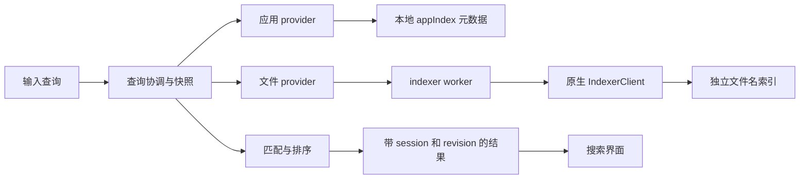

# Raycast 应用与本地文件搜索研究

研究日期：2026-10-22。本报告记录研究阶段证据；后续实现与发布状态见[搜索验收](local-search-acceptance.md)。对象：本机 Raycast **2.8.2.0（build 0）、arm64** 的冻结副本。目标是为 Thermo 增加应用和本地文件搜索，范围不含扩展商店、AI、剪贴板和窗口管理。

## 对 Thermo 的结论

应做独立的轻量搜索入口，应用目录和文件名索引各自维护，由同一个协调层合并结果。文件名检索不能只接 Spotlight 就宣称达到 Raycast 的覆盖范围。Spotlight 可以作为以后可选的内容搜索来源；本次需求不需要内容搜索。

最值得借鉴的是输入后的状态管理、应用名称处理、明确的排序规则和文件索引维护。Thermo 不需要引入 Raycast 的 Node 后端、扩展框架或整套进程结构。研究结论用于独立实现，没有把目标应用代码加入 Thermo。

## 对象与证据

本机原有 Raycast 正在运行；本次未安装、启动、退出或操作它，也未读取其用户数据库、历史、账号或搜索设置。通过 `ditto` 复制应用包后分析副本。副本的 `codesign --verify --deep --strict` 通过，签名团队为 `SY64MV22J9`，签名证书显示 Raycast Technologies Inc，包内带 stapled ticket。这不等同于本次在线公证验收。

| 包内文件 | 大小 | SHA-256 |
| --- | ---: | --- |
| `Contents/MacOS/Raycast` | 16,208,512 B | `9d823200b6fc4803c9a669d295035654598b7c0655434bc86f27f71493af3076` |
| 后端 `index.mjs` | 7,435,729 B | `953aaa95df410fbb3b02fcac411457e508a9c1794173aa10092d208a51e81b27` |
| `indexer-worker.mjs` | 4,169 B | `4dfb379c1cf4a3c5b70b005686c06748cb5faf645e5b7d220cf20b4cb9430274` |
| `indexer.darwin-arm64.node` | 14,033,456 B | `4f9fb110e4df807e1bf4c4eb85b93b977563d13684d29006cba75283e100362d` |

“后端”指 `Contents/Resources/macos-app_RaycastDesktopApp.bundle/Contents/Resources/backend/`。完整相对路径、片段哈希和原生字符串位置在 [证据目录](raycast-search-evidence.json)。所有 `index.mjs` 位置均为从 0 开始、末端不含的字节范围；此文件全部为 ASCII，字节偏移与 JavaScript UTF-16 偏移一致。

本次使用 REA 6.7.0。整份后端的 REA 分析在 MCP 客户端等待 300 秒后超时，未据此声称获得完整应用图。随后用 Babel AST 确认声明边界，提取 22 个目标函数/类的原始连续字节片段，每片段仅追加换行，交给 REA 独立分析。其跨片段绑定未恢复，不能把片段图说成原应用完整调用图。以下链路来自原文件的显式调用与状态检查，并与 REA 的片段观察核对。

| 证据 | Evidence ID | 范围与限制 |
| --- | --- | --- |
| 主程序 Mach-O | `ev_cb50bde74d6c16b51ee8c916a22b6e2e04f17dd1810905589d4c1ebf7c7f2528` | 包含 arm64、最低系统 26.0；不能把该系统要求带进 Thermo |
| 索引模块 Rust 元数据检查 | `ev_cb75d98bbcac273af48d292a6c6686ed3c87b8532e55e40ebec034021790c96b` | 没有 `.dep-v0`；编译器路径为线索，不是完整依赖清单 |
| 原始 worker 静态分析 | `ev_700aa945042d9de8dd0561dfefb8dad19e3bc54a12179718e08b09be51e5a3af` | 只选择 `indexer-worker.mjs`；其他 100 个清单文件未分析 |
| 22 个有来源映射的片段 | `ev_6a6b6d6416db3c7319926fffe65b8832162248eb037824131eea63d60b38c957` | 片段内静态语法，不能证明运行可达性；语义覆盖有未知项 |
| 查询类片段视图 | `ev_8e495f985cf0957038b067e656ab8f7a3597545bc755155f065157b3bcd13599` | `tZi` 的源哈希、范围及 AST 观察 |

本地完整 Evidence 导出位于 `dist/raycast-study/`，包括 worker、片段和主程序观察，未把这些大型导出或第三方应用包加入版本控制。Evidence ID 在原会话关闭后可能无法在线解析；导出文件和下述核对脚本才是本地复核入口。

```sh
python3 scripts/inspect-raycast-search.py /Applications/Raycast.app
```

脚本只读应用包，核对 4 个文件的完整哈希及声明/字符串锚点。版本不同返回非零，不会继续套用旧偏移。它不执行目标 JavaScript/native addon，不测搜索效果，也不证明运行中的进程与磁盘包相同。

## 搜索如何流转



这是按静态代码整理的结构；图中箭头不代表本次观察到了真实调用。

### 查询生命周期

| 原文件锚点 | 静态代码确认的行为 | 对 Thermo 的意义 |
| --- | --- | --- |
| `qJi` `[6098562,6099371)` | 空查询和非空查询各有一个在途槽位，以唯一 token 区分请求；同一在途 term 共享 promise | 不缓存每次击键产生的所有查询 |
| `ZJi` `[6099531,6100292)` | 仅保留空查询与当前活跃非空查询的快照，按稳定项目身份建立位置索引 | 限制缓存工作集，避免列表选择跟着数组下标漂移 |
| `tZi.search` `[6132301,6133311)` | 激活 provider 与当前 term，检查缓存/在途请求，再刷新并生成快照 | 协调器统一持有当前查询状态 |
| `tZi.assertSearchStillRelevant` `[6138654,6138817)` | 发布前检查在途 token 和活跃 term；过期请求抛 superseded 错误 | 旧结果不能覆盖新输入 |
| `chainProviderRefresh` `[6130309,6130556)` | 同一 provider 的刷新排队串行执行 | 避免同一数据源的刷新互相覆盖 |
| `raceProviderRefreshes` `[6130556,6131968)` | 一批 provider 共享 200 ms 截止时间；慢刷新继续运行，完成后触发延迟失效通知 | 首批结果不无限等待慢来源；200 ms 是观察到的策略，不是性能实测或 Thermo 必选值 |
| `iZi.queueInvalidation` `[6149629,6150051)` | 把失效请求合并到 16 ms 批次 | 合并密集索引变化，减少无效刷新 |

初次查询时未完成的 provider 暂无候选；增量刷新时可以保留它上一次候选。快照变更使用 `sessionId / baseRevision / revision`，项目按稳定身份生成插入、删除、移动和更新补丁。这里证明的是丢弃过期结果、刷新排队和版本校验，**没有证明底层原生查询会被硬取消**。

Thermo 只有应用和文件两类来源，不必照搬整个补丁框架。查询 generation、稳定 result ID、可取消任务和来源刷新状态已经足够表达同样的约束；若使用快照替换，仍须保留选中项目身份。

### 应用名称与排序

`J$r` `[4793631,4794327)` 从 `sD` 取得应用索引，并订阅 `indexer:applicationsUpdated`。显示名称优先 `localizedName`；候选还保留原名称、alternate names，以及不冲突且非通用的 executable alias。bundle name、keywords 等作为补充匹配信息。`sD` `[1875824,1876092)` 查询本地 `appIndex`，空目录时可等待初始快照，但发生错误也返回空数组。因此不能把它的 `[]` 解释成已完整扫描且没有应用。

`FXi` `[6125992,6126154)` 对查询去掉开头空白、NFC 归一化、转小写，并生成 transliteration 版本。它没有在这里去掉末尾空格。跨语言实际覆盖尚未测量，不能从这个调用推定支持任意拼音或日语读音。

共享标题匹配器 `af` `[611769,612793)` 用按顺序匹配字符的动态规划，保留两行评分。字符串全等直接返回 exact。普通字符、开头、单词/CamelCase 边界的贡献不同，非相邻字符有间隔扣分；部分分隔符可互换或跳过。这里观察到的是 **子序列匹配**，不是编辑距离纠错。不能用它证明原生文件名引擎采用相同算法。

`rf` `[611575,611769)` 根据 low/medium/high 使用不同接受阈值。`cXi/sXi` `[6116856,6121162)` 则按条件比较别名精确匹配、符合条件的已学习查询、标题/副标题、别名前缀、匹配分、使用历史和应用/命令优先级；固定收藏另行分组。它不是简单的“模糊分 × 使用次数”。应用优先级用于部分并列决胜，不是无条件排在所有文件前。

`PJi` `[6093402,6094261)` 批量获取使用历史、缓存未命中项，并对缓存样本的分数使用 10 天半衰期衰减，最低到 1。此处不能推出数据库每次 visit 如何更新分数。Thermo 应独立设计可解释的排序层级，让明确的名称/别名意图优先，再在相近结果间使用本地历史；无需复制这些常量。

## 文件索引：确认了什么

`indexer-worker.mjs` 的原始语法显示 worker 为 `IndexerClient` 提供请求/响应代理；加载的 addon 按平台和架构选择。后端 `iD` `[1868781,1868938)` 将文件查询交给 worker 的 `search`。这条链与内容搜索 `aD` 分开。

根搜索与专门的文件搜索还有一层差别。根搜索的文件 provider `I6r` `[4865554,4869992)` 向原生索引请求最多 10 条，之后过滤 `.app/.prefPane`，不会为这些被过滤项补齐名额。`P6r` `[4865039,4865476)` 按 NFC 路径去重，将原生结果顺序记录为后续决胜用的 sort heuristic。文件命令设置 `alwaysMatching:true`，让已由原生引擎召回的文件免于被共享模糊匹配再次淘汰，但共享根搜索排序仍可能重排它们。专门文件搜索的后端入口 `[6921027,6921054)` 则直接调用 `iD`，没有这里的根搜索排序阶段。

`iD` 没有 JavaScript 最短查询门槛，空查询可以用于最近文件。前述 3 个字母数字、含中日韩字符时 2 个字符的门槛属于内容搜索 `Kln/aD`，不能用于描述文件名搜索。根搜索的可选内容搜索另有 200 ms debounce 和独立 generation/token；它与 provider 的 200 ms 首批刷新截止时间是两个机制。后端转发入口不足以确定专门文件搜索界面的 debounce、分页和焦点规则。

| 锚点 | 静态代码观察 |
| --- | --- |
| `ATt/jTt` `[923579,924006)` | macOS 初始文件范围含 home 和 `/Applications`；默认排除临时文件、node_modules、缓存、部分应用状态目录 |
| `$E` `[1858979,1859824)` | 向原生层传入用户目录、排除规则、隐藏文件、ignore files、外部卷策略、walk pace 和线程数等参数；不能只凭参数名断言原生层已完整执行 |
| `Wun` `[1852202,1852717)` | 读取 `index/watch.json`，校验安全整数事件 ID；超过 21,600 秒的状态不用于恢复，转为完整扫描路径 |
| `Cdn` `[1857142,1857271)` | 有可恢复事件状态且无需 rebuild 时配置文件监听，避免启动时总是全量扫描 |
| `Xdn` `[1863634,1864133)` | 文件夹权限状态未就绪时延迟扫描；启动时可等待窗口获得焦点再进行完整扫描 |
| `qdn` `[1861701,1862736)` | 索引存放在应用支持目录下 `index`；原生初始化可返回 deferred rebuild，内容数据库有单独配置 |
| `Dun` `[1848280,1849233)` | 应用增删更新进入 appIndex；保留 localized/bundle/alternate 名称、关键词和稳定 ID |

默认配置观察：内容搜索关闭、隐藏文件关闭、尊重 ignore files、遍历线程数 2。它们是包内声明和迁移逻辑，**不是读取了当前用户的实际设置**。外部卷还受迁移、启动阶段和全局开关共同影响，不能只挑一个默认布尔值描述最终行为。

原生模块里存在以下精确字节锚点，偏移记录在证据 JSON：

- `minidex/.../segmented_index.rs`、`wal.rs`、`search/matching.rs`、`search/scoring.rs`，以及分段压缩与 WAL 恢复诊断。
- `fst-0.4.7/.../levenshtein.rs` 和 `memmap2` 的编译路径。
- Raycast 的 `actors/watch.rs`、`actors/volume_watch.rs`、`rpc/handlers/search.rs` 和 `native_search/macos.rs`。
- `.gitignore`、`.ignore`、`.rayignore` 与 FSEvents 事件诊断。

这些与后端独立索引调用共同支持“包内包含 Minidex 文件索引实现”的推断；单独字符串不能证明每个能力都处于查询热路径，也不足以恢复实际拼写容错阈值、评分权重、FSEvents 丢失后的修复保证或崩溃恢复正确性。

### 原生函数核对

默认 REA MCP 的 Hopper 启动等待为 120 秒，短于首次原生分析所需的约 4 分半，且该失败会话的清理回执未确认。已从 GUI 关闭其任务文档；后续用同 SHA-256 的独立文件副本和单独 REA stdio 客户端，将本次 `REA_HOPPER_STARTUP_TIMEOUT_MS` 设为 600000，不修改全局设置。下列地址属于该 arm64 图像的静态地址空间。

| 关联链 | REA 观察 | 能支持的结论 |
| --- | --- | --- |
| `scoring.rs` 字符串 `0xbb2b46` → 文件中指针槽 `0xcd4390` → 代码引用 `0x45e08c` → 函数 `0x45dbe8` | `ev_b52aad58e56158743c9331a79b9670aaafab0ebb5582a5919faa9ca0630aa26b`、`ev_ecb4261ad8b26cd65b8dd93ec8441040a48d53447286a329c2b2f2674c9ae0b4`；伪代码 `ev_8a2e6784d10e9d923fca1d31436c4f8c83c1c1f23d681f29d07af769eb77efe8` | 可见字节串扫描、长度检查和不同长度的比较路径，另有 UTF-8 边界处理；不能恢复整体排序公式 |
| 同一字符串 → 指针槽 `0xcd43a8` → 代码引用 `0x45db10` → 函数 `0x45c588` | `ev_ed7c084a86a7b1130f2e4b7383cd638796e3178e1aad62a214aef782187bceea`、`ev_9ce0785c5da39f1ecc7ac96746be9994e9e8283881ad4d4502dd93288076a2f7`；伪代码 `ev_8c1d339b15717684d04a400d3d1d3ee075d2dd2a5b2569288cbf03affe265824` | 可见匹配位置记录、前置字符类别判断、后缀前的点号检查及浮点值聚合，支持存在位置/边界/后缀相关评分处理 |
| `matching.rs` 字符串 `0xbb2760` → 指针槽 `0xcd3330` → 代码引用 `0x43acdc` → 函数 `0x434d00` | `ev_38a67a4148f8cc0871b1687837eaf7c091fd7af0417f9eb1888a5ed8842ee9f2`、`ev_173ccc51c548724151db1f52231e6269330ed89f8bd05946a2f82b15efa5865e` | 已从源位置元数据追到原生函数；不能仅由文件名判定其算法 |

指针槽来自文件字节的只读查找，代码引用和函数归属来自 REA/Hopper。直接查询字符串地址时 Hopper 未报告引用，不能据此说没有使用；经 Rust 位置元数据指针槽才得到上述引用链。源位置可能属于内联函数的 panic/bounds-check，因而不能把反编译函数重命名为原始 Rust 函数。

伪代码有未初始化寄存器、无法解释的 `(null)()`、数值被渲染为字符串地址，以及失真的浮点指令。这里只记录可信的处理结构，不给出 ABI 参数、数值权重、完整 Unicode 保证或最终结果顺序。原生评分仍是部分重建，没有把伪代码移入 Thermo。

对大型 `0x434d00` 继续请求伪代码时，Hopper 长时间未返回且 GUI 读取超时，已终止本次创建的 Hopper 进程。独立 REA 客户端随后导出 20 条成功记录，`close_binary` 返回成功；未返回的函数不计入重建成果。原 MCP 连接仍报告旧会话清理未确认，需要重连，其私有目录保留，不声称该连接已恢复。

### 公开 Minidex 不能冒充同版源码

找到可供比较的 [Minidex 公开仓库](https://github.com/PitNikola/minidex/tree/c595f59a6f554527939cc27960c7b2d267ac111b)，固定为 `c595f59a6f554527939cc27960c7b2d267ac111b`，crate 0.39.0、MIT。其公开源码采用分段 FST、内存映射、WAL、删除标记和后台压缩，也有 Unicode 路径 token 化及文件名/路径/最近使用等评分输入。

但目标二进制嵌入的 checkout 前缀是 `53c8dec`。对该 fork 和 `jpgneves/minidex` 查询此提交均返回 422，未取得同版源码；公开快照甚至没有目标中的同名 `search/matching.rs`。因此公开代码只能用于评估实现路线，不能把它的默认权重、匹配方式或基准数字当作 Raycast 2.8.2.0 的事实。

## Thermo 实现方案

| 部分 | 建议 | 现有代码与限制 |
| --- | --- | --- |
| 应用目录 | 新建轻量 `ApplicationCatalog`，缓存名称、URL、bundle ID、语言名称与别名；后台增量更新 | `CleanKit/AppInventory.swift:67` 含卸载身份/保护检查，`:73` 含逐应用 cask 查询；`ThermoApp/AppsPage.swift:101` 随后触发体积测量，不能用作搜索热路径 |
| 应用范围 | 包含 `/System/Applications`，明确处理系统工具、套件子目录和多个安装副本 | `CleanKit/Apps.swift:118` 的卸载目录范围偏窄；`:140` 使用文件名，不能直接充当完整显示名 |
| 文件目录 | 建立可重建的本地文件名索引，目录授权和覆盖状态独立展示；支持隐藏文件、排除和卷可用性 | 当前没有通用文件搜索索引；已有 Spotlight 调用服务于其他用途 |
| 索引存储 | 先以固定语料比较 SQLite 文件名索引与 MIT Minidex 适配；依据延迟、大小、增量更新和维护成本定型 | 不预先承诺 SQLite FTS 与 Minidex 的召回/速度相同；Rust 会增加 FFI、跨架构打包和升级成本 |
| 查询协调 | 应用先可用、文件异步补齐，generation 拒绝旧结果，保留选中 ID；状态有 loading/partial/unavailable | 可按两类 provider 简化，不能把返回空结果当作完整覆盖 |
| 匹配排序 | Unicode 归一化，名称/别名优先，缩写和边界匹配，本地历史只在合适层级调整；文件和应用匹配分分别校准 | 子序列缩写与拼写纠错是不同能力，验收分别列例子 |
| 搜索窗 | 独立轻量 `NSPanel`；输入法组合期间不触发回车动作；Escape、失焦和前应用焦点有明确状态 | `MainWindow.swift:145` 是常规大窗口，`main.swift:43` 的 popover 则依附菜单栏，均不适合直接改作搜索面板 |
| 快捷键 | 复用 Carbon 注册与 lease 冲突处理，按搜索用途重新规定有效组合 | `CleanScreenShortcut.swift:13` 要求至少两个修饰键，不能原样支持常见的单修饰键+Space |
| 文件操作 | URL API 打开、Finder 显示、复制路径和 Quick Look；处理文件已删除/卷已离线 | `AppsPage.swift:542` 有 Finder 显示模式；当前没有通用 Quick Look 实现 |
| 权限与发布 | 保持用户级，不接 root helper；所有查询离线，不收集文件内容 | Raycast 最低系统 26.0 不代表 Thermo 可以放弃现有 macOS 13+；新 API 要逐项核对 |

本节保留研究时的设计建议，实际实现与验收以[搜索验收](local-search-acceptance.md)为准。后续用户已授权完成搜索并发布，之前暂停的其他功能仍不在本次范围内。

## 验收要测什么

1. 应用：系统应用、套件子目录、本地化名称、自定义别名、重复安装、改名与卸载；明确失败/不完整目录状态。
2. 匹配：固定中日英样例覆盖 exact、prefix、CamelCase/缩写和拼写错误；高频历史不能不受约束地淹没明确输入。
3. 并发：快速输入/清空时延迟旧查询不能覆盖新列表；异步补齐结果后选择仍指向同一项目。
4. 文件变化：自有夹具中新建、改名、移动、删除、排除规则变更；事件丢失、睡眠唤醒、进程停止期间变化和重启恢复。
5. 权限/卷：Spotlight 排除目录、拒绝授权、外部盘拔出/重连、云端占位文件；扫描文件名不得意外下载云端内容。
6. 动作：操作实际选中的 URL；文件变动后报错正确；Quick Look、输入法、Esc、失焦、全屏/Spaces 和多显示器在本机 GUI 验证。
7. 性能：记录固定语料的文件数、目录数、卷类型、索引大小、冷/热查询 p50/p95、首次扫描、增量更新、空闲 CPU/RSS。Raycast 文档的“快几倍”不作为本次测量值。

后续编译、引擎夹具测试和基准优先在 Mac 190 的隔离目录进行，并按全局要求固定 Xcode 27.0 与对应 SDK；本机快捷键/焦点/预览验收单独记录。本次仅核对了远端可达与空间，没有进行构建或性能测试。

## 研究覆盖

| 问题 | 本次结论 |
| --- | --- |
| 应用数据与多名称匹配 | 已追踪包内后端声明、provider 和共享排序链路 |
| 查询替换、缓存与慢 provider | 已定位 token、快照版本、截止时间和失效合并 |
| 文件名/内容搜索是否独立 | 已追踪后端与 worker 边界，确认独立路径 |
| 文件监听/启动恢复策略 | 已追踪上层事件恢复与延迟扫描；原生完整行为仍未验证 |
| 原生文件匹配与索引内部 | 已取得部分函数与位置/边界/后缀评分观察；完整评分公式、索引维护保证仍未重建 |
| 搜索速度、CPU/内存、焦点体验 | 未测；本次没有操作运行中的 Raycast |

官方交互范围来自 [File Search](https://manual.raycast.com/file-search) 和 [Search Bar](https://manual.raycast.com/search-bar)，研究时重新读取。官方说明用来界定产品行为，包内静态证据用来解释实现，两者都不能代替真实场景验收。

## 本次交付核验

- 核对脚本对本机磁盘包通过：4 个文件、34 个范围/字符串锚点一致。这不认证运行中进程来源。
- 3 份规范 Evidence 导出均已压缩保存并核对压缩前后 SHA-256，共 30 条记录；包含父记录与派生视图，不能把数量当作 30 项独立结论。原生导出另经 `rea inspect-evidence-bundle` 读取成功。
- 已删除冻结应用包、独立原生二进制副本、公开源码 checkout、生成的源码片段和重复导出。保留约 2.4 MB 的压缩证据、原始清单、核验和失败记录在忽略目录 `dist/raycast-study/`。旧 MCP 私有目录 `/tmp/rea-Qhh92P` 因其清理回执未确认而保留。
- 本次创建的 Hopper 进程与独立客户端已退出，未改动用户的 Raycast。研究阶段的仓库改动仅为本报告、证据 JSON 与只读核对脚本，当时未提交；原有 `.claude/` 和两个崩溃日志保持原样。没有编译、安装或发布 Thermo。
